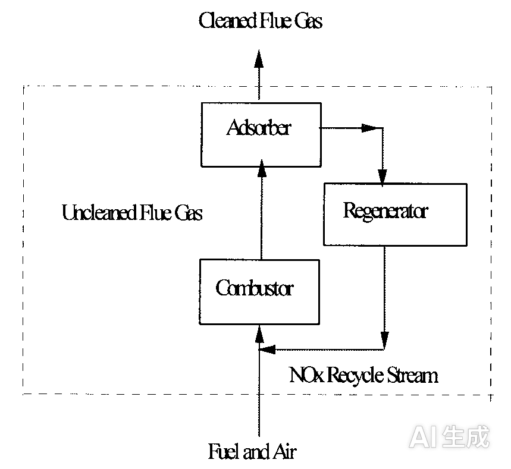
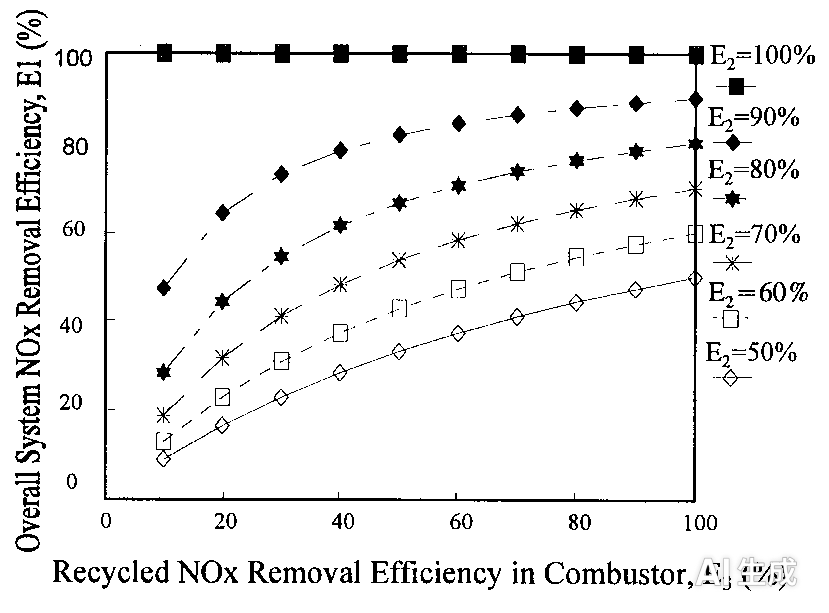
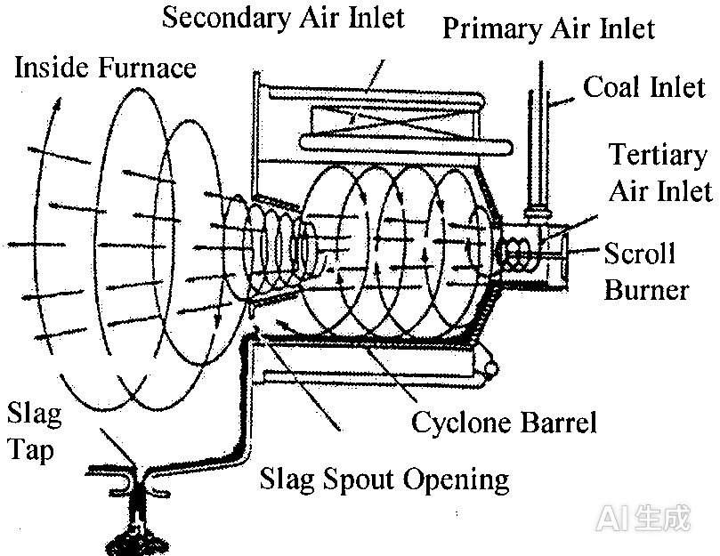
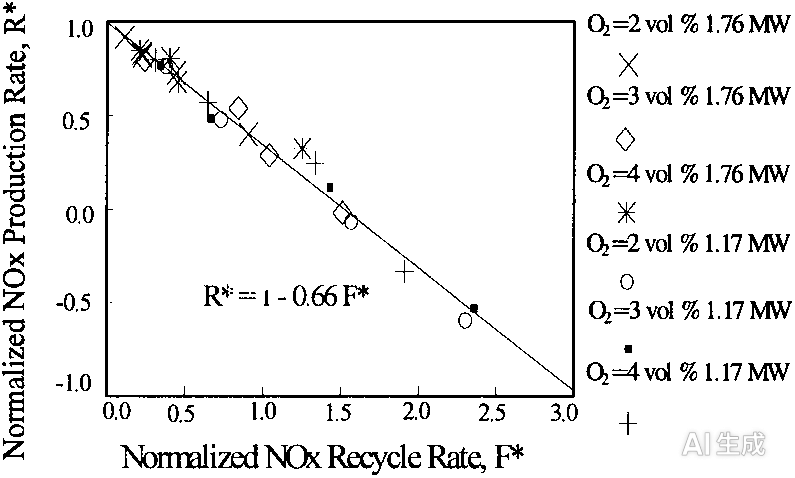
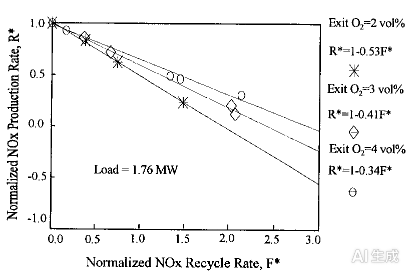
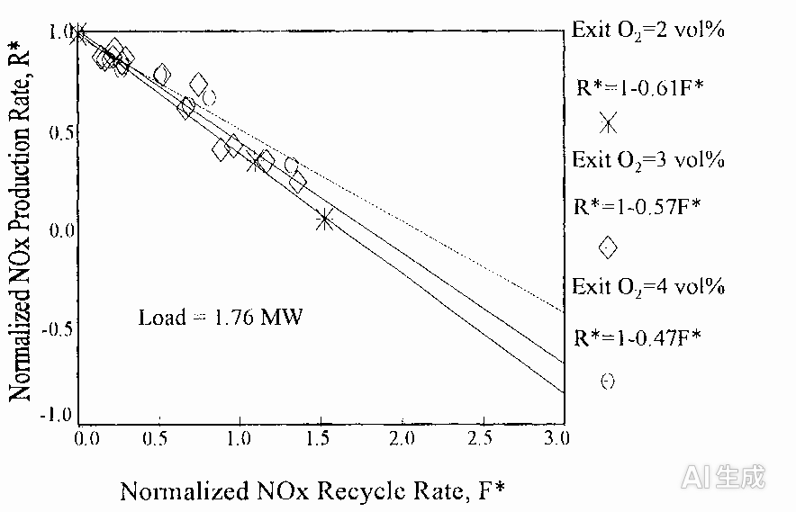
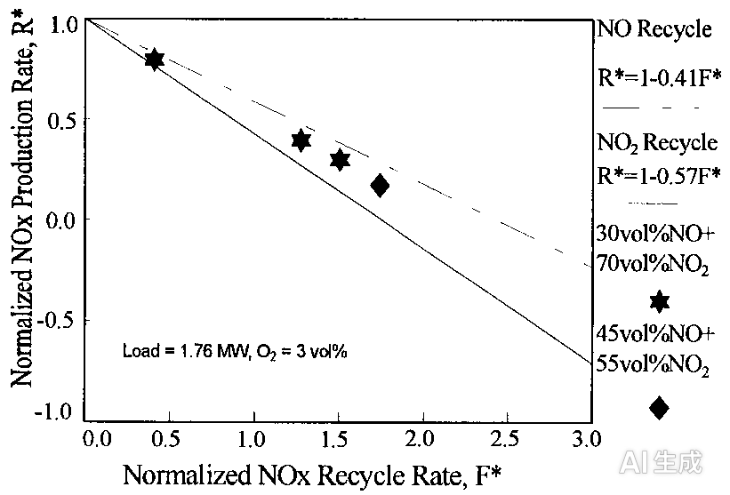
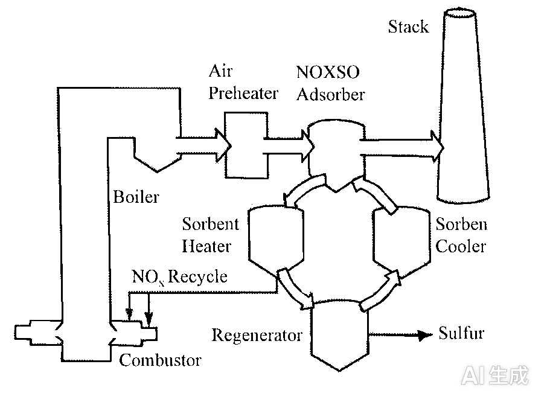
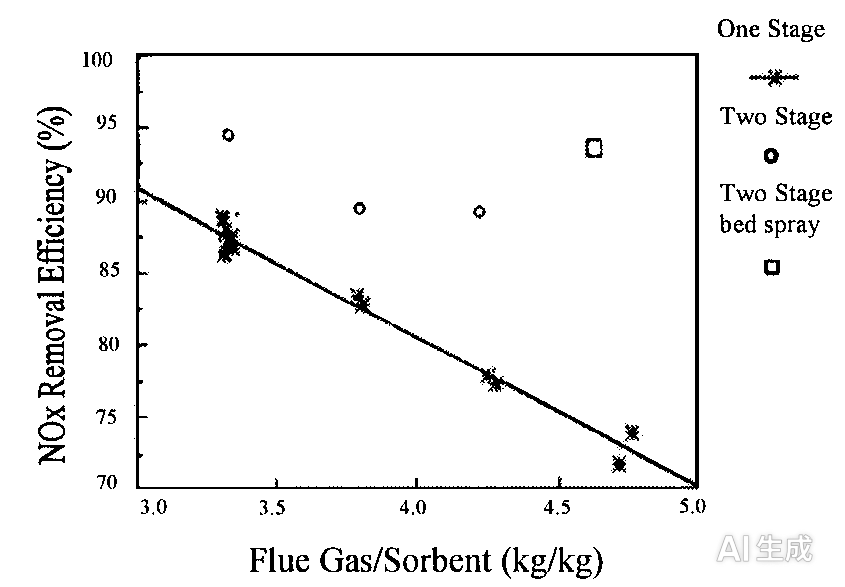

---
AIGC:
    Label: "1"
    ContentProducer: 001191440300708461136T1XGW3
    ProduceID: 4dcff8c4f0c4eb682e9fb9e4b0ef72a3_1b9fb84ab1e611f197a3525400248c00
    ReservedCode1: 3gbWb/BKdEWsvQGh74FztYBHYdS+CKY89oR2J2rCc8NXk5Lcfsv8Q5C3ZBoSghwkzrAOD9XmccCSCE/vMx5rJpd5Q/0WzqBNwYqLMeCxItBXjnTxkYDSP43TPMABnkwNn7b195O5n9JpKy595CYx+TGzWjr9eCip2q2rnzcRUh9SQJCwBPrpVbK7WzA=
    ContentPropagator: 001191440300708461136T1XGW3
    PropagateID: 4dcff8c4f0c4eb682e9fb9e4b0ef72a3_1b9fb84ab1e611f197a3525400248c00
    ReservedCode2: 3gbWb/BKdEWsvQGh74FztYBHYdS+CKY89oR2J2rCc8NXk5Lcfsv8Q5C3ZBoSghwkzrAOD9XmccCSCE/vMx5rJpd5Q/0WzqBNwYqLMeCxItBXjnTxkYDSP43TPMABnkwNn7b195O5n9JpKy595CYx+TGzWjr9eCip2q2rnzcRUh9SQJCwBPrpVbK7WzA=
---

# 通过NOx再循环方法控制NOx排放

> 原文：CONTROL OF NOx EMISSIONS BY NOx RECYCLE APPROACH
> 出处：Twenty-Sixth Symposium (International) on Combustion / The Combustion Institute, 1996, pp. 2091–2097
> 作者：Chenn Q. Zhou（普渡大学卡柳梅特分校，工程系，美国印第安纳州哈蒙德 46323）；L. G. Neal、Rita Bolli、John Haslbeck、Alex Chang（NOXSO公司，2414 Lytle Road, Bethel Park, PA 15102, USA）

---

## 摘要

NOx再循环（NOx recycle）是控制燃烧过程NOx排放的一种替代方法。该方法利用可再生吸附剂（regenerable sorbent）吸附燃烧器烟气中的NOx，随后通过脱附产生同时含有NO和NO2的高浓度NOx气流，再将该气流送回同一燃烧器或另一台燃烧器，在火焰中使NOx被还原，并抑制NOx的生成。为考察NOx再循环对NOx排放削减的影响，开展了实验研究：将高浓度的NO、NO2或NO/NO2混合物在燃烧器不同位置进行再循环。结果表明，视实验条件不同，可实现50%–90%的NOx还原效率。燃烧器中的NOx还原效率受再循环位置、出口空气量以及再循环气体组成的影响。最有利的再循环位置是一次风道（primary air duct）。当NOx再循环至二次风道时，出口O2越低，越有利于火焰中的NOx破坏。实验结果还表明，与NO再循环相比，NO2再循环可获得更高的NOx还原效率。NOx再循环方法的概念已在NOXSO工艺中得到应用。NOXSO工艺是一种用于化石燃料锅炉的干式燃烧后烟气处理技术，可脱除90%以上的NOx/SO2。NOx再循环方法有望成为从烟气中脱除NOx的新替代方案，尤其适用于利用可再生吸附剂同时脱除燃烧产生的NOx、SO2及其他污染物的集成系统。

---

## 1 引言

氮氧化物（NOx，包括一氧化氮NO和二氧化氮NO2）被认为是酸沉降和光化学烟雾的主要前体物。根据1990年《清洁空气法修正案》中酸雨条款的要求，公用事业锅炉必须控制NOx排放。

目前，NOx控制方法大致分为三类：燃烧前燃料处理、燃烧改进（combustion modification）和燃烧后烟气处理[1–4]。燃料处理可减少燃料结合氮（fuel-bound nitrogen）的含量，但成本效益不高，且只能减少燃料型NOx。燃烧改进技术通过改变燃烧器设计和运行方式来抑制燃烧器中NOx的生成，已被电力公司广泛用于实现第一阶段（Phase I）合规排放削减。然而，这些技术都会在其他方面对电站性能造成损失，如效率和热耗率、部件可靠性、运行灵活性、燃料灵活性，并会增加其他污染物的排放[5]。燃烧后烟气处理技术（从烟气中脱除NOx）同样存在问题。例如，选择性催化还原（SCR）可以实现较高的NOx脱除率[6]，但成本很高，且可能产生二次污染物，如氨、氮氧化物以及固体废物排放。为了满足政府机构和地方立法的严格法规，需要努力寻找新方案或对现有方法进行改进。

在燃烧后烟气处理工艺中，有若干正在开发的技术采用可再生吸附剂吸附燃烧器排放的NOx，随后通过脱附产生高浓度NOx气流。该气流可以作为助燃空气的一部分送回同一燃烧器或另一台燃烧器，在火焰中使NOx被还原，并抑制NOx的生成。这一概念称为NOx再循环，由NOXSO公司开发并应用于NOXSO工艺[7,8]。预计它是一种简单、无二次污染物且成本效益高的烟气脱硝方法，尤其适用于利用可再生吸附剂同时脱除燃烧产生的NOx、SO2及其他污染物的集成系统。

为考察NOx再循环对NOx排放削减的作用，开展了相关实验，结果将在以下各节中给出，同时还包括NOx再循环概念及其在实际装置中应用的描述。

## 2 NOx再循环的概念

NOx再循环气流的概念如图1所示。NOx再循环气流含有高浓度的NO和NO2，它们在火焰中被还原。系统整体NOx脱除效率（E1）主要取决于吸附器中的NOx吸附效率（E2）和燃烧器中再循环NOx的还原效率（E3）。这三个效率之间的关系可由式(1)推导得出，如图2所示。

**图1 NOx再循环方案示意图。**

$$E_1=\frac{E_2 E_3}{1-E_2(1-E_3)} \qquad (1)$$

**图2 系统整体NOx脱除效率与燃烧器中再循环NOx还原效率的关系（不同NOx吸附效率下）。**

图2绘制了在不同NOx吸附效率下，系统整体NOx脱除效率随燃烧器中再循环NOx还原效率的变化。图中表明：在给定NOx吸附效率时，燃烧器中再循环NOx被还原得越多，系统整体脱除的NOx就越多。在实际系统中，若吸附器设计不可更改，则提高燃烧器中再循环NOx的还原效率将改善系统整体的NOx脱除效率。

与其他NOx还原技术（如再燃过程[9–11]和烟气再循环（FGR）[12]）相比，[[NOx再循环方法有其独特之处。首先，NOx再循环气流量小于助燃空气流量的25%]]，送入主燃烧区，且再循环位置可调，可位[于一次风道、二次风道或其他有利位置]()。其次，NOx再循环气流中的NOx浓度很高，在0.3–2.0 vol.%范围内，而烟气中NOx浓度通常为0.06–0.1 vol.%。第三，在NOx再循环气流中，根据吸附剂性质和再生条件的不同，NO2可占NOx总量的70 vol.%。由于燃烧产生的NOx通常仅含5 vol.%或更少的NO2，文献中尚未见关于高浓度NO2在燃烧器中作用的报道。鉴于这些独特特征，有必要对燃烧器中再循环NOx的还原进行研究。

关于NOx再循环方法中NO还原的机理，有两种普遍假设：热力学-动力学条件和还原性气氛。热力型NO由以下反应生成[13]：

$$\mathrm{O}+\mathrm{N_2}\rightleftharpoons\mathrm{NO}+\mathrm{N} \qquad (2)$$

$$\mathrm{N}+\mathrm{O_2}\rightleftharpoons\mathrm{NO}+\mathrm{O} \qquad (3)$$

将上述方程合并，NO的生成可描述为：

$$\mathrm{N_2}+\mathrm{O_2}\rightleftharpoons 2\mathrm{NO} \qquad (4)$$

如方程所示，这些反应是可逆的，受化学动力学控制[14,15]。如果NO的浓度高于平衡值，由于逆向反应速率很高，NO将分解为N2和O2，因此燃烧过程的净NOx生成速率会降低。可见，热力学-动力学条件可能在NOx再循环方法中发挥非常重要的作用。此外，火焰中（尤其是富燃料区）产生的自由基，如CH·、NH·和NH2·，也可能通过与NO或NO2的反应来还原NOx[11,14,15]。详细机理有待进一步研究。

## 3 燃烧器中再循环NOx的还原

为考察燃烧器中再循环NOx的还原，在美国能源部（DOE）和NOXSO公司的资助下，于巴布科克-威尔科克斯（Babcock & Wilcox, B&W）研究中心的[[一座1.76 MW（6 mmbtu/h）旋风炉上进行了实验研究]]。旋风燃烧器示意图如图3所示。本研究中，NOx再循环气流由瓶装气体配制的气流模拟，并注入助燃空气流中，从而在燃烧器中还原NOx。尽管NOx来自瓶装气体，但助燃空气中的NOx浓度和组成代表了NOx再循环方法中非常真实的条件。通过测量助燃空气和烟囱中的NOx浓度来确定再循环NOx的还原效率。研究了参数效应，参数包括：NOx再循环率；[[再循环位置（仅一次风PA、仅二次风SA、一次风与二次风同时）]]；气体组成（NO、NO2及NO/NO2混合物）；炉负荷；以及出口O2浓度。典型实验条件为：[[炉负荷1.76 MW（6 mmbtu/hr）、出口O2浓度3 vol.%、烟气流量0.69 kg/s（5500 lb/h）]]。典型实验结果见以下各节。

**图3 B&W旋风燃烧器示意图。**

### 3.1 NO再循环至一次风流

图4给出了在两种炉负荷和三种出口O2浓度下，NO气体再循环至一次风流的实验结果。图中纵轴为归一化NOx生成速率R\*，横轴为归一化NOx再循环率F\*。R\*的定义如式(5)所示：它是烟囱NOx（NOxs）与再循环NOx（NOxi）之差（可视为燃烧产生的NOx），除以无NOx再循环时的烟囱NOx（即基线NOx，NOxb）。F\*的定义为再循环NOx与基线NOx之比，如式(6)所示：

$$R^\*=\frac{\mathrm{NO_{xs}}-\mathrm{NO_{xi}}}{\mathrm{NO_{xb}}} \qquad (5)$$

$$F^\*=\frac{\mathrm{NO_{xi}}}{\mathrm{NO_{xb}}} \qquad (6)$$

其中，NOxs和NOxb分别为有、无NOx再循环时的烟囱NOx（mol/s）；NOxi为进入燃烧器的NOx再循环速率（mol/s）。

**图4 NO再循环至一次风流的实验结果。**

该图提供两类基本信息。其一是NOx生成速率与NOx再循环速率之间的关系，可直接用于工艺设计程序。如图4所示，NOx生成速率随NO再循环率的增加而降低，所有数据点落在一条直线上，可用关联式 R\* = 1 − aF\* 描述，其中a为直线斜率，等于0.66。该关联式对工艺设计程序中的质量流量计算非常有用。

图4提供的另一类信息是燃烧器中再循环NOx的常规还原效率，定义为在燃烧器中被还原的再循环NOx的百分比，如式(7)所示：

$$\eta\%=\frac{1-\mathrm{NO_{xs}}/\mathrm{NO_{xb}}}{\mathrm{NO_{xi}}/\mathrm{NO_{xb}}}\times 100 \qquad (7)$$

可以推导出，上述关联式中的斜率a实际上代表了平均再循环NOx还原效率。图4中0.66的值意味着66%的再循环NOx在燃烧器中被还原，且在该实验条件下不受出口O2浓度和炉负荷的影响。

### 3.2 NO再循环至二次风流

在一种炉负荷和三种不同出口O2浓度下，NO再循环至二次风流的实验结果如图5所示。结果表明，NOx还原效率随出口O2浓度而变化。对应出口O2浓度为2 vol.%、3 vol.%、4 vol.%时，平均还原效率分别为53%、41%和34%，均低于NO再循环至一次风流时的值。这归因于二次风区域的还原性气氛较弱，导致可用于NOx还原的自由基较少，且温度较低，不利于反应速率。

**图5 NO再循环至二次风流的实验结果。**

### 3.3 NO同时再循环至一次风和二次风流

还进行了一些实验，将NO同时再循环至一次风和二次风流，并改变再循环至一次风流与二次风流的NO量之比。如预期所示，再循环至一次风流的NO比例越大，NOx还原效率越高。最有利的再循环位置是一次风道，它能提供再循环NOx与还原性气氛之间的良好混合。

### 3.4 NO2再循环至二次风道

NOx再循环气流可能含有大量NO2。文献中尚未见关于高浓度NO2在燃烧器中归宿的研究。为此开展了将NO2再循环至二次风流的实验，结果如图6所示。数据呈现与NO再循环测试一致的趋势，出口O2的影响也类似：出口O2越低，NOx还原效率越高，这是因为还原性气氛增强。在出口O2浓度为2 vol.%、3 vol.%、4 vol.%时，平均NOx还原效率分别为61%、57%和47%，均高于对应条件下的NO再循环值。这对系统整体NOx还原效率是有利的，因为在NOXSO工艺的NOx再循环气流中，NO2所占比例高于NO。然而其机理有待探索。一般而言，当NO2再循环进入燃烧器时，预期先在高温度下转化为NO，随后NO在火焰中被还原。除此之外，实验结果还暗示有其他反应直接促进了NO2的还原。如前所述，自由基可能参与NO2的还原，这将是未来研究的课题。

**图6 NO2再循环至二次风流的实验结果。**

### 3.5 NO/NO2混合物再循环

图7给出了NO/NO2混合物再循环至二次风流的实验数据，并与NO和NO2再循环数据进行了对比。如预期所示，NO/NO2混合物再循环的数据点落在单独NO再循环与单独NO2再循环数据之间。NO/NO2混合物再循环的NOx还原效率高于NO再循环，低于NO2再循环。

**图7 NO/NO2混合物再循环至二次风流的实验结果。**

NO2再循环的担忧之一是烟囱中的NO2排放。如果NO2再循环导致高NO2排放，将产生额外问题。通过同时测量烟囱中的NOx和NO来考察该效应，NO2由NOx与NO之差得到。结果发现，尽管在NO2或NO/NO2再循环期间，助燃空气中测得的NO2浓度非常高，但烟囱中几乎未检出NO2。这表明再循环的NO2在燃烧器中部分被破坏，部分转化为NO。

## 4 NOx再循环在实际系统中的实现——NOXSO工艺

NOx再循环的概念已应用于NOXSO工艺。NOXSO工艺是一种干式燃烧后烟气处理技术，利用干燥且可再生的吸附剂，可同时脱除90%以上的NOx/SO2。该吸附剂由NOXSO公司开发并获得专利，是一种浸渍碳酸钠（Na2CO3）的γ-氧化铝球体。它稳定、惰性、无毒且不可燃。钠和氧化铝共同赋予NOXSO吸附剂从烟气中吸附NOx和SO2的能力。

在NOXSO工艺中，NOx和SO2在吸附器内的流化床中于120°C温度下被吸附。随后，NOx在加热器中通过加热吸附剂脱附，再循环回锅炉进行还原。由于在吸附剂加热器中仅使用少量空气加热吸附剂，NOx再循环气流的体积很小，因此可以很容易地送回主燃烧区，对燃烧过程影响很小。SO2在620°C下用还原性气体脱附，并在克劳斯（Claus）装置中转化为硫副产品。硫再生后，吸附剂被冷却并输送回吸附器循环使用。NOXSO工艺已完成中试（POC）试验，目前正处于商业化阶段[16]。NOXSO工艺示意图如图8所示。

**图8 NOXSO工艺示意图。**

POC试验表明，燃烧器90%以上的NOx可在吸附器中被吸附。图9给出了POC试验期间得到的NOx吸附效率随烟气与吸附剂质量比（flue-gas-to-sorbent-mass ratio）的变化。图中显示，NOx吸附效率受吸附器级数和流化床运行温度的影响。对于单级吸附器，NOx吸附效率随质量比增大而成比例降低。对于两级吸附器（两个串联流化床），无论有无床内喷水，实验数据均呈现相同趋势，但NOx吸附效率高出5–10个百分点。这一改进归因于：(1) 增设第二块布风板后气体分布更好；(2) 烟气与吸附剂逆流流动，因此在吸附器底部床层中，部分饱和的吸附剂与最高浓度的污染物接触。实验期间还观察到，在120–180°C的吸附器床温范围内，NOx吸附效率随床温降低而呈现明确的升高趋势。预计在低于120°C的床温下还可进一步改善。采用含床内喷水（用于降低床温）的两级流化床，在烟气与吸附剂质量比为4.6时实现了95%的NOx吸附效率。

**图9 NOXSO中试试验结果（单级与两级吸附器对比）。**

POC试验还表明，所有被吸附的NOx均在吸附剂加热器中脱附，产生NO（30 vol.%）和NO2（70 vol.%）。实验室研究表明，完全脱附也可在约370°C的固定床反应器中进行。

如前所述，NOXSO系统的NOx脱除效率受再循环NOx还原效率和NOx吸附效率的影响。综合全部实验数据，NOXSO工艺可从烟气中脱除80%以上的NOx。

## 5 结论与未来工作

NOx再循环方法已被证明是控制燃烧NOx排放的一种新替代方案。它简单、无二次污染物且成本效益高。对燃烧器中再循环NOx还原的实验研究结果表明：

1. 视实验条件不同，可获得较高的NOx还原效率。
2. NOx再循环位置影响显著。当NOx再循环至一次风流时，获得最高的NOx还原效率。
3. 当NOx再循环至二次风流时，出口O2浓度影响NOx还原。
4. 与NO再循环相比，NO2再循环可获得更高的NOx还原效率。

实验结果还表明，再循环NOx与还原性气氛的良好混合，以及在高温富燃料区中的较长停留时间，将有利于燃烧器中再循环NOx的还原。对燃烧器中再循环NOx还原详细机理的研究，尤其是NO2再循环的机理，是未来工作的课题。

## 致谢

感谢美国能源部匹兹堡能源技术中心和NOXSO公司对本研究的资助。同时感谢B&W研究中心的Cliff Eckhart和Jennifer Lyden所做的努力，该中心是NOXSO公司NOx再循环测试的分包商。

## 参考文献

1. EPA Office of Air and Radiation, "Summary of NOx Control Technologies and Their Availability and Extent of Application," EPA-450/3-92-004, 1992.
2. Kokkinos, A., Cichanowicz, J. E., Eskinazi, D., Stallings, J., and Offen, G., "NOx Controls for Utility Boilers: Highlights of the EPRI July 1992 Workshop," J. Air Waste Manage. Assoc. 42(11):1498–1505 (1992).
3. Rhodes, T. W., Marks, J. R., and Siebert, P. C., "Overview of Industrial Source Control for Nitrogen Oxides," Environmental Progress, 9(2):126–130 (1990).
4. Energy and Environmental Analysis, Inc., "NOx Control for Gas-Fired Industrial Boilers and Combustion Equipment: A survey of Current Practices," Topical Report for Gas Research Institute, October 1992.
5. Makansi, J., "Reduction of NOx Emissions from Today's Powerplants," Power 137(5):11–26 (1993).
6. Behrens, E. S., "SCR Operating Experience on Coal-Fired Boilers and Recent Progress," Joint Symposium on Stationary Combustion NOx Control, EPA/EPRI, Washington, D.C., 1991, Section 4B, pp. 1–20.
7. Haslbeck, J. L., Ma, W. T., and Neal, L. G., "A Pilot-Scale Test of the NOXSO Flue Gas Treatment Process," NOXSO Report, Pittsburgh, June 1988.
8. Zhou, Q., Haslbeck, J. L., and Neal, L. G., "An Experimental Study of NOx Recycle in the NOXSO Flue Gas Cleanup Process," Final Report to U.S. Department of Energy, Pittsburgh Energy and Technology Center, March 1993.
9. Wendt, O. L., Sterling, C. V., and Matovich, M. A., "Reduction of Sulfur Trioxide and Nitrogen Oxides by Secondary Fuel Injection," Fourteenth Symposium (International) on Combustion, The Combustion Institute, Pittsburgh, 1973, p. 897.
10. Smart, J. P. and Morgan, D. J., "Multi-Fuel Reburning in a Coal Fired Internally Fuel Staged Burner for NOx Reduction," Joint Symposium on Stationery Combustion NOx Control, EPA/EPRI, Washington, D.C., March 1991, Section 3B, pp. 1–20.
11. Chen, W. and Lester, T. W., "Effects of Reburning Fuel Type on NOx Reduction," Proceedings of the Eighth Coal Preparation, Utilization, and Environmental Control Contractor Conference, DOE-PETC, Pittsburgh, July 1992, pp. 231–239.
12. Michel, Y. and Belles, F. E., "Effects of Flue Gas Recirculation on NOx Production and Performance of Pulse Combustion Hot-Water Boilers," Combust. Sci. Technol. 94(1–6):447–468 (1993).
13. Zeldovich, Y. B., "Oxidation of Nitrogen in Combustion and Explosion," Comput. Rend. Acad. Sci. USSR. 51:417 (1946).
14. Miller, J. A. and Bowman, C. T., "Mechanism and Modeling of Nitrogen Chemistry in Combustion," Prog. Energy Combust. Sci. 15:287–338 (1989).
15. Flagan, R. C. and Seinfeld, J. H., Fundamentals of Air Pollution Engineering, Prentice Hall, Englewood Cliffs, NJ, 1988.
16. Bolli, R., Browning, J. P., and Halslbeck, J. L., "The NOXSO Project/Incorporating Lessons Learned from a Pilot into a Full-Scale Demonstration," 88th Annual Meeting of Air Waste & Management Association, Paper No. A-201, June, 1995, pp. 1–16.

---

## 附录：现场问答（COMMENTS）

**Vladimir Zamansky（美国能源与环境研究公司）：** 请评论NOx再循环方法的两个方面：(1) 吸附器中使用了哪些化合物？能否给出描述吸附器特性的参考文献？(2) 能否比较NOx再循环方法与SCR的成本，特别是资本支出？

**作者回复：** NOXSO工艺吸附器中使用的化合物是沉积在氧化铝载体上的钠。文末参考文献16对吸附器特性有很好的描述。NOx再循环方法的成本取决于该方法如何集成到实际系统中。在同时脱除NOx和SO2的NOXSO工艺中，很难将NOXSO系统的资本成本拆分为NOx和SO2脱除的单独成本。与美国当前先进洗涤塔加SCR的成本相比，NOXSO系统的资本成本低25%。若按NOx脱除的年平准化成本（资本成本按30年平准化加年运行成本）评估，NOXSO系统比SCR系统低35%（美元/吨）。

**Th. Just（德国DLR-燃烧物理化学研究所）：** 通过烟气再循环实现的NOx还原程度很可能与燃烧器具体类型相关。您能否就此评论？

**作者回复：** 旋风炉上的实验数据表明，NOx还原受再循环位置影响很大，这说明NOx再循环方法的NOx还原程度很可能与燃烧器具体类型相关。未来的试验数据应为不同燃烧器设计确定具体数值。不过，旋风炉代表的是NOx还原程度上最保守的情形，因为旋风炉内没有悬浮式火焰，也没有有利于高NOx还原的明确定义还原区。在最近的项目中，NOx再循环工艺已应用于丹麦技术大学NOXSO中试装置，再循环气流被送入再生系统中新设计的独立低NOx燃烧器，试验数据显示NOx总还原率超过80%[1]。NOXSO公司还已在美国印第安纳州ALCOA工厂的第一套商业设计NOXSO工艺中纳入NOx再循环，该装置采用墙式燃烧煤粉锅炉，试验数据将在未来收集并报告。

**补充参考文献：** 1. B. H. Jensen, S. B. Lading and K. Daub, "Implementation of Novel Combined deNOx and deSOx process to Power Plants," presented at the 3rd NORDIC Conference on SOx and NOx, March 13–14, 1996, Copenhagen, Denmark.
*（内容由AI生成，仅供参考）*
