---
AIGC:
    Label: "1"
    ContentProducer: 001191440300708461136T1XGW3
    ProduceID: 4dcff8c4f0c4eb682e9fb9e4b0ef72a3_8b51ac1bb1e411f197a3525400248c00
    ReservedCode1: nqwp5XlqL5y3lb8CwJJ8mAdqkS08WmYSkL9RZaDyZFdgyfo8T2TkZ3POaPUoRP7j3M6II3O4LtkaaYOcnmkLuQBnD300tRScETlt9FYv0rUx60unxEWdy8KkzAN2m0YeZ4kjvgYMGm8TYgfyUQ8Fj+1C21cnd+9+tSZopc9A2SdioG9C6lUJN3Iky4o=
    ContentPropagator: 001191440300708461136T1XGW3
    PropagateID: 4dcff8c4f0c4eb682e9fb9e4b0ef72a3_8b51ac1bb1e411f197a3525400248c00
    ReservedCode2: nqwp5XlqL5y3lb8CwJJ8mAdqkS08WmYSkL9RZaDyZFdgyfo8T2TkZ3POaPUoRP7j3M6II3O4LtkaaYOcnmkLuQBnD300tRScETlt9FYv0rUx60unxEWdy8KkzAN2m0YeZ4kjvgYMGm8TYgfyUQ8Fj+1C21cnd+9+tSZopc9A2SdioG9C6lUJN3Iky4o=
---

# 燃烧中氮化学的建模

Peter Glarborg^1^, James A. Miller^2^, Branko Ruscic^2^, 和 Stephen J. Klippenstein^2^

^1^ 丹麦技术大学化学与生物工程系，DK-2800 Kgs. Lyngby, 丹麦

^2^ 美国伊利诺伊州阿贡国家实验室化学科学与工程处，60439, 美国

关键字：一氧化氮，热型 NO，快速 NO，燃料-NO，动力学模型

理解支配燃烧过程中氮氧化物（NOx）的形成和破坏的化学过程仍然是一个挑战。尽管在过去四十年里这一领域一直是广泛研究的主题，但仍存在许多未解决的问题，这些问题可能会限制工程计算的准确性，从而限制 NOx 初级控制措施的潜力。在这篇综述中，我们讨论了负责燃烧产生含氮空气污染物形成的机理。利用活性热化学表（ATcT）方法更新了相关氮化合物的热化学。对于关键的含氮气相反应，基于来自实验和高水平理论的信息，对反应速率参数进行了综述。讨论了热型 NO、快速 NO、燃料-NO 以及通过 NNH 或 N2O 形成的 NO 的机理，还讨论了 NO 去除过程的化学，如燃烬（reburning）和选择性非催化还原（Selective Non-Catalytic Reduction）。每种机理子集均与实验数据进行评估，并对建模预测的准确性进行了讨论。

## 1 引言

来自燃烧和高温工业过程的氮氧化物排放继续引起环境关注。氮氧化物总称为 NOx，在基本上所有燃烧过程中形成，主要以一氧化氮（NO）为主，同时伴有少量二氧化氮（NO2）和氧化亚氮（N2O）。一氧化氮随后在大气中被氧化为 NO2。一氧化氮和二氧化氮是酸雨的前体物，并参与光化学烟雾的产生，而氧化亚氮是一种温室气体。

已经确定了导致氮氧化物大量形成的几种独立机理。这些机理涉及燃烧空气中分子氮的固定，或者燃料中化学键合的有机氮的氧化。图 1 概述了燃烧中 NO 的主要来源。

对于不含或仅含微量燃料结合态氮的气体燃料（例如天然气），以及对于低氮含量的燃料（油、木质生物质、塑料废弃物），NO 的形成源于燃烧空气中 N2 的固定。N2 固定的均相机理涉及活性自由基（O、CHn、H）对分子氮中三键的攻击 [1-4]。这些反应形成的是 NO 或者是活性氮中间体（N2O、氰化物、NNH），随后可能被氧化为 NO。对于含有相当大量有机结合态氮的燃料，即大多数固体燃料，燃料结合态氮的氧化是氮氧化物的主要来源。这里，NO 的形成取决于燃料-N 在挥发分和焦碳之间的分配。挥发分的氮化学很复杂，因为它可能涉及焦油-N、炭黑-N、环状化合物以及轻组分诸如 HCN 和 NH3 的氧化。

煤中的挥发分氮主要以焦油形式释放，随后主要作为 HCN 释放；而对于生物质和低阶煤，在固相基体挥发过程中可能会直接释放大量 NH3 [3]。

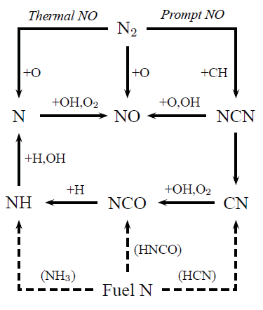

**图1：简化反应路径图，展示了热型 NO、快速 NO 和燃料-NO 形成的主要步骤。图中未显示 NO 通过原子氮反应或通过与碳氢自由基反应生成氰化物被循环回 N2 的过程。**

大量工作致力于提高对燃烧中 NOx 形成机理的理解，并开发减排策略 [1-3, 5, 6]。曾经仅适用于大型燃烧系统的 NOx 排放限制现在也实施于更小的规模；它们继续成为许多工业高温过程中研发的动力。在大型电站和某些发动机中，排放通常通过催化烟气净化来控制。然而，这种技术在生物质和废物等燃料的使用上具有挑战性，因为存在中毒问题，或者由于相对较高的成本而产生不利影响。因此，通过初级手段控制 NOx 排放的动力仍然存在。

或是通过选择性非催化还原（SNCR）或燃尽（reburning）等原位技术。为了实现这一目标，拥有可靠且通用的化学动力学模型对于高温过程中NO的形成和消耗至关重要。随着目前计算能力的显著增强，将详细反应机理与计算方法流体动力学（CFD）等工程模型相结合，已成为设计低NOx燃烧系统的重要工具。

目前工作的目标是建立并评估一套最先进的、未经优化的、适用于燃烧中均相氮化学的化学动力学模型。它基于过去几十年关于氮化学的研究，同时也汲取了热化学和反应速率理论研究方面的最新进展。文中探讨了NO形成和消耗的不同机制，并评估了关键的反应步骤。还将模型的各个子集与实验数据进行比较以验证其有效性，并评估了该机制的预测能力。

为了限制本文的综述范围，我们侧重于在常压或亚常压条件下，轻烃（主要是CH4，和/或轻质燃料氮物种HCN、NH3、HNCO）燃烧中的氮化学。在目前的工作中未涉及复杂燃料（如硝基烷烃）燃烧过程中可能形成的杂环氮化合物，或含能材料的氮化学。此外，我们关注的是实验条件充分明确的体系，以便进行动力学解释；我们避开对实际燃烧系统的建模部分，部分原因是湍流流动特性以及湍流/化学相互作用可能在燃烧系统中扮演重要角色，部分原因是在用于计算流体动力学计算时，需要简化的化学模型。

在此次综述中，已广泛选用实验数据进行模型验证，包括常压和低压下的层流预混火焰、冲击管实验以及喷射搅拌反应器（jet-stirred reactors）的结果。

模拟预测也已与层流流动反应器中获取的数据进行了广泛的比较。然而，流动反应器数据很容易因初始条件（例如预处理、预热或混合）的不确定性或反应炉表面的干扰（即使是在石英和氧化铝这样相当惰性的材料上）而出现偏差。因此，在解释结果时必须谨慎，参见文献[7]。在附录A中，讨论了石英表面如何在流动和间歇反应器中与气相化学相互作用。实际上，所有实验方法在用于模型开发和评估时，都存在需要谨慎处理的复杂情况，必须加以考虑。

## 2 详细化学动力学模型

化学动力学模型由反应机理以及涉及物种的热力学性质和传输系数组成。燃烧中的氮化学反应机理必须包含烃类氧化、活性氮物种（如胺类、氰化物等）的氧化等子反应机理，以及烃类化学与氮化学之间的相互作用（例如，初始NO的形成和再燃）。本综述中建立的模型基于过去40年发表的氮化学研究工作。然而，主要涉及NO形成和消耗的反应的热化学和速率常数，是基于最新的高级理论工作重新评估的。完整的模型以CHEMKIN输入格式提供，作为补充材料。具体模型相关的方面将在下文中详细讨论。

### 2.1 热力学性质

表1列出了模型中选定物种的热力学性质。这些物种的数据是在本研究中使用活性热化学表（Active Thermochemical Tables, ATcT）方法[8,9]重新评估的。特别强调了所选碳氢化合物自由基和活性氮物种的热化学性质。在相关部分，下文将有更详细的讨论。CHn烃类自由基的生成焓与Ruscic最近的评估[10]完全一致，该评估基于ATcT热化学网络（TN）v. 1.122版[11]。所列值基于更新的子代ATcT TN v. 1.122b，它在随后的努力基础上进行了补充，该努力旨在提取HCN和HNC之间目前可用的最佳能量差异，以及这两种物种及其正负离子的生成焓[12]。ATcT TN v. 1.122b也被用于开发并作为基准测试新的、已知为ANLn的高水平复合电子结构方法[13]。为了获得表1中所需物种的NASA热力学多项式，基于TN v. 1.122b的结果生成了JANAF风格的表格ATcT输出。使用金标准的NASA PAC程序（McBride和Gordon [14]）对这些多项式（包含温度、等压热容、熵、生成焓增量以及50K增量步的生成焓）进行了拟合。

表1中其他物种的热力学性质主要采用Goos、Burcat和Ruscic[15]的理想气体热化学数据库（该数据库会不定期地用可用的ATcT生成焓进行更新）。

### 2.2 反应机理

该反应机理的核心基于作者近期关于C1-C2碳氢化合物[16-18]、胺类[19]、氰化物[20]以及烃类/氮相互作用[21-23]的化学研究。然而，模型的许多特征可以追溯到20世纪80年代的工作[1, 24]。该机理中的氮化学子集将在下文中讨论。在本节中，我们将简要讨论在燃料氧化子集中对于氮化学特别重要的反应。

例如，C1自由基中的CH3、^3CH2、^1CH2、CH和C，以及C2自由基池中的C2H、C2、HCCO和C2O，都可能参与这种相互作用。在这些自由基中，甲基炔基（CH）因具有足够的活性去攻击分子氮并引发瞬时NO的生成而备受关注。

在本次综述中，我们将范围限定于小烃类（主要是甲烷）燃烧中的氮化学。在甲烷氧化过程中，CH自由基和C自由基主要通过以下序列形成：

CH3 --(+H,OH)--> ^3CH2 --(+H,OH)--> CH --(+H,OH)--> C

在附录B中，我们探讨了决定小烃基自由基水平的反应，并评估了反应机理的这一部分。与之前的建模工作相比，当前机理的一个重要特征是为CH + H2O使用了更准确的速率常数。

## 3 氮氧化物(NO)的形成机理

### 3.1 热力型NO (Thermal NO)

热力型NO或Zeldovich机理[25]是高温气体燃烧中NO最主要的来源。热力型NO的形成机理已得到充分确立。引发步骤是氧原子攻击N2中的三键，

O + N2 ⇌ NO + N   (R1b)

该反应的活化能很高，约为75 kcal mol^-1 [26]，是热力型NO形成的速率控制步骤。一旦生成，氮原子会通过与OH或O2的反应迅速被氧化为NO，

N + OH ⇌ NO + H   (R2)

N + O2 ⇌ NO + O   (R3)

对热力型NO形成的建模问题主要集中在对反应R1速率常数的准确性上，下文将讨论。

#### 3.1.1 热力型NO的反应子集

表2列出了热力型NO形成反应的速率常数。速率控制步骤(R1b)的速率常数已在激波管研究中直接测量[27,28]，并从一系列火焰研究中推断得出[29-36]。此外，逆反应，

N + NO ⇌ O + N2   (R1)

已在广泛的温度范围内进行了实验表征[26,37-46]。由于基态电子曲面上的最小能量路径是完全吸引性的且无极小值，预计N + NO反应几乎没有或没有压力依赖性[47]。

图2是反应R1的阿伦尼乌斯图。O + N2反应(R1b)的数据通过平衡常数转换而来。Baulch等人[26]估计速率常数的不确定性为两倍，并建议使用比其除以平衡常数后的k1值大50%-70%的k1b值。

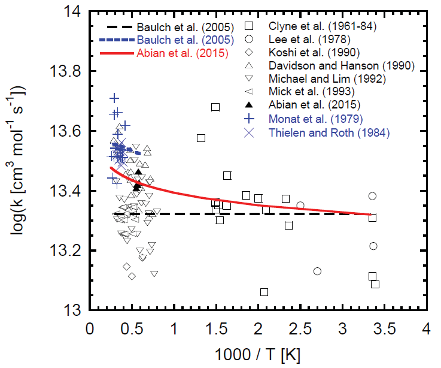

**表2：热力型NO形成中涉及的反应。用于修正阿伦尼乌斯表达式 k = AT^β exp(-E/RT) 的参数。单位为mol、cm、s、cal。**

我们采用了Abian等人[46]近期研究中反应R1的速率常数。他们通过流动反应器实验确定了k1，测量了1700-1800 K下N2/O2混合物中NO的形成，并考虑到文献数据外推至更宽的温度范围。其得到的k1值比Baulch等人的建议值高25%，但对应于比Baulch等人的评估值低25%的k1b值，从而调和了正向和逆向速率常数的数据（图2）。

**图2：反应 N + NO = O + N2 (R1) 的Arrhenius图。黑色符号表示对正反应（正向反应）的测量，而蓝色符号表示的是逆反应的测量数据。数据通过热力学性质换算。k1的数据来自Clyne等人[37-40]，Lee等人[41]，Koshi等人[42]，Davidson和Hanson[43]，Michael和Lim(1992)，Mick等人[45]，以及Abian等人[46]。k1b的数据来自Monat等人[27]和Thielen与Roth[28]。长虚线显示Baulch等人[26]对k1的建议，而短虚线是其对k1b建议得出的k1值。实线是Abian等人推荐并被本工作采用的速率常数。**

#### 3.1.2 热NO形成的建模

与[46, 50, 51]综述的相比少有的实验工作是在良好控制的条件下进行的，以表征热NO的形成。遵循Abian等人[46]，我们选择了Arai等人[52]的反应器数据和Homer与Sutton[53]的火焰数据进行比较，以验证模型预测。

Arai等人[52]在等温层流反应器中进行了关于O2/N2体系的实验研究，考察了O2摩尔分数（0.05-0.95）和温度（1550-1750 K）对NO形成的影响。图3将Arai等人测得的NO浓度与模型预测进行了比较。在这些实验中，石英反应器表面对NO形成的干扰预计可忽略不计。反应器壁原子的损失（可能是个问题，见附录A）可以不予考虑，因为在这种条件下O已迅速与O2达到平衡[46]。

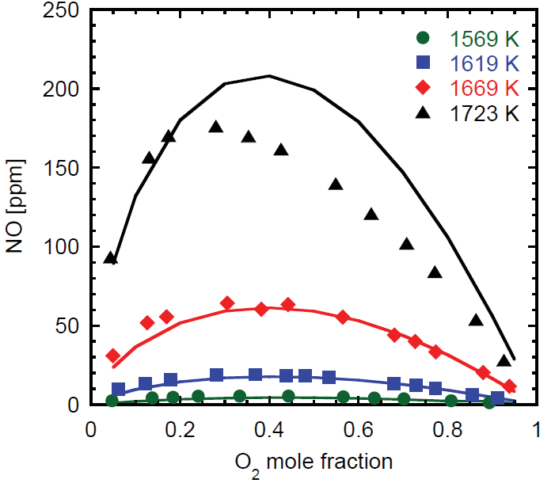

**图3：以温度和O2摩尔分数为变量的，在O2/N2反应气混合物的流动反应器中形成的NO的实验数据[52]和模型预测的比较。实验数据用符号表示，模型预测用线表示。**

一致性在20%以内或更好。在温度为最高温度时，O2含量高于30%，预测的NO水平超过测量值。正如Abian等人[46]所指出，在此温度下观察到的NO轮廓与在其他温度下测量的形状不同，NO的峰值出现在较低的O2浓度，这种差异可能部分归因于实验伪像。

Homer和Sutton[53]报告了在一大范围温度和化学计量比下，大气压力预混氢-氧-氮火焰中NO浓度的测量。

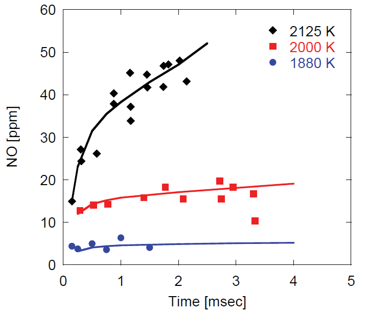

**图4：在大气压力H2/O2/N2预混层流火焰的后燃区中测量的与预测的NO摩尔分数的比较。符号表示来自Homer和Sutton[53]的实验数据，而线条表示计算值。火焰1：T = 2125 K，入口成分 25% H2, 17.5% O2, 57.5% N2。火焰2：T = 2000 K，入口成分 23% H2, 16.1% O2, 60.9% N2。火焰3：T = 1880 K，入口成分 21.1% H2, 14.7% O2, 64.2% N2。**

Homer和Sutton的火焰在燃烧器上得到了强烈的稳定，可以设想燃烧器表面通过从火焰区去除热量和自由基影响了火焰。Homer与Sutton报道的大量的NO形成发生在非常早的火焰阶段，即火焰可能与燃烧器表面相互作用的地方。遵循Abian等人[46]，我们在计算中选择将在火焰区以上大约0.25厘米处测得的值固定为NO的水平，并仅在火焰后区对NO的形成进行建模，以最大程度地减少不确定性。

火焰数据分散，测量的火焰温度存在一些不确定性。然而，后燃区域观测值和计算NO浓度之间的吻合度很好。

即使由于缺乏合适的实验数据，热NO子集只能得到有限的验证，但针对该NO形成机制的计算不确定性预计会很小。速率决定步骤(R1)的速率常数精度在高温下可能是25%的量级，而在良好控制的条件下的热NO生成的模型预测可能具有类似的精度。在实际系统中，计算精度将会因温度和/或湍流化学相互作用的更大的不确定性而受到限制。

### 3.2 快速型NO (Prompt-NO)

由CHn自由基攻击N2引发进行的机制被称为prompt-NO [29,54]。Prompt-NO是三流碳氢化合物/空气扩散火焰（这通常具有实用火焰结构）中NO的重要、也许是主要的来源[55]。早期的建模研究[1,24]将CH与N2的反应确定为最重要的引发步骤。长期以来，人们认为该反应生成HCN + N，但现在已知该反应是通过CH插入N2三键来进行的，生成NCN + H [56,57]：

CH + N2 ⇌ NCN + H   (R4)

其他的碳氢自由基也被提出来进攻分子氮。三重态亚甲基 (^3CH2) 和单重态亚甲基 (^1CH2) 与N2的反应已被证明具有非常高的势垒，不足以促进prompt-NO的形成[1,24,58]。此外，C2O + N2的反应在许多文献[59-62]中都有讨论，具有禁阻性势垒[63]。C2 + N2的反应 (R6) 是一个候选者[64,65]，但C2的浓度通常低于CH的浓度两个数量级（在预混火焰中）[66]，这使得该步骤变得不重要。只有C + N2反应生成CN + N (R5b) 或NCN (R7b) 的反应足够快，可以与CH + N2 (R4) 竞争。直接形成CN + N (R5b) 的反应比反应R4具有更高的活化能，随着燃烧温度的增加变得更具竞争力，但随后也通过C + N2 (+M) → NCN (+M) (R7b)，随后通过NCN的反应，可能导致NO的形成。C + N2 (+M) → NCN (+M) 反应 (R7b) 在298 K时为放热63.6 kcal mol^-1，在高温下吸热，而C + N2 → CN + N (R5b) 的反应在298 K时为吸热17.4 kcal mol^-1，随着温度升高其吸热性逐渐增加。

由CH + N2 (R4) 或C + N2 (R7b) 形成的NCN自由基将进入到氰化物池并最终被氧化为NO或N2。最近的建模研究[60-62,67-72]已成功包括并完善了NCN化学，以形成prompt-NO。然而，仍有未解决的问题，如下文讨论。

#### 3.2.1 NCN的生成热

NCN的热力学性质对于prompt-NO模型很重要，因为它们影响了CN + H反应向CH + N2 (R4b) 和HCN/HNC + N (R8, R9) 的分支比。用于模型研究的NCN生成热的数值[61,62,67,71,72]变化超过3 kcal mol^-1，这种差异对模型预测有显著影响。

表3列出了NCN生成热的报告值。Clifford等人[73]根据电子亲和力和计算出的(CBS-4, CBS-Q, CBS-APNO) HNCN气相酸度估计 ΔfH°298(NCN) 为107.9 ± 4.0 kcal mol^-1。Bise等人[74,75]研究了NCN的光解动力学，使用光束光解光谱学导致 ΔfH°298 = 111.1 ± 0.7 kcal mol^-1。Canneaux等人[76]使用CBS-QB3, CBS-APNO, G3B3, G3和G4计算的原子化能计算出 ΔfH°298 = 107.2 ± 0.8 kcal mol^-1。

| ΔfH°298(NCN) kcal mol^-1 | 方法 | 参考 |
|---|---|---|
| 107.9 ± 4.0 | 实验 | Clifford等人[73] |
| 111.1 ± 0.7 | 实验 | Bise等人[74,75] |
| 109.4 ± 2.0 | 理论 | Harding等人[77] |
| 107.2 ± 0.8 | 理论 | Canneaux等人[76] |
| 109.4 ± 0.5 | ATcT (TN ver. 1.112 bis) | Goos等人[71] |
| 107.5^+1.4 | 实验，间接 | Fassheber等人[78] |
| 107.7 ± 0.2 | 理论, ATcT (TN ver. 1.12b) | 见文本 |

**表3. NCN的生成热报告值。**

最近，Goos等人[71]基于现有实验和理论热化学数据与两台Active Thermochemical Tables分析，重新检查了NCN的生成热。正如这些作者[79]长期以来讨论的那样，最初的TN版本1.112分析，其中包括当时可用的实验和理论数据，表明一个暂定值为106.5 ± 0.4 kcal mol^-1 [79]。该值反映了目前存在且无法解释的实验数据之间的巨大差异，因此受到了几个中高水平电子结构结果的显著影响，比如Canneaux等人[76] (CBS-QB3, CBS-APNO, G3B3, G3, G4)，这些结果似乎是相互一致的。在重复和进一步审查这些（和其他）单参考计算后，Goos等人[71]发现这些NCN的结果（基态为^3Σ^-双自由基）存在严重的自旋污染问题，这个问题之前未能被Canneaux等人[76]和Clifford等人[73]的文献注意到。Goos等人[79]提出的值，109.4 ± 0.5 kcal mol^-1，是通过解决小型（局部化）TN（ver. 1.112 bis）获得的，其中包括来自Clifford等人[73]和Bise等人[74,75]的冲突实验数据，加上Harding等人[77]的几个多参考结果，但也排除了所有自旋污染的单参考理论结果。正如Goos等人所述，当时可用的数据产生了一个相当稀疏的TN，涉及的NCN很少有热力学循环，通常可以通过ATcT检查个体测定的一致性。因此，ATcT统计TN分析既不能在两项实验研究中找出明确的错误，也不能通过在中位数和两个不一致实验之间找到更少的误差，而这些实验最终与包括多参考Harding等人[79]的值相吻合。（顺便说一下，当局部化TN的内容与完整版TN合起来，如ver. 1.118[80]，TN在很大程度上未受影响，因此结果变化很小，达到109.1 kcal mol^-1。）由于推荐结果偏差较大之前的建模研究采用的数值，Goos等人[78]测试了其影响。

对于prompt-NO形成，并与Bise等人的高数值相比，得出从局部化TN得到的数值在燃料富集甲烷火焰中似乎对NCN和NO摩尔分数分布有所改善。此外，通过单独检查哪些数值范围可以被纳入模型，Goos等人得出结论，可行的NCN焓值应介于106.4至108.3 kcal mol^-1之间——略低于ATcT从局部化TN计算的结果，但也间接表明Clifford等人的实验值可接受性更高，因为它们超出了范围而非Bise等人提出的极高值。

其他的先前prompt-NO建模研究也采用了 ΔfH°298(NCN) 值变化超过或相当于3 kcal mol^-1。Konnov[61]喜欢从Bise和同事们[74,75]处获得111 kcal mol^-1的高值。Desgroux和同事们[62,67]最早采用了来自Clifford等人[73]的107.9 kcal mol^-1，但在他们最近的工作[72]中发现，使用更低的 ΔfH°298(NCN) = 106.1 kcal mol^-1与火焰测量结果最好。

在目前的工作中，我们使用了当前的ATcT值 ΔfH°298(NCN) = 107.7 ± 0.2 kcal mol^-1（参见2.1节）。该数值部分基于新的实验和理论信息。新理论信息来源于最近高准确度计算结果（理论ANL1级别[13]），并将它们当作等能反应适当添加到TN中；新实验信息基于Fassheber等人[78]的研究基于第二第三法则的结果。最近由Fassheber等人对NCN + H反应的脉冲电弧管研究支持的值约为107.5 kcal mol^-1，上限可达108.9 kcal mol^-1。当前使用ATcT焓值证明（基于对物种特异性方差分解[81]分析）确实严重依赖于最新的ANL1结果（累计贡献76.5%），紧接着是Fassheber等人的实验研究（对第二和第三法贡献）

#### 3.2.2 快速NO（Prompt NO）形成的反应子集

快速NO子集中选定的反应列于表4。其他重要步骤涉及碳氢自由基的形成与消耗（见附录B），以及氰基和胺子集中的反应将在下一节讨论。

Prompt NO形成的关键反应速率常数：

CH + N2 ⇌ NCN + H   (R4)

该反应不仅通过实验获得[87,88]，也通过理论计算得出[77,82,89,90]。

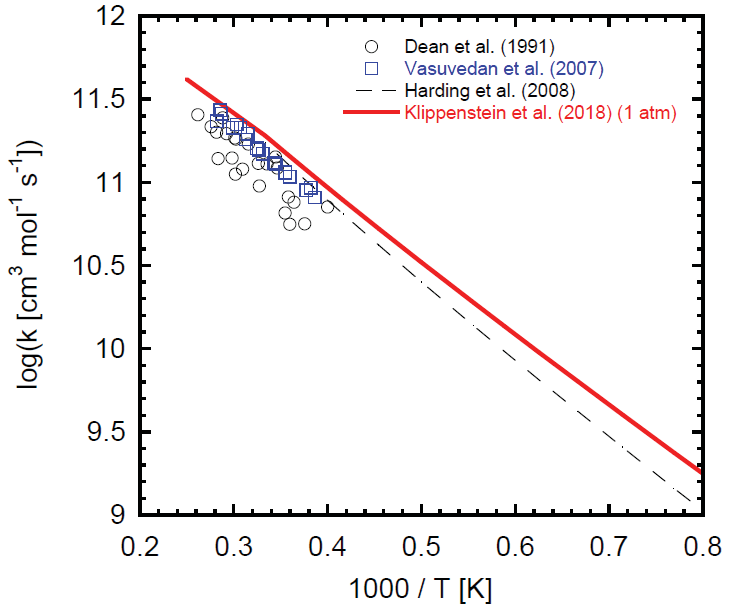

**图5：R4反应（CH + N2 ⇌ NCN + H）的阿伦尼乌斯图。图中符号代表速率常数的测量值，而线条代表计算值。数据来源于Dean等人[87]、Vasudevan等人[88]、Harding等人[77]和Klippenstein等人[82]。**

Dean等人[87]和Vasudevan等人[88]通过将N2加入初始反应混合物来推断CH + N2反应在2500-3800 K温度范围内的速率系数。他们的结果吻合良好，但Vasudevan等人的数据分散度较大。Lindackers等人[91]也报道了来自冲击管实验的CH + N2反应测量结果。然而，他们监测的是原子N的形成，现已知这是次要反应的产物，因此在本次评估中忽略了他们的结果。

Harding等人[77]报道了关于CH + N2反应的高水平理论研究。他们确定了一个k4值，其不确定性为一个因数，这主要源于NCN的生成热不确定性。最近，Klippenstein等人[82]基于HNCN势能面重新分析了相关反应。他们得出的k4值被本研究所采用，该值略高于Harding等人的速率常数以及Vasudevan等人的测量结果（见图5）。

关于NCN自由基随后反应的知识在很大程度上得益于Friedrichs及其同事的冲击管工作，他们测定了几个NCN反应的速率常数，即NCN + M (R7) [83]，NCN + H (R9) [82]，NCN + O (R9) [83]，NCN + O2 (R13) [85]，以及NCN + NO (R14) [86]。此外，Lin及其同事还从理论上研究了若干反应，包括NCN + H [92]，NCN + O [84]，NCN + OH [93] 以及NCN + O2 [94]。最近，Klippenstein等人[82]报道了关于NCN + H和NCN + OH的理论研究。本次NCN子集主要基于Friedrichs及其同事的实验结果以及Klippenstein等人的理论工作。

Prompt NO形成在略带还原性的条件下最为重要，而与原子氢的反应是NCN子集中的关键步骤。除了重组形成HNCN外，该反应有三个产物通道：

NCN + H ⇌ CH + N2   (R4b)

NCN + H ⇌ HCN + N   (R8)

NCN + H ⇌ HNC + N   (R9)

Fassheber等人在冲击管中测量了NCN + H的总反应速率常数，温度范围为962-2425 K，而Vasudevan等人从NCN自由基浓度的随时间变化历史中推导出HCN + N (R8) 和HNC + N (R9) 通道的速率常数之和，温度为2300-2500 K。此外，NCN + H反应已被Teng等人[92]和Klippenstein等人[82]在理论上研究过。

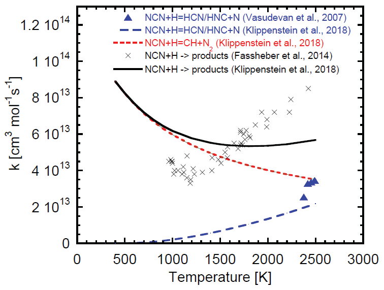

**图6：Fassheber等人[78]和Vasudevan等人[88]关于NCN + H的测量值与Klippenstein等人的高水平计算值[82]的比较，分别是针对k4b、k8 + k9以及k(NCN+H,total)。NCN + H反应在中低温度下主要被CH + N2 (R4b) 通道主导，而HNC + N (R8) 在高温下变得竞争性强。由于k4b具有负温度依赖性，而k8随温度增加，NCN + H的总速率常数存在一个拐点，该拐点发生在1000至1500 K之间的温度。**

Teng等人计算了反应R8的速率常数，与Vasudevan等人的测量结果吻合良好，发现HNC + N (R9) 的形成因高能垒而变得微不足道。Klippenstein等人的分析证实了HNC + N (R9) 通道是次要的，尽管可能存在来自^2HNCN到^4HNCN的系统间跃迁贡献。

由Fassheber等人从实验中推断出的k8 (+k9) 值大约是Vasudevan等人的数据以及理论研究预测值的两倍。然而，NCN + H的总速率常数与Klippenstein等人的预测吻合良好，特别是在高温下。

在本次工作中，我们采用了基于Klippenstein等人的理论结果的速率常数，因为这些结果不仅涵盖了三个通道，而且与现有的所有实验数据一致。

对于NCN + O反应，目前文献数据非常有限。除了Fassheber等人的早期研究之外，Lin等人研究了一些相关反应，但仅限于理论研究[92]。关于该反应子集的更多信息详见附录B。

#### 3.2.3 Prompt NO形成的其他途径

虽然HNCN的重排通道对于生成prompt NO很重要，但其他途径也可能具有显著影响。这里主要重点讨论涉及氰化氢 (HCN) 的反应。

HCN不仅是燃料氮形成prompt NO的关键中间体，它也是燃料分解产物，并且作为HCN衍生的氰化氢自由基生成的重要前体（例如，NCO）。

**表4：与prompt NO形成相关的重要选定反应。表4列出了在修改后的阿伦尼乌斯表达式 k=AT^β exp(-E/[RT]) 中使用的参数。单位为mol, cm, s, cal。a: 1 atm（关于压力依赖性，参见补充材料）。**

#### 3.2.4 模拟快速NO的生成

快速NO生成的模型通过与低压预混火焰[62,72,95-99]和搅拌反应器[100]的数据比较来评估。Desgroux及其同事通过一系列出版物[62,72,96-99]开展了最全面的关于火焰中快速NO生成的实验工作。层流预混火焰的数据通常非常可靠，特别是当通过非侵入式方法获得时。担忧包括测量温度曲线的准确性以及与燃烧器表面可能的相互作用。搅拌反应器装置的特点是强烈的湍流混合、高浓度的自由短寿命自由基。这些条件有利于快速NO生成，并使其在当量比从化学计量到富燃料范围内成为NO的主导来源。然而，搅拌反应器的数据容易受到混合影响，特别是在化学过程快速的较高温度区域。

遵循Glarborg等人[24]和Miller and Bowman[1]，我们将建模预测与Bartok等人[100]在搅拌反应器中甲烷燃烧（图7）测量的NO生成数据进行比较。在计算中，我们使用了测量的温度，其在略微富燃料条件下在约2000 K时达到峰值。由于对混合影响的担忧，实验结果中的不确定性想必很大。考虑到这一点，除了非常富燃料条件下NO浓度被低估的情况外，实验数据与建模预测之间的吻合度很好。

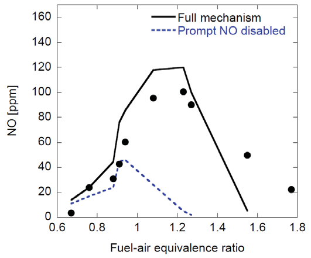

**图7：在搅拌反应器中甲烷燃烧的NO生成数据[100]与模型预测的比较。对图7计算的分析提供了关于主导NO生成机制如何由化学计量和温度控制的信息。**

从图中可以看出，如果从反应机制中删除快速NO引发反应（虚线），在贫燃料条件下仍能很好地预测NO，但在化学计量和还原条件下它被严重低估了。在略微贫燃料条件下，热NO占主导地位。而在过量空气增加且温度降低的情况下，第3.3节讨论的氧化亚氮(N2O)机制的NO生成变得越来越重要。在化学计量条件下，热NO和快速NO贡献的氮氧化物量相似，但对于燃料-空气当量比大于1.0的条件，快速NO迅速成为NO的主导来源。

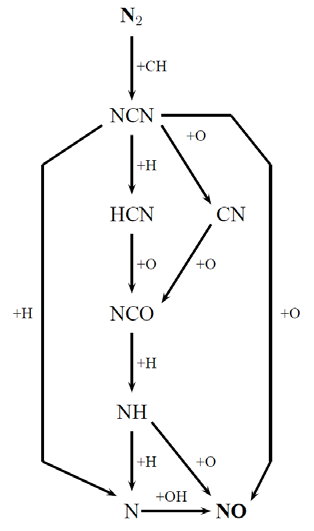

**图8：在略微富燃料条件下快速NO生成的反应路径图。**

快速NO的生成涉及三个总体步骤[1,24]：

- CHn自由基的形成，特别是CH
- 分子氮的固定
- 固定氮物种之间的相互转化

N2的固定主要通过CH + N2反应(R4)发生，即使碳(C)和N2 (R7b)再组合也起到了贡献作用。在大约1.2的燃料-空气当量比范围内，在这些反应中形成的NCN和N迅速氧化为NO，主要是按以下序列进行：

NCN + H ⇌ HCN + N (R8)
HCN + O ⇌ NCO + H (R26)
NCO + H ⇌ NH + CO (R31)

NH + H ⇌ N + H2

N + OH ⇌ NO + H   (R2)

一个次要的替代途径涉及序列 NCN --(+H)--> HNC --(+OH)--> HNCO --(+H)--> NH2。

在当量比 φ > 1.2 的条件下，HCN 的浓度迅速增加，而 NO 减少。固定氮从 NO 到 HCN 的分配变化是由几个因素共同作用引起的。由于氧原子浓度的降低，通过反应 (R26) 将 HCN 转化为 NO 的过程不再快速。此外，胺自由基和 NO 通过反应与碳氢自由基结合再循环利用生成 HCN 的过程变得主导。在更富燃料的条件下，形成 CHn-自由基的反应相较于生成甲醛的氧化路径更有利。CHn-自由基与 NO 之间的反应随后有效地将 NO 转化为氰基和异氰基化合物。这些步骤将在第 4.2 节关于再燃烧的部分详细讨论。氰基池中的胺自由基回收主要通过以下快速反应发生：

CH3 + N ⇌ H2CN + H

CH3 + NH ⇌ CH2NH + H

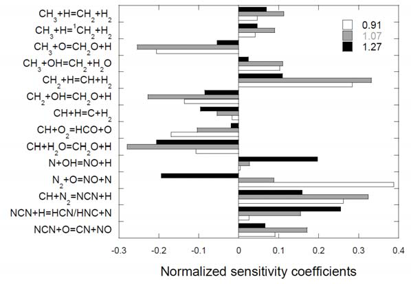

**图9：在Bartok等人[100]的搅拌反应器实验条件下，三种燃料-空气当量比下NO预测的灵敏度系数。该图展示了不同化学反应路径对NO预测结果的归一化灵敏度系数，比较了当量比为0.91、1.07和1.27的情况。**

图 9 展示了 Bartok 等人（图 7）实验条件下 NO 的灵敏度分析结果。显示了三个选定燃料-空气当量比的结果。在略微贫燃条件下 (φ = 0.91)，热力型 NO 有助于 NO 的形成，且预测对反应 O + N2 → NO + N (R1) 敏感。在略微富燃条件下 (φ = 1.08)，这一步的重要性减弱，甚至在更还原条件下 (φ = 1.27)，它以逆方向进行 (N + NO → N2 + O) 并显示负系数。

在三种条件下，快速型 NO 都是 NO 的重要来源。

Prompt NO机制中的关键反应，CH + N2 (R4)，NCN + H (R8, R9) 和 NCN + O (R10) 显示正的灵敏度系数。通过序列 CH3 → ^3CH2 → CH 促进 CH 形成的反应，即 CH3 + H (R99, R100b)，CH3 + OH (R103) 和 ^3CH2 + H (R106)，也显示正的灵敏度系数，而破坏该序列的步骤（主要是 CH3 + O (R101) 和 ^3CH2 + OH (R107)）以及与 CH + N2 (R4) 竞争的反应（主要是 CH + O2 (R113) 和 CH + H2O (R115)）抑制了 NO 的形成。在还原条件下，反应 N + OH (R3) 也对 NO 的形成变得重要。

模型预测与一系列低压层流预混甲烷-空气火焰中 NO 和相关前驱体的浓度分布进行了比较。实验数据由 Berg 等人[95]获得，他们检测了 CH 和 NO，以及 Desgroux 及其同事[62,72,96-99]除了 CH 和 NO 外还报告的 HCN、NCN、CN 和 NCO 的浓度分布。在这两项火焰研究中，甲烷被用作燃料，压力范围为 25-30 和 40 托，并且覆盖了一系列当量比。

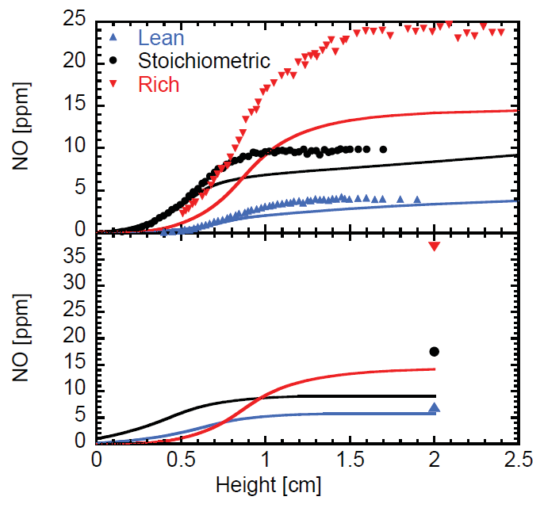

**图10：低压预混甲烷/氧气/氮气火焰中 NO 的摩尔分数比较，作为燃料-空气当量比的函数。符号表示实验数据，实线表示计算值。详细说明了 Lamoureux 等人[62,72,97]火焰的条件：当量比 0.80（贫燃，Tmax=1825 K）、1.0（化学计量，Tmax=1875 K）和 1.25（富燃，Tmax=1845 K）；压力 40 托。Berg 等人[95]火焰的条件：当量比 0.81（贫燃，25 托，Tmax=1750 K）、1.07（化学计量，25 托，Tmax=1920 K）和 1.28（富燃，30 托，Tmax=1980 K）。**

图 10 比较了 Lamoureux 等人与 Berg 等人两组火焰的测量 NO 浓度分布与模型预测。尽管两组火焰存在差异，但观察到一些共同趋势。在这些火焰中，随着燃料-空气当量比增加，测量的 NO 从贫燃火焰 (φ = 0.80) 的约 5 ppm 增加到富燃火焰 (φ = 1.25-1.28) 的 25-40 ppm。这是预期的，因为快速型 NO 是这些火焰中控制 NO 形成的机制，温度范围为 1750-1980 K。模型在略微贫燃条件下能较准确地预测 NO 分布，但在化学计量和还原条件下低估了 NO。在我们看到最大偏差的富燃火焰中，计算的 NO 比测量值低约一倍。

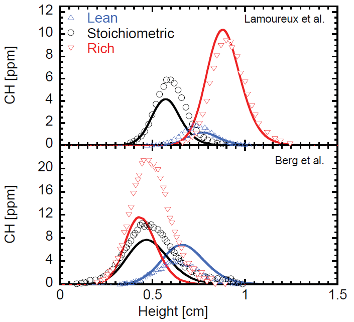

**图11：两组低压预混甲烷火焰中测量的与计算的 CH 分布比较。**

图 11 比较了两组火焰的测量与计算的 CH 分布。尽管 Lamoureux 等人和 Berg 等人的研究中调查的当量比相似，但压力和温度的差异意味着这些火焰不能直接比较。模型预测总体上与测量值满意地一致。唯一显著的差异出现在 Berg 等人的富燃火焰中，其中 CH 被低估了两倍。然而，在 Lamoureux 等人的类似火焰中，CH 的预测相当准确。

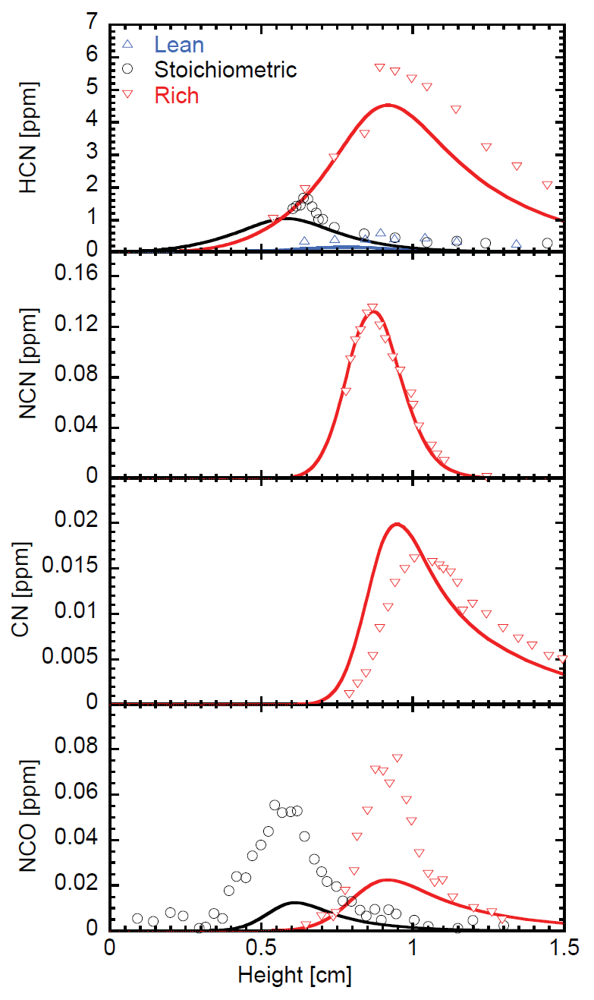

**图12：Lamoureux 等人火焰中快速型 NO 形成相关的关键氮中间体的结果。**

图 12 展示了 Lamoureux 等人火焰中快速型 NO 形成相关的关键氮中间体的结果。HCN、NCN 和 CN 的浓度均被模型很好地捕获。最大的偏差出现在 NCO 上，其在化学计量和富燃火焰中被低估。

为了使当前的模型预测与测量到的富燃火焰中的 NO 分布一致，反应 NCN + H → HCN + N (R8) 的速率常数需要增加四倍以上，使其大致与 Fassheber 等人[78]的测定值一致，并且使用了 Lamoureux 等人[72]优化的速率常数。这种改变将超出理论速率常数[82]估计的 2σ 不确定性范围（1.5倍）。虽然高 k8 值没有得到理论支持，但显然在当前模型的还原条件下预测性能恶化，值得进一步研究以解决这些差异。

预测快速型 NO 的形成需要一个准确的 CH + N2 反应 (R4) 的速率常数，以及预测 CH 浓度和 NCN 氧化生成 NO 或 N2 的选择性的能力。k4 的值已知优于两倍，但重要反应的速率常数

**图11：低压预混甲烷/氧气/氮气火焰中CH的测量值[72, 95]与预测摩尔分数比较。图表展示了不同当量比（贫燃、化学计量比、富燃）下，两种不同实验条件（Lamoureux et al. 和 Berg et al.）中CH自由基浓度随高度的变化。图中符号代表实验数据，实线代表计算值。对于 Lamoureux 等人的火焰，条件为：当量比 0.80 (贫燃), 1.0 (化学计量比) 和 1.25 (富燃)；压力 40 托。对于 Berg 等人的火焰，条件为：当量比 0.81 (贫燃, 25 托), 1.07 (化学计量比, 25 托) 和 1.28 (富燃, 30 托)。**

NCN 反应，特别是 NCN + H，尚在讨论中。因此，预测甲烷或天然气燃烧中"快速型"（prompt）NOx 生成的准确性可能不会优于两倍因子。对其他碳氢燃料生成的预测不确定性可能更大，这源于对准确预测 CH 浓度[70]的担忧。

### 3.3 N2O 和 NNH 机理

从大气氮生成 NO 的额外反应路径是由 N2 与原子氧 [O + N2 (+M) → N2O (+M) [101]] 或原子氢 [H + N2 (+M) → NNH (+M) [102]] 的复合引发的，随后通过氮中间体的氧化生成 NO。N2O 机理在高压、中等温度及贫燃条件下可能很重要，而 NNH 机理则在略富燃条件和较高温度下最为显著，尤其是在扩散火焰中，NNH 可能在火焰片富燃侧形成并在火焰片内部与 O 反应[103]。虽然 N2O 机理已相当确立，但通过 NNH 生成 NO 的重要性仍有争议，如下文讨论。

#### 3.3.1 通过 N2O 生成 NO 的反应子集

N2O 机理由 Malte 和 Pratt[101]提出。它包含以下步骤：

O + N2(+M) ⇄ N2O(+M)  (R15b)
N2O + H ⇄ NO + NH      (R17b)
N2O + O ⇄ NO + NO      (R18)

NH 自由基可与 OH 或 O2 反应生成 NO，或与 NO 反应生成 N2 或 N2O。生成 NO 的反应与将 N2O 循环回 N2 的步骤竞争：

N2O + H ⇄ N2 + OH  (R16)
N2O + O ⇄ N2 + O2  (R19)

该机理中 N2O 子集列于表 5。关于 N2 与 O 的缔合反应 (R15b) 的数据非常有限，但其逆反应，N2O 的分解 (R15)，已在广泛条件下进行了实验研究。据 Baulch 等人[26]综述的数据，吻合非常好。从 N2O 生成 NO 或 N2 的选择性很大程度上由 N2O 与 H 和 O 的反应的分支分数控制。

**表5: N2O 机理中涉及的反应。用于修正阿伦尼乌斯表达式 k = AT^β exp(-E/[RT]) 的参数。单位为 mol, cm, s, cal。**

| 反应方程 | A | β | E | 来源 |
|---|---|---|---|---|
| 15. N2O(+M) ⇄ O + N2(+M) | 9.9E10 | 0.000 | 57901 | [26] |
| 低压极限: | 6.0E14 | 0.000 | 57444 | |
| 16. N2O + H ⇄ N2 + OH | 6.4E07 | 1.835 | 13492 | [19] |
| 17. NH + NO ⇄ N2O + H | 2.7E15 | -0.780 | 20 | 见正文 |
| 18. N2O + O ⇄ NO + NO | 9.2E13 | 0.000 | 27679 | [104] |
| 19. N2O + O ⇄ N2 + O2 | 9.2E13 | 0.000 | 27679 | 见正文 |

N2O + H 反应由 Klippenstein 等人[19]从理论上进行了研究。其计算速率常数与 Marshall 等人[105]的测量值吻合极好。该反应主要在产物 N2 + OH (R16)，仅在极低温度下发生加成反应。生成 NH + NO (R17b) 的产物通道对于前向反应而言数据稀缺。然而，NH + NO 反应已被广泛研究。该反应有两个主要产物通道：

NH + NO ⇄ N2O + H  (R17)
NH + NO ⇄ N2 + OH  (R71)

NH + NO 的整体速率常数报告结果总结在图 13 中。低温测量结果在两倍因子范围内一致，Lillich 等人[106]和 Romming 和 Wagner[107]的数据吻合良好，可用于外推至约 2200 K。此外

来自 Klippenstein 等人的[19]理论速率常数以及 Baulch 等人的[26]评估值均展示了出来，既适用于 k17 + k71 的情况。

关于反应 N2O + H (R17) 分支比的实验数据[106, 108-112]和理论数据[19]显示，在 300-2200 K 温度范围内，该反应处于主导地位，占总反应速率的 70-90%。而 N2 + OH 通道 (R71) 仅占 10-30%；根据理论预测，该比例随温度升高仅略有增加[19]。

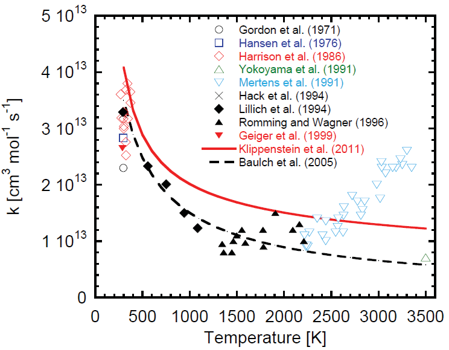

**图13：NH + NO 反应的阿伦尼乌斯图。符号代表速率常数的测量值，实线代表理论计算值，虚线代表评估值。数据来源于 Gordon 等人[113]、Hansen 等人[114]、Harrison 等人[115]、Yokoyama 等人[108]、Mertens 等人[109]、Hack 等人[116]、Lillich 等人[106]、Romming 和 Wagner[107]、Geiger 等人[117]、Klippenstein 等人[19] (k17 + k71) 以及 Baulch 等人[26] (k17 + k71)。**

在 2200 K 以上的温度下，仅有两项关于 NH + NO 的研究被报道，且均是在使用 HNCO 作为 NH 源的激波管中进行的。Mertens 等人[109]报告了 2200-3350 K 范围内的整体速率测量值，而 Yokoyama 等人[108]报告了 3500 K 的单次测量值。Mertens 等人的数据与 Romming 和 Wagner 的数据在重叠的温度范围内非常吻合，这表明 NH + NO 的速率常数在 2200 K 以上有所增加。速率常数出现的这种上升趋势与 Yokoyama 等人的测量结果不一致。他们在 3500 K 下测得的 kNH+NO 值比 Mertens 等人的数据低了约三倍，但与 Baulch 等人关于 k17 + k71 的建议值非常吻合。

Baulch 等人[26]将 Mertens 等人检测到的 NH + NO 在高温下速率常数的增加归因于第三个产物通道：

NH + NO ⇌ NNH + O   (R23b)

这将要求 NNH + O (R23) 的速率常数在高温下接近碰撞频率。虽然这与早期的估算[102, 118, 119]一致，但理论工作[19, 120]指出其值低了一个数量级，这使得 NNH + O 通道 (R23) 对 NH + NO 的整体速率可以忽略不计。反应 R23 将在 3.3.2 节中详细讨论。

我们采用了 Baulch 等人[26]给出的 k17 + k71 的值和分支比 k71/(k17 + k71)；这些速率系数在不确定范围内与理论工作[19]一致，但与 Lillich 等人的实验以及 Romming 和 Wagner 在本研究感兴趣的温度范围内的实验吻合得更好。

对于 N2O + O 反应，形成 NO + NO (R18) 的速率常数，无论是正反应方向还是逆反应方向均已测定，且在高温下整体速率常数也已建立[26, 104]。然而，从 N2O 生成 NO 的预测结果对 N2O + O 反应生成 NO + NO (R18) 和 N2 + O2 (R19) 的分支比以及 k19 的值非常敏感，后者在中等温度下存在显著的误差限[26]。在 Baulch 等人的早期评估[121]以及 Hanson 和 Salimian[122]的研究中，他们得出结论：在很宽的温度范围内，k18 和 k19 是相似的。最近，这一结论受到了 Meagher 和 Anderson[104]的质疑。通过对可用实验结果的重新评估，他们认为 R19 的活化能显著低于 R18，导致在较低温度下 N2 + O2 的形成占主导地位，而在 1900 K 以上则以形成 NO 为主。

在低温下报道的实验结果并不支持 Meagher 和 Anderson 关于 k19 的结论。Kaufman 等人[123]进行了一个关于 N2O 分解和 NO 形成的间歇反应器研究，温度范围为 876-1031 K。他们的数据显示，在这些条件下，生成 NO 的通道 (R18) 至少占 50%。Meagher 和 Anderson 因担心表面效应而舍弃了间歇反应器的数据。然而，根据 Kaufman 等人的说法，增加表面积/体积比导致 NO 的生成量减少，而不是增加。NO 生成的减少将与石英表面原子氧的损失一致（见附录 A）。在当前工作中，我们采用了 Meagher 和 Anderson[104]综述中的 R18 的速率常数，但根据 Kaufman 等人[123]、Dindi 等人[124]和 Rohrig 等人[125]的结果，暂定假设 k18 = k19。对于反应 R19 的高活化能与理论工作[126]是一致的，但该反应还需要更多的研究工作。

#### 3.3.2 通过 NNH 生成 NO 的反应子集

NNH 的反应子集列于表 6 中。通过 NNH 生成 NO 的机制包括以下反应序列[102]：

H + N2(+M) ⇌ NNH(+M)   (R20b)
NNH + O ⇌ NH + NO   (R23)

以及随后的 NH 氧化过程。

**表6：来自 NNH 子集的选定反应。用于修正阿伦尼乌斯表达式 k = AT^β exp(-E/[RT]) 的参数。单位为 mol, cm, s, cal。**

| 编号 | 反应 | A | β | E | 来源 |
| :--- | :--- | :--- | :--- | :--- | :--- |
| 20. | NNH ⇌ N2 + H | 1.0E09 | 0.000 | 0 | [19] |
| 21. | NNH + O ⇌ N2O + H | 1.9E14 | -0.274 | -22 | [19] |
| 22. | NNH + O ⇌ N2 + OH | 1.2E13 | 0.145 | -217 | [19] |
| 23. | NNH + O ⇌ NH + NO | 5.2E11 | 0.381 | -409 | [19] |
| 24. | NNH + O2 ⇌ N2 + HO2 | 5.6E14 | -0.385 | -13 | [19] |

NNH 解离 (R20) 的速率常数将在 4.1.1 节中更详细地讨论。由于 NNH 的寿命约为 10^-9 s [19]，反应 NNH ⇌ N2 + H 快速达到平衡。因此，从 NNH 机制生成的 NO 产率与 NNH + O ⇌ NH + NO (R23) 的速率常数以及 R20b 反应的平衡常数 KC,20b 成正比[19, 127]。平衡常数 KC,20b 取决于 NNH 的生成焓，现已明确确定其值为 ΔH298(NNH) = 59.7 kcal mol^-1 [19]。与此相反，已报道的关于 NNH + O → NH + NO 反应 (R23) 的速率常数变化超过一个数量级，如图 14 所示。

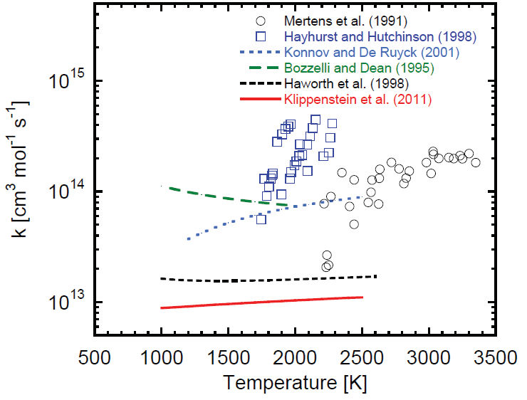

**图14：NNH + O → NH + NO 反应 (R23) 的速率常数汇总。**

没有测量 k23 的直接数据。Mertens 等人展示的数据是通过减去激波管中测得的 kNH+NO 的值并减去 k17 + k71，然后通过平衡常数转换为 k23·KC,20b 得到的。Hayhurst 和 Hutchinson 报告了 k23·KC,20b 的值，这些数据源自火焰测量值，误差限为五倍；我们使用现有的热化学数据来获得 k23。Kotov 和 De Ruyck[128]将他们对 k23 的建议基于对 Harrington 等人[129]在 1200 K 的火焰数据的再解释。他们的值与 Hayhurst 和 Hutchinson (1800-2500 K) 以及 Mertens 等人的结果相符。

**图14：反应 NNH + O → NH + NO (R23) 的阿伦尼乌斯图。数据来源：Mertens 等人[109]（激波管研究）、Bozzelli 和 Dean[102]、Hayhurst 和 Hutchinson[127]（火焰研究）、Konnov 和 De Ruyck[128]（火焰研究）、Haworth 等人[120]（理论）以及 Klippenstein 等人[19]（理论）。Mertens 等人的数据是从他们对 kNH+NO 的整体测量中减去 k17 + k71 并通过平衡常数转换得到的。Hayhurst 和 Hutchinson 的数据来自他们报告的 k23·KC,20b 值，使用当前的热化学数据。**

这些对 k23 的间接实验测定都支持接近碰撞频率的值。然而，Haworth 等人[120]和 Klippenstein 等人[19]的理论研究表明反应 R23 的速率常数要低得多（图 14）。在本工作中，我们从 Klippenstein 等人[19]的理论研究中取得 k23。该值的估计 2σ 不确定性为两倍因子。这种选择对通过 NNH 机制预测 NO 形成的影响将在下文讨论。

#### 3.3.3 对 N2O 和 NNH 机理形成 NO 的建模

在大多数条件下，通过 N2O 或 NNH 形成 NO 与热力型 NO 和快速型 NO 相比只是 NO 的次要来源。因此，N2O 或 NNH 机理主导 NO 形成的实验很少。为了排除快速型 NO 形成的可能性，我们只选择非碳氢化合物体系的验证数据，即以 H2 或 H2/CO 混合物为燃料的体系。

遵循 Haworth 等人[120]和 Klippenstein 等人[19]，我们选择了 Harrington 等人[129]的低压富燃火焰和 Steele 等人[130]的贫燃喷射搅拌反应器实验与建模预测进行比较。Harrington 等人的 H2/空气火焰设计旨在最小化通过热力型 NO 和 N2O 机理形成 NO，同时产生可测量的由 NNH 生成的 NO。为获得此条件，火焰在相对较低的温度（约 1200 K）和还原条件下运行。

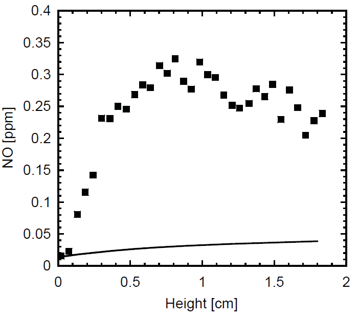

**图15：低气压预混氢/空气火焰中测量的[129]和预测的 NO 摩尔分数比较。实测摩尔分数（符号）与预测值（实线）的比较。条件：38 torr 压力，燃料-空气当量比 φ = 1.5，焰温约 1200 K。**

在图 15 中，Harrington 等人 38 torr 火焰的实测 NO 分布与建模预测进行了比较。形成的 NO 量非常低，低于 1 ppm。即便如此，模型在火焰中低估了 NO 近一个数量级。我们目前无法解释该火焰观测值与计算 NO 水平之间的差异。当 k23 值约为 10^14 cm^3 mol^-1 s^-1 时，NO 预测与实验一致。然而，这样的快速步骤似乎与理论工作[19,120]不相容，后者明确指出 NH + NO 只是 NNH + O 反应的一个次要通道。

Malte 及其同事[101, 130]进行了一系列喷射搅拌反应器实验，以表征贫燃预混燃烧中的 NO 形成。虽然在这些条件下 NO 主要通过 N2O 形成，但 Steele 等人[130]的 CO/H2 氧化数据也对 NNH 机理形成的 NO 敏感[19,120]。图 16 比较了实测和预测的 NO 与 N2O 浓度随温度的变化。模型对 NO 和 N2O 的预测均在约 20% 以内。计算分析表明，在这些实验条件下 N2O 机理占主导。然而，加上反应器中高水平的自由基，NNH 机理也很活跃，贡献了约 25% 的 NO 形成。值得注意的是，若采用 NNH + O ⇌ NH + NO 反应 (R23) 的高速率常数，在这些条件下会导致 NO 的显著高估[19,120]。

N2O 机理已经相当成熟，在相关温度和压力下，对该机理形成的 NO 的预测预计会相当准确。主要的不确定性涉及 N2O + O → N2 + O2 (R19) 的活化能，特别是在较低温度下对计算 NO 有一定影响。

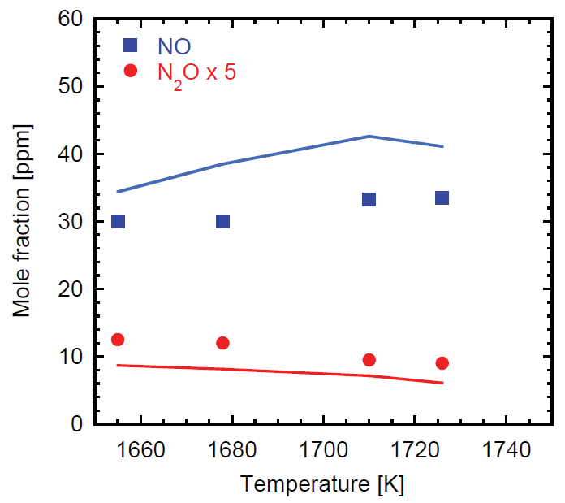

**图16：喷射搅拌反应器中 CO/H2/空气燃烧中测量的[130]和预测的 NO 和 N2O 摩尔分数比较。实测摩尔分数（符号）与预测值（实线）的比较。结果随温度变化，入口组成：17.4% CO，82% 空气，0.69-0.25% H2（随温度升高而降低）。标称停留时间约为 4.0 ms。**

对 NNH 生成 NO 的预测则显著更加不确定。对 ΔfH°298(NNH)[19]和 NNH + O 反应[19,120]的高水平理论结果表明，NNH 机理可能比早期建模研究所指示的不那么重要。实验结果[129,130]尚无定论，需要额外的实验工作来验证该子集。

### 3.4 HCN的氧化

在燃烧过程中，氰化物可能由CH和C与N2反应形成（即快速型NO生成的引发步骤），由反应性氮物种（如NO或胺）与烃自由基反应生成，或由含氮有机酸的分解产生，或由含有结合态氮的燃料脱挥生成[1-4,131]。燃烧中的主要氰化物物种是氰化氢（HCN），该组分的氧化化学在过去已被广泛研究[132-143]。Dagaut等人[20]曾对这项工作进行了综述。最近，Glarborg和Marshall[143]重新考察了这一化学过程，强调了氢异腈（HNC）异构体的作用。HCN化学涉及的关键问题是在氧化过程中形成其他含氮物种的选择性，即NH3、HNCO、NO、N2O和N2。

#### 3.4.1 HCN氧化反应子集

表7列出了化学动力学模型中HCN子集的选定反应。它基于Dagaut等人[20]的工作，并采用了Glarborg和Marshall[143]建议的修正。对于HCN的主要消耗步骤是与O的反应（R27-R29）和与OH的反应（R30-R33）。这两种反应都是复杂的过程，涉及多个势能井和多个产物通道[1]。对于HCN + O反应，速率常数和产物通道已有相当好的确立[1,20,144]，但关于HCN + OH的实验数据很少。只有H-抽取反应R30在实验上表征良好[143]。对于HCN + OH的其他产物通道（R31-R33），其速率常数来源于Miller和Melius的BAC-MP4计算[145]。

异氰酸（HNC）已被提出作为燃烧中HCN氧化的重要中间体[154]。在较高温度下，HCN和HNC通过异构化反应（R25）迅速达到平衡，并且比HCN更具反应活性。

**表7：HCN氧化子集中的选定反应。用于改进的Arrhenius公式 k=A(T^β)exp(-E/(RT)) 的参数。单位为 mol, cm, s, cal。**

| 编号 | 反应 | A | β | Ea | 来源 |
|---|---|---|---|---|---|
| 25. | HCN + M ⇌ HNC + M | 1.6E26 | -3.230 | 54900 | [146] |
| 26. | CN + H2 ⇌ HCN + H | 1.1E05 | 2.600 | 51908 | [26] |
| 27. | HCN + O ⇌ NCO + H | 1.4E04 | 2.640 | 4980 | [1] |
| 28. | HCN + O ⇌ NH + CO | 3.5E03 | 2.640 | 4980 | [1] |
| 29. | HCN + O ⇌ CN + OH | 4.2E10 | 0.400 | 20665 | [146] |
| 30. | HCN + OH ⇌ CN + H2O | 3.9E06 | 1.830 | 10300 | [147] |
| 31. | HCN + OH ⇌ HOCN + H | 5.9E04 | 2.430 | 12500 | [145] |
| 32. | HCN + OH ⇌ HNCO + H | 2.0E-03 | 4.000 | 1000 | [145] |
| 33. | HCN + OH ⇌ NH2 + CO | 7.8E-04 | 4.000 | 4000 | [145] |
| 34. | HNC + H ⇌ HCN + H | 7.8E13 | 0.000 | 0 | [148] |
| 35. | HNC + O ⇌ NH + CO | 4.6E12 | 0.000 | 2200 | [146] |
| 36. | HNC + OH ⇌ HNCO + H | 3.6E12 | 0.000 | -479 | [143,149] |
| 37. | CN + O2 ⇌ NCO + O | 5.8E12 | 0.000 | -417 | [26,150] |
| 38. | CN + O2 ⇌ NO + CO | 1.4E12 | 0.000 | -417 | [26,150] |
| 39. | NCO + H ⇌ NH + CO | 7.2E13 | 0.000 | 1000 | [26] |
| 40. | NCO + O ⇌ NO + CO | 2.0E15 | -0.500 | 0 | [151] |
| 41. | NCO + O2 ⇌ NO + CO2 | 2.0E12 | 0.000 | 20000 | [152] est |
| 42. | NCO + NO ⇌ N2O + CO | 4.0E19 | -2.190 | 1743 | [153] |
| 43. | NCO + NO ⇌ N2 + CO2 | 1.5E21 | -2.740 | 1824 | [153] |

HCN，异腈（HNC）为氰化物提供了一种替代的氧化途径。关于HNC的主要问题是与HCN平衡时的能量分离，这对于预测HNC浓度非常重要，以及HNC与OH和O2反应速率常数。由于近期的工作，HNC的热力学性质及关键HNC反应已知得更准确。Nguyen等人[12]确定，HNC与HCN在298 K下的能量差为15.1±0.1 kcal mol^-1，比Lin等人早期研究[154]提出的值高2.2 kcal mol^-1，比Dagaut等人的推荐值[20]高0.3 kcal mol^-1。HNC与OH（R36）[149]和O2[143]的反应均已在理论上得到表征，并且这两个步骤在相关温度下的表现似乎比早期建模中假设的要慢。

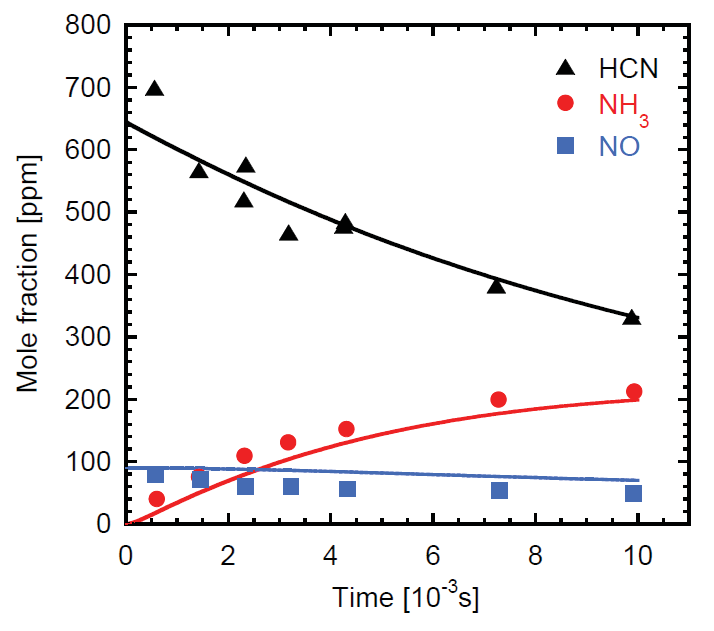

**图17：从添加氨的富乙烯火焰后火焰区（post-flame zone）的实验数据和模型预测的对比图。描述的是在含燃料过量的富焰条件下，HCN随温度和位置的变化浓度分布。**

特别是Glarborg和Marshall[143]报道了后一反应（HNC + O2）的高能垒为44 kcal mol^-1，使其在大多数受关注的条件下变得不相关。

与先前工作[20,143]中的HCN子集相比，仅进行了少量修改。其中最重要的是CN自由基与O2的反应。此步骤快速进行，且整体速率常数已确立。然而，通向两个产物通道NCO + O（R37）和NO + CO（R38）的分支分数一直存在争议。R37和R38的分支分数测量结果在室温下与文献[150,155,156]有良好的一致性。最近，Feng和Hershberger[150]验证了NO + CO通道（R38）在296-475 K范围内约占20%，且几乎没有温度依赖性，这与同一小组之前的结果[156]相反，我们采用了他们的建议。

#### 3.4.2 HCN氧化的建模

在下文中，将HCN氧化的模型预测与火焰（高温、还原条件）和流动反应器（中等温度、氧化条件）的实验结果进行比较。

遵循Glarborg和Marshall[143]，我们将模型预测与从添加了氨的富乙烯火焰[图17]后火焰区的测量值进行比较。这些条件代表了在富燃燃料-氧化剂转变前的高温火焰区。实验数据来自Haynes[157]，他研究了使用含氮添加剂（氨或吡啶）作为HCN来源的多种富燃、常压碳氢化合物火焰燃烧气体中氰化氢的消耗情况。在燃烧区，添加剂会转化为HCN，并生成较小量的NO。在后火焰区，HCN缓慢转化为NH3。燃烧气体的温度为2000 K。在模型中，假设乙烯和氧气在燃烧区耗尽，形成CO、H2、CO2和H2O的平衡混合物进入后火焰区，同时进入燃烧气体中的HCN、NH3和NO的测量浓度[143]。

模型预测与HCN、NH3和NO的测量结果吻合良好。氰化氢通过两步序列消耗：

HCN + M ⇌ HNC + M  (R25)
HNC + OH → HNCO + H  (R36)

在火焰条件下，HCN与HNC迅速达到平衡。原子氢和少量OH是火焰中的主要自由基，但他们消耗的HCN很少，因为反应HCN + H ⇌ CN + H2 (R26b) 和HCN + OH ⇌ CN + H2O (R30) 均迅速达到平衡。反应R36中形成的HNCO快速进入胺池，最终形成NH3：

HNCO + H ⇌ NH2 + CO  (R44)
NH2 + H2 ⇌ NH3 + H  (R53b)

小部分NH2通过序列 NH2 --(+H)--> NH --(+H)--> N 转化为NH和N。产生的NH和N可以通过与OH反应被氧化生成NO，或者与NO反应生成N2O或N2。这种竞争最终导致NO浓度略有下降。

在燃烧过程中，HCN在富氧条件下被氧化为NO和N2，通常伴随可燃物的存在。图18比较了由Hulgaard和Dam-Johansen[136]以及Glarborg和Miller[137]进行的HCN贫燃氧化流动反应器实验结果与模型预测。上图显示了HCN在无可燃物存在下的氧化结果[137]，下图显示了添加CO作为反应物的影响[136]。两者之间的吻合度显示出预测值与实验数据之间的良好一致性。

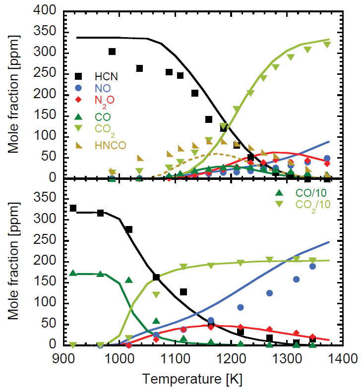

**图18：HCN氧化在贫燃条件下、有（下）和无（上）CO存在时的流动反应器实验数据（点）与模型预测（线）对比。**

关于HCN氧化过程中N原子的去向。在图18（上图）的条件下，NCO在较低温度下主要与H2O反应（R48b），从而将HCN转化为HNCO。由于自由基浓度低，HNCO在1150 K以下的消耗非常缓慢。随着温度升高，NCO + H2O → HNCO + OH 反应在较长反应时间下发生逆转。这样，反应R48成为HNCO的主要消耗通道，同时也是主要来源。

**图18：对比石英流动反应器中HCN氧化（无催化剂）的模拟预测与实验数据。上图为无CO的情况，下图为入口处有CO的情况。实验数据以符号表示，模型预测以线条表示。入口摩尔分数：上图HCN = 337 ppm，O2 = 2.6%，H2O = 3.1%；下图HCN = 318 ppm，CO = 1710 ppm，O2 = 2.4%，H2O = 2.8%，其余为N2。压力P = 1.05 atm。反应时间：上图和下图均为900 K时0.149秒和0.071秒（恒定质量流）。表面/体积比：上图4.4 cm^-1，下图8.0 cm^-1。**

在存在可燃物的情况下，此处为CO（图18下图），链载体的产生对HCN子集中的反应变得不那么敏感。序列 CO + OH → CO2 + H，H + O2 → O + OH 作为自由基源，将HCN氧化化学向较低温度移动。它还抑制了HNCO的形成。由于OH与CO快速反应，原子氧现在在HCN氧化中承担更重要的角色。HCN与O的反应（R27, R28）在移除HCN方面变得与HCN + OH（R30）具有竞争力，并且通过反应R28现在有一条次要氧化途径经过胺池。增加的O原子浓度也改变了NCO + O和NCO + NO反应之间的平衡，导致在较高温度下HCN被氧化为NO的比例相对更大。

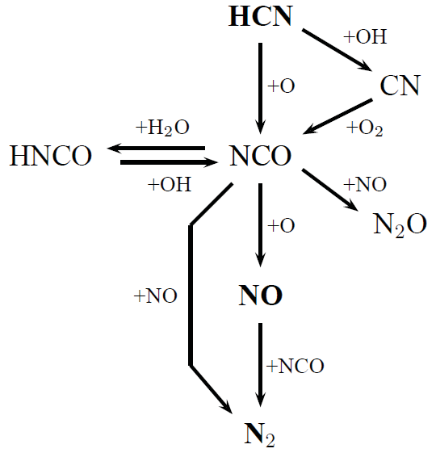

**图19：HCN在贫燃条件下的氧化反应路径图。反应路径：HCN --(+OH, +O, +O2)--> CN；HCN --(+O)--> HNCO <-->(+H2O, +OH) NCO；NCO --(+NO)--> N2O；NCO --(+O)--> NO --(+NCO)--> N2。**

对于大多数实际目的，HCN氧化化学已经足够成熟。氰化氢很少作为独立可燃物，自由基池通常由主燃料或燃料中间体的氧化控制，而非HCN化学。当前模型相当准确地预测了HCN氧化中形成NO、HNCO、NH3、N2O或N2的选择性。

### 3.5 HNCO的氧化

#### 3.5.1 HNCO氧化反应子集

**表8：HNCO氧化子集中的选定反应。用于修改后的Arrhenius表达式 k=AT^β exp(-E/[RT]) 的参数。单位为 mol, cm, s, cal。**

HNCO与 O2 的反应：

HNCO + O2 ⇌ HNO + CO2   (R49)

Glarborg等人[159]提出了该反应，以解释在没有其他可燃物存在时HNCO的氧化行为。他们假设反应R49的活化能为 35 kcal mol^-1。在本研究中，我们估计三重态 O2 加成到HNCO上的势垒约为 58.9 kcal mol^-1。反应R49的总体势垒可能更高。如此高的反应势垒意味着在此感兴趣的条件下，HNCO + O2 反应可以忽略不计。

HNCO的替代反应包括自反应以及与 H2O 的反应。这两种反应都可能生成 CO2。

HNCO + HNCO ⇌ HNCO...H + CO2   (R51)

HNCO + H2O ⇌ NH3 + CO2   (R50)

反应R51已通过实验[164]和理论[164, 175]进行了研究，且数据吻合良好。在大多数感兴趣的情况下，导致HNCO消耗的速率常数被预测为快1-2个数量级[175]，但预计二聚体在高温下不稳定。

据报道，HNCO的加氢（水解）在液相中易于发生[176]，但尚无气相步骤的测量。该反应已在气相[173, 174, 177]和液相[178]中进行过理论研究。Wei等人[173]和Cheng等人[174]计算了R50的势垒分别为 48.4 和 48.7 kcal mol^-1；显著高于在水相中预测的双分子反应的 35.3 kcal mol^-1 值[178]。遵循Wei等人[173]和Cheng等人[174]，我们包含了活化能为 48.5 kcal mol^-1 的该反应。

#### 3.5.2 HNCO氧化的建模

HNCO氧化的唯一实验研究是Glarborg等人[159]的流动反应器工作。然而，HNCO还原NO (RapRenOx) 的结果对于理解HNCO化学也很重要；这些将在4.1.2节中讨论。Glarborg等人研究了1025–1275 K温度范围内、常压下无CO存在时的HNCO氧化情况。图20比较了实验结果与本模型的预测。不幸的是，实验中HNCO的来源——195 K时氮气流的饱和——并不完全稳定，但数据的分散度有限。为了便于解释，图中的实验结果是基于规范化基础呈现的，使用计算出的入口HNCO浓度。每组计算的入口组成是固定的。

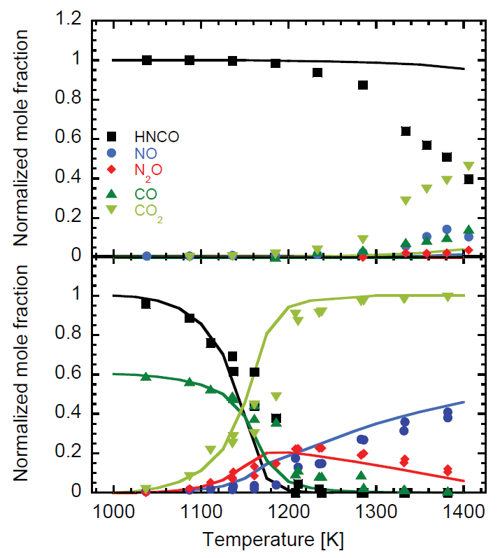

**图20：HNCO在流动反应器中氧化的实验数据[159]与模型预测的比较。上图：无CO存在；下图：有CO存在。**

图20（上图）显示了在无可燃物存在下HNCO氧化的结果。在低于1250 K的温度下，HNCO的消耗非常缓慢。在1250 K以上，HNCO衰变更快，但在1400 K下，仅有约50%的入口量HNCO被消耗。HNCO的氧化导致 CO2 的浓度始终大于 CO。NO 和 N2O 构成了产物中相对较小的一部分。

该模型严重低估了HNCO的消耗速率。即使在高温下，预测的HNCO氧化速率较低，是因为在这些条件下HNCO的主要氧化途径是链终止。OH自由基是主要的链载体，HNCO主要通过与反应 (R48) (HNCO + OH) 消耗，生成 NCO 和 H2O。NCO自由基通过与 O 反应 (R40) 以及与 O2（在高温下可能）反应 (R41) 被消耗。这些反应是链终止反应，并抑制了氧化过程。异氰酸酯的氧化在1400 K下也可以忽略不计，如果它仅通过此序列进行的话。观察到的HNCO消耗以及 CO2 而不是 CO 的形成，支持了HNCO与另一种稳定物种反应的重要性，即 O2 (R49), H2O (R50), 或 HNCO (R51)。然而，所有这些步骤似乎都太慢，无法解释观察到的反应。HNCO异构体的形成可能会像HCN中观察到的那样增强氧化（见3.4节）。HNCO的异构化途径已被多个研究组[108, 179, 180]进行过理论研究，他们发现生成 HOCN 的途径在能量上最为有利。然而，整体势垒高度约为 90 kcal mol^-1，这对于当前温度下的过程来说太高了。尽管石英表面被认为是惰性的[158, 160, 181]，但不能排除通过表面的多相反应促进氧化。

图20（下图）显示了有 CO 存在时HNCO氧化的结果。CO 对HNCO氧化的影响类似于其对HCN氧化的效果，后者在3.4节中讨论。CO 的存在显著增强了HNCO的消耗速率，异氰酸在1200 K下已被完全氧化，形成了相当数量的 NO 和 N2O 以及 N2。模型很好地描述了这些观察结果。预测的反应起始点略微偏早，但产物浓度与实验吻合良好。

CO 氧化化学起到了补充自由基库的作用，并将化学反应推向更低的温度。与HCN氧化中看到的类似，这是通过CO + OH ⇌ CO2 + H 的链分支序列发生的。

H + H + O2 ⇌ O + OH，O + H2O ⇌ OH + OH。CO 的氧化因链终止NCO反应的存在以及CO与HNCO对OH自由基的竞争而受到轻微抑制。因此，只有在大部分HNCO耗尽之后，CO才会进入快速氧化阶段。

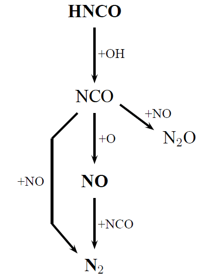

**图21：贫燃条件下的HNCO氧化反应路径图。路径：HNCO --(+OH)--> NCO；NCO --(+O)--> NO --(+NCO)--> N2；NCO --(+NO)--> N2O。**

图21展示了在有CO存在时HNCO氧化途径的示意图。异氰酸主要通过反应R49（HNCO + OH）被消耗，生成NCO。NCO自由基随后要么与O反应生成NO（R40），要么与NO反应生成N2O（R42）和N2（R43）。在高于1250 K的温度下，N2O的生成减少，而消耗反应，特别是热分解，变得具有竞争性，导致N2O减少。

与HCN类似，该模型中HNCO氧化子集的可靠性对于大多数实际应用已足够。在燃烧系统中，HNCO仅是一种次要的活性含氮物种，由固体燃料的挥发分释放或氰化物的部分氧化形成。HNCO氧化化学中的不确定性主要与在无其他燃料存在时的缓慢氧化有关。

然而，正如在第4.1.2节详细讨论的那样，由三聚氰酸或尿素对NO进行的选择性非催化还原对HNCO子集敏感，此处的化学不确定性限制了该模型的预测能力。

### 3.6 氨（NH3）的氧化

氨是燃烧过程中的关键挥发态氮物种。它在固体燃料的挥发分释放过程中形成[3]，或在更高温度下由氰化物转化形成[1,3,131,157]。在富燃-贫燃转换的分级燃烧过程中，NH3（而非HCN）主导氮化学并控制着生成NO和N2的选择性[182]。

许多关于氨氧化化学的模拟研究和综述已有报告，例如[1,19,48,146,183-185]。此外，氨与NO反应的选择性非催化还原化学已被广泛研究（见第4.1.1节）。然而，可靠氨氧化模型在燃烧和烟气脱硫脱硝中的开发部分受到关键反应问题的阻碍，特别是NH2 + NO反应的分支分数和NNH的寿命[1,19]，部分受到氨对表面强烈敏感性的影响，这可能会限制反应器实验的准确性（见附录A）。

#### 3.6.1 氨氧化反应的子集

表9列出了化学动力学模型中胺子集中的选定反应。该子集主要基于Klippenstein等人的近期工作[19]，其又借鉴了之前的模拟研究[22,48,186-189]。对于氨子集中的许多关键反应，速率常数已由Klippenstein及其同事使用高级理论计算得出。这些包括NH2 + NO [190,191]和NH2 + NO2 [192]（包含在ONNH势能面上(NH + NO, NNH + O, N2O + H) [19]的反应）、氨基（NH2）与氧（NH2 + O [19]）以及亚氨基（NH）与氧（NH + O2 [19]）的反应，氨基（NH2）与羟基（NH2 + OH [193]）的反应。

在没有碳氢化合物的情况下，氨主要通过O/H自由基池的H抽取反应被大量消耗(R53-R55)；这些步骤均在整个宽温度范围内通过实验确定。随后的NH2自由基反应对NH3的消耗速率以及生成NO和N2的选择性具有巨大影响。由于NH2对O2的低反应性，在存在极少量NO时，NH2 + NO反应是关键步骤。由于该反应在SNCR工艺（第4.1.1节）中的重要性，过去已对其进行了广泛研究[203]。整个NH2 + NO反应的阿伦尼乌斯图如图22所示。该反应已在全温范围内进行了测量，数据符合良好。

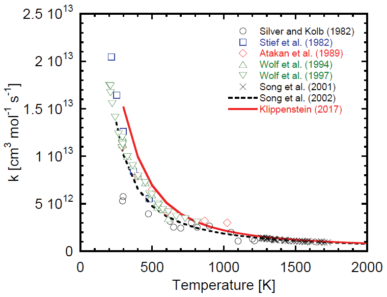

**图22：NH2 + NO 反应的阿伦尼乌斯图。**

**表9：NH3氧化子集选定的反应。用于改进Arrhenius公式 k=AT^βexp(-E/[RT]) 的参数。单位为mol, cm, s, cal。**

| 编号 | 反应 | A | β | E | 来源 |
| :--- | :--- | :--- | :--- | :--- | :--- |
| 52. | NH2 + H ⇌ NH3(+M) | 1.6E14 | 0.000 | 0 | [194] |
| 低压极限: | 3.6E22 | -1.760 | 0 | |
| Troe参数: 0.5 1.0E-30 1.0E30 | | | | |
| 53. | NH3 + H ⇌ NH2 + H2 | 6.4E05 | 2.390 | 10171 | [195] |
| 54. | NH3 + O ⇌ NH2 + OH | 9.4E06 | 1.940 | 6460 | [196] |
| 55. | NH3 + OH ⇌ NH2 + H2O | 2.0E06 | 2.040 | 566 | [197] |
| 56. | NH2 + HO2 ⇌ NH3 + O2 | 1.7E04 | 1.550 | 2027 | [198] |
| 57. | NH + H2 ⇌ NH2 + H | 2.1E13 | 0.000 | 15417 | [199] |
| 58. | NH2 + O ⇌ HNO + H | 6.6E14 | -0.500 | 0 | 见正文 |
| 59. | NH2 + O ⇌ NH + OH | 7.0E12 | 0.000 | 0 | 见正文 |
| 60. | NH2 + OH ⇌ NH + H2O | 3.3E06 | 1.949 | -217 | [19,193] |
| 61. | NH2 + HO2 ⇌ H2NO + OH | 2.5E17 | -1.280 | 1166 | [198] |
| 62. | NH2 + O2 ⇌ H2NO + O | 2.6E11 | 0.487 | 29050 | [19] |
| 63. | NH2 + O2 ⇌ HNO + OH | 2.9E-2 | 3.764 | 18185 | [19] |
| 64. | NH2 + HNO ⇌ NH3 + NO | 5.9E02 | 2.950 | -3469 | [200] |
| 65. | NH2 + NO ⇌ NNH + OH | 4.3E10 | 0.294 | -866 | [201] |
| 66. | NH2 + NO ⇌ N2 + H2O | 2.6E19 | -2.369 | 870 | [201] |
| 67. | NH2 + NO2 ⇌ N2O + H2O | 2.2E11 | 0.110 | -1186 | 见正文 |
| 68. | NH2 + NO2 ⇌ H2NO + NO | 8.6E11 | 0.110 | -1186 | 见正文 |
| 69. | NH + O2 ⇌ HNO + O | 4.6E05 | 2.000 | 6500 | [202] |
| 70. | NH + O2 ⇌ NO + OH | 1.3E06 | 1.500 | 100 | [202] |
| 71. | NH + NO ⇌ N2 + OH | 6.8E14 | -0.780 | 20 | 见正文 |
| 72. | H2NO + O2 ⇌ HNO + HO2 | 2.3E02 | 2.994 | 16500 | 见正文 |
| 73. | HNO + O2 ⇌ NO + HO2 | 2.0E13 | 0.000 | 16000 | [146] |

总体上在约两倍因子以内。Song等人[204]基于实验的值和Klippenstein[191]的理论速率常数，两者都精确地代表了现有测量数据，略低于我们近期建模工作[19]中使用的Miller和Glarborg[188]的值。

**图22：反应 NH2 + NO → 产物的阿伦尼乌斯图。符号表示速率常数的测量值，而线条表示理论值。数据来源于Silver和Kolb[205]、Stief等[206]、Atakan等[207]、Wolf等[208,209]、Song等[201,204]和Klippenstein[191]。**

NH2 + NO 反应有两个产物通道：

NH2 + NO ⇌ NNH + OH (R65)
NH2 + NO ⇌ N2 + H2O (R66)

反应R65是链分支反应，而R66是链终止反应。因此，模型预测对该反应的分支分数非常敏感，定义为 α = k65 / (k65 + k66)。图23将分支分数的实验数据与Miller和Klippenstein[190]以及Klippenstein[191]的理论比值进行了比较。近期的实验数据[201, 204, 210-213]和理论值非常一致。

在本工作中，我们采用了Song等人[201]对反应R65和R66的速率常数。他们的分支比被选择为与Miller和Klippenstein[190]的理论值匹配。在Thermal DeNOx工艺的温度窗口（约1250 K）内，该值略低于Klippenstein[191]的CASPT2计算值（见图23）。由于建模预测对α在Thermal DeNOx中具有极高的敏感性，即使很小的变化也有显著影响（见4.1.1节）。

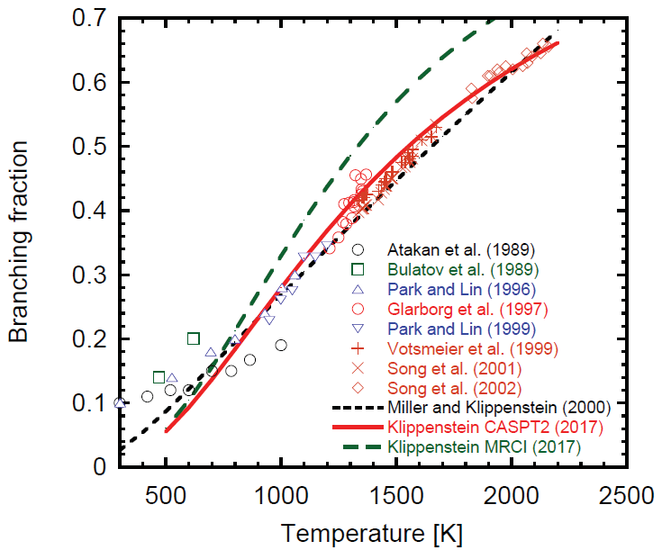

**图23：反应 NH2 + NO → 产物的分支分数阿伦尼乌斯图，定义为 α = k65 / (k65 + k66)。符号表示测量值，而线条表示理论值。数据来源于Atakan等[207]、Bulatov等[214]、Park和Lin[210,211]、Glarborg等[212]、Votsmeier等[213]、Song等[201,204]、Miller和Klippenstein[190]以及Klippenstein[191]。Klippenstein的分支分数基于以下速率常数：k65 = 6.2×10^15 T^-1.150 exp(-1267/T); k66 = 1.2×10^20 T^-2.576 exp(-365/T) (CASPT2); k65 = 1.3×10^16 T^-1.216 exp(-1360/T); k66 = 3.3×10^21 T^-3.029 exp(-588/T) (MRCI+Q)。**

在大过剩空气比下，HO2 自由基可能大量形成，促进NO氧化为NO2。这通过反应 NO + HO2 ⇌ NO2 + OH 发生，该反应的正向[26,215]和逆向[216]方向均已得到很好的表征。NH2 + NO2 反应已在很宽的温度范围内得到研究。与NH2 + NO类似，它有两个主要产物通道：

NH2 + NO2 ⇌ N2O + H2O (R67)
NH2 + NO2 ⇌ H2NO + NO (R68)

总体速率常数的值已在很宽的条件范围内报道[192,217-226]，但数据的分散度相当大。然而，尽管500 K下的数据相差超过一个数量级（图24），大多数最近的测定结果相当一致。Klippenstein等人[192]计算的速率常数很好地描述了1000 K以下的大部分数据，但比Song等人[226]的高温（1300-1600 K）激波管测定低三倍。在本工作中，我们采用了Glarborg等人[223]的总体速率常数，该值与Song等人和Klippenstein等人的速率常数在其不确定度范围内兼容。

NH2 + NO2 反应的分支分数（定义为 k67 / (k67 + k68)）也一直在讨论中，但大多数研究支持约20%的值[223,225-229]，与Klippenstein等人[192]的理论分析一致。

NH2 的竞争消耗步骤包括与O/H自由基池的反应（R57-R61）、与胺自由基反应生成N2-胺，以及在高的过剩氧水平下与O2的反应（R62, R63）。NH2 + H 反应（R57b）已在高温下以正向[230,231]和逆向[199,232]方向测量。NH + H2 反应[199,232]的数据在很宽的温度范围内高度一致，并与k57b的唯一低温测量值[233]一致。NH2 + O 反应（R58, R59）仅在低温下测量过，其总体速率常数已被证明是快的[234-236]，且HNO + H (R58) 是主要的产物通道，NH + OH (R59) 有次要贡献[234,235]。基于Temps的未发表数据（由Miller等人[183]引用），我们假设反应R58具有 T^-0.5 的温度依赖性。由于NH2 + O 反应对高温下NH3生成NO很重要，因此需要对该步骤在高温下的速率进行测量。NH2 + OH 反应（R60）已由Klippenstein等人[193]进行了实验和理论研究。

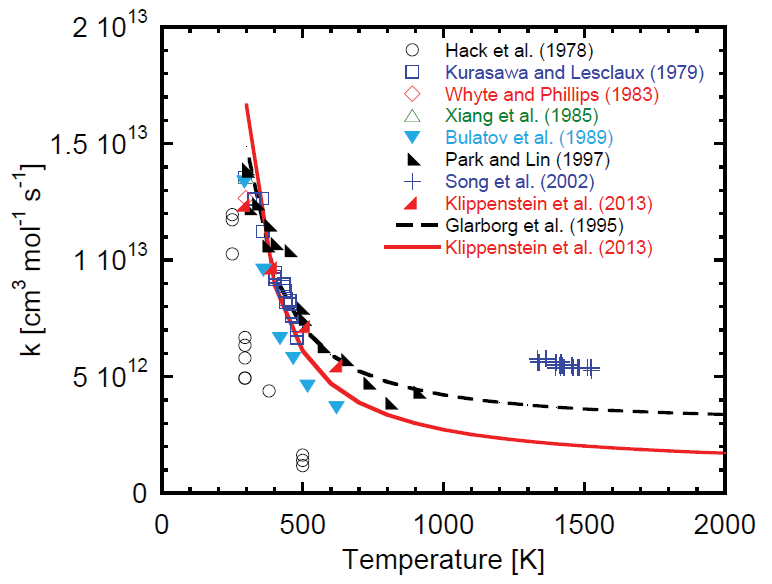

**图24：反应 NH2 + NO2 → 产物的阿伦尼乌斯图。符号表示速率常数的测量值，而线条表示理论值。数据来源于Hack等[217]、Kurasawa和Lesclaux[218]、Whyte和Phillips[219]、Xiang等[220]、Bulatov等[221]、Park和Lin[225]、Song等[226]、Klippenstein等[192]以及Glarborg等[223]。**

NH自由基（由NH2的氢原子抽取形成）可以与NO反应生成N2O (R17) 或N2 (R71)，如3.3.1节所讨论，或者与O2反应生成NO：

NH + O2 ⇌ NO + OH (R70)

NH + O2 ⇌ HNO + O (R69)

在氨氧化过程中，不同消耗反应之间的竞争对生成NO或N2的整体选择性很重要，特别是在较高温度下。

在高O2浓度[19]或高压[237]条件下，亚硝酰（H2NO）可能由NH2与HO2或NO2的反应大量生成。该反应机理中关于H2NO的部分尚未完全确立，且主要包含具有估算速率常数的反应。其中最重要的反应是与O2的反应：

H2NO + O2 ⇌ HNO + HO2 (R72)

此反应没有可用的实验数据。最近，Song等人[237]通过从头算理论对该反应进行了理论研究，计算了其速率常数。为了便于在高氧浓度下对NH3氧化和热DeNOx进行建模预测，我们将反应(R72)的活化能降低了2.5 kcal mol^-1；这一变化在计算出的能垒高度的估算不确定度范围内。

此外，对于HNO，与O2的反应(R73)是一个重要的消耗步骤。对于此反应，我们依赖于从QRRK理论[146]导出的速率常数。目前仍需要对HNO + O2和H2NO + O2这两个反应的速率常数进行实验测定。

#### 3.6.2 氨氧化的建模

过去，人们广泛地研究了氨的氧化问题，包括实验研究和建模研究。实验工作包括对火焰[238-245]、激波管[185, 246-253]和流动反应器[136, 140, 237, 254, 255]的研究。

由于表面反应可能对NH3氧化中的诱导时间产生影响，即使是对于石英（参见[254]和附录A），流动和间歇反应器实验在用于模型验证时也必须谨慎使用。因此，我们补充流动反应器数据，并使用在预混火焰和激波管中进行的实验结果来验证NH3氧化机理子集。

遵循Miller和Bowman[1]的工作，我们将模型与Bian等人[244]的低压火焰数据进行比较。他们在减压（35 Torr）下测量了在接近等摩尔氨-氧混合物中燃烧的火焰结构，采用分子束采样技术耦合质谱仪。图25将测量的物种分布与模型预测进行了比较。

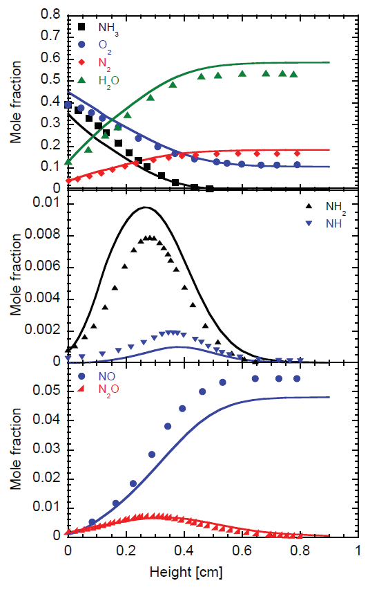

**图25：低压预混氨/氧火焰中稳定物种和选定自由基的测量[244]与预测摩尔分数的比较。符号代表实验数据，而实线代表计算值。条件：压力35 Torr；入口成分48% NH3, 51% O2, 和1% Ar。气体速度为60.8 cm s^-1，峰值火焰温度约为2250 K。上图：NH3（方块）、O2（圆点）、N2（菱形）、H2O（三角形）；中图：NH2（上三角）、NH（下三角）；下图：NO（五角星）、N2O（倒三角）。横轴为高度[cm]，纵轴为摩尔分数。**

总体而言，实验结果与模型预测之间的一致性良好。反应物（NH3, O2）和产物（NO, N2O, N2和H2O）的浓度预测非常准确，而胺自由基NH2和NH的计算值在实验不确定度范围内。仅有的重大差异（未显示）出现在HNO和N上，两者的预测值均被严重高估。

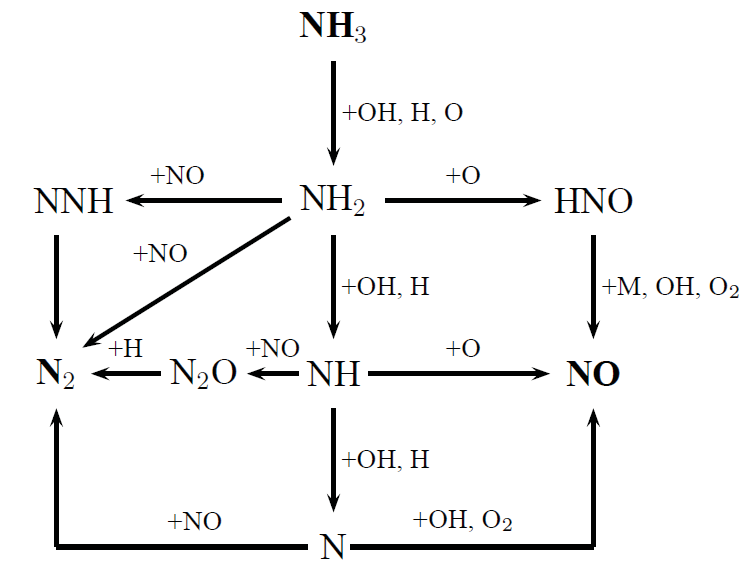

**图26：NH3氧化反应路径图。图中展示了以NH3为起点，通过与其他物种（如 +OH, H, O, +NO, +H, +M, OH, O2）反应生成NH2, HNO, NH, NNH, N2O, NO, N2等中间体的完整路径。**

图26展示了NH3氧化的反应路径图。氨通过与自由基池反应转化为NH2。NH2自由基可能通过序列 NH2 --(+OH,H)--> NH --(+OH,H)--> N 转化为NH和N；随着温度升高，这些反应变得更具竞争性。随后，NH自由基可能与NO反应生成N2，或与O、OH或O2反应生成NO。氨氧化中生成NO或N2的选择性取决于胺自由基与NO或与O/H自由基池（或O2）反应之间的竞争。

Mathieu和Petersen[185]测量了作为当量比和压力函数的NH3的着火延迟时间。在图27中，他们在1.4 atm下的结果与模型预测进行了比较。计算结果与贫燃和富燃条件下的测量结果一致，但奇怪地在化学计量条件下表现出更大的偏差。正如Mathieu和Petersen所指出的[185]，预测的NH3着火延迟时间对机理中的N2Hx子集非常敏感。该子集相当不确定，因此希望进一步研究N2-胺化学。

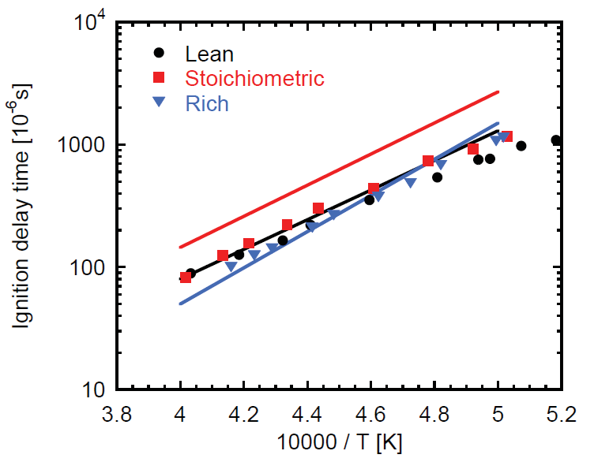

**图27：NH3在1.4 atm下的着火延迟时间：测量值[185]（符号）与模型预测（线）的比较。**

即使在少量NO存在的情况下，NH3的氧化也开始对引发反应不敏感，并且表面效应在流动反应器实验中降至最低[1, 159]。图28显示了在存在NO的情况下（NO浓度在25-100 ppm范围内变化），而NH3和O2入口水平分别维持在1000 ppm和40%时NH3氧化的结果[256]。反应起始温度与NO浓度水平无关。即使在最小的NO浓度25 ppm时，也在起始温度上方观察到NO的极小值，并且检查数据表明，在极小值处的NO的分数转化在广泛的NO水平（从25到100 ppm）下相当相似。在较高温度（>1200 K）下，出口NO浓度渐近地趋近于一个与入口水平无关的值。Lyon和Benn[257]也报道了类似观察结果。模型预测很好地捕捉到了所有这些趋势。

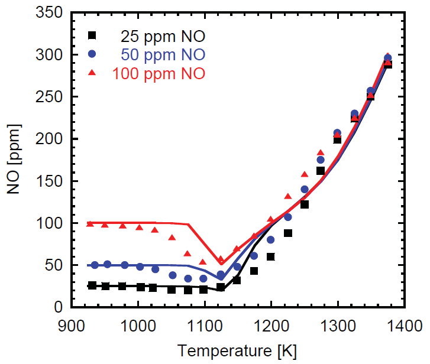

**图28：添加NO时NH3在流动反应器中的氧化：测量值[256]（符号）与模型预测（线）的比较。入口条件：NH3 = 1000 ppm，O2 = 40%，NO = 25-100 ppm，其余为N2。**

与火焰结构数据（图25）、激波管着火延迟（图27）和流动反应器数据（图28）的比较表明，重要的

**图27：氨气（NH3）和氧气（O2）在氩气（Ar 99%）中混合物的实验点火延迟时间[185]及预测值，作为当量比（贫燃φ=0.5，化学计量φ=1.0，富燃φ=2.0）和温度的函数。数据是在1.4 bar压力下通过激波管获得的。符号代表实验数据，实线代表模型预测。**

氨气氧化的特性，包括形成NO和N2的选择性，均被该模型很好地描述。然而，在燃烧过程中，由燃料氮形成的氨气通常仅以少量存在，与其他可燃物相比。这些可燃物的氧化化学将控制链载体的生成，并且在还原条件下，烃类/胺类相互作用可能很重要。

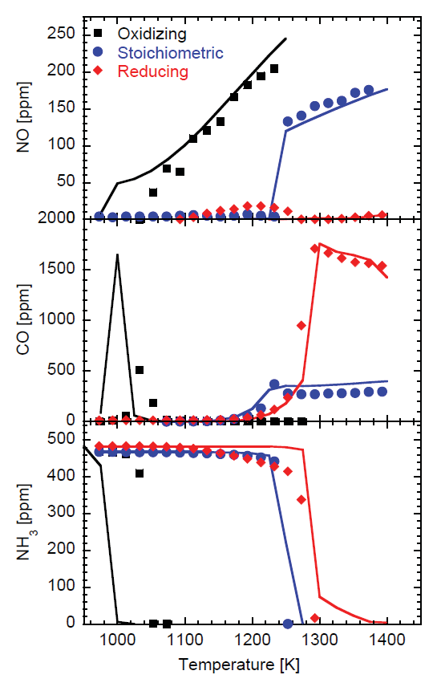

**图29：掺混甲烷（CH4）和氨气（NH3）的混合物作为当量比和温度函数的氨气氧化实验数据[22]与模型预测比较。符号代表实验数据，实线代表模型预测。入口浓度（还原φ=0.13 / 化学计量φ=1.07 / 氧化φ=0.13）：CH4 = 2508 / 2513 / 2513 ppm，O2 = 3480 / 5040 / 40100 ppm，NH3 = 484 / 468 / 468 ppm；余量为N2。所有实验均在1.05 atm下于内径12 mm的氧化铝反应器中进行，等温区的停留时间为1296/T(K)。**

图29将模型预测结果与Mendiara和Glarborg[22]掺氨甲烷（CH4）气流反应器中的氧化实验结果进行了比较。这些实验条件预期更能代表实际燃烧系统。甲烷入口水平约为2500 ppm，氨气约为500 ppm。化学计量比对NO的形成具有主要影响。在富燃条件下，生成的NO量可忽略不计。CO在1230 K以上形成，并在温度接近1300 K时达到平台水平。

氨气氧化始于1130 K，但在甲烷完全转化为CO之前，NH3的消耗速率较慢。对于化学计量条件，反应的起始发生在略低的温度。NO在氨气（NH3）消失后形成，在1400 K时达到180 ppm的水平，然后趋于平稳。CO表现出在1230 K时的峰值，然后达到平台。对于贫燃条件，反应在更低的温度下启动。CO已在1030 K达到峰值，并且在1075 K以上未观察到CO。在大约1050 K时，随着氨气（NH3）的耗尽，NO形成。NO浓度随温度升高可达1250 K，然后趋于平稳。

模型预测总体而言与实验结果吻合良好。该模型很好地捕捉了甲烷和氨气氧化的启动以及NO形成的开始，除了贫燃条件下起始温度的预测存在偏差（起始温度预测偏低）。在温度和化学计量的整个范围内，形成的NO量预测得相当准确。

烃类的存在为NH3开辟了额外的氧化途径，相对于图26中的图示。这些相互作用在其他地方有更详细的讨论[22, 131, 189]。特别是，甲基自由基起活跃作用，将胺自由基转化为烃类胺：

CH3 + NH2(+M) ⇌ CH3NH2(+M)
CH3 + NH ⇌ CH2NH + H

以及氢氰酸转化为乙腈：

CH3 + HCN ⇌ CH3CN + H

图29中显示的准确性水平可能代表了该模型在模拟氨气氧化、特别是在大多数实际系统中形成NO和N2的选择性方面的可靠性。这是令人鼓舞的，因为NH3可以被视为气相中最重要的燃料氮物种。然而，NH3与烃类氧化化学的相互作用，特别是在还原条件下，相当复杂[22, 131, 189]，该化学中的不确定性可能会限制还原条件下模型预测的准确性。

# 4 氮氧化物的原位还原

随着关于氮氧化物排放的立法日益严格，基于分段燃烧的基础措施可能变得不足，这使得采用催化烟气净化或原位控制技术等方法变得必要，例如选择性非催化还原（SNCR）或再燃烧技术。SNCR [1, 152, 258, 259] 和再燃烧 [21, 260-273] 已得到广泛研究。它们作为商业技术可用，通常能提供约50%的NOx削减率[274]。在接下来的章节中，将概述这些过程的化学原理，并评估模型在描述NO还原方面的可靠性。

## 4.1 氮氧化物的选择性非催化还原

选择性非催化还原NO（SNCR）被广泛用于生物质和废料等燃料燃烧过程中的NOx控制，其中催化剂中毒可能导致催化净化技术成本过高。用于与NO反应的还原剂有氨、尿素和三聚氰酸。也有人提出了硫酸铵[274]，但关于该还原剂的性能知之甚少。

### 4.1.1 氨（NH3）为还原剂的SNCR（热DeNOx）

使用NH3作为还原剂的选择性非催化NO还原过程是由Lyon[258]开发的，他将此过程称为热DeNOx。热DeNOx的化学原理已被广泛研究[1, 19, 187, 188, 258, 259, 275-277]。该过程的特征是，只有在以1250 K为中心的狭窄温度范围内，并且只有在有氧存在的情况下，才能去除一氧化氮。在低于1100 K的温度下，反应速度过慢，无足轻重；而在高于1400 K时，NH3会氧化成NO而不是N2。

热DeNOx的动力学模型与前述部分讨论的H/N/O化学的模型相同。目前采用的子集（主要基于Klippenstein等人[19]）与先前的热DeNOx动力学模型（例如，[1, 188]）之间的主要区别在于，过程中的链分支现在主要受到NH2 + NO反应的小分支分数α的限制，而不是由NNH与O2或NO的反应决定。遵循Klippenstein等人[19]，我们采用NNH寿命为10^-9 s的值，这比建模中常用的值要低得多。该值对应于 k20 = 1x10^9 s^-1。快速离解的速率下限可估计为约2x10^8 s^-1。对NNH离解速率（R20）的准确测定，对于建模氨氧化和选择性非催化还原NO将非常有价值。

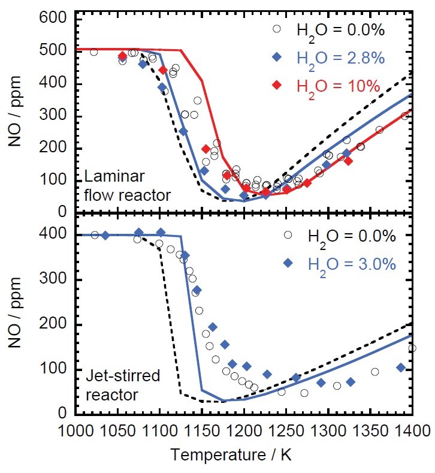

**图30：氨（NH3）还原NO的实验数据[276, 278]与模型预测的比较：水（H2O）浓度的影响。符号代表实验数据，实线代表模型预测。上图（层流石英管反应器[278]）：入口浓度：NH3 = 832 ppm，NO = 507 ppm，O2 = 4.0%，H2O = 0%或2.8%或10%，平衡N2。停留时间(s) = 92.7/T(K)。下图（搅拌式反应器[276]）：入口浓度：NH3 = 960 ppm，NO = 400 ppm，O2 = 0.8%，H2O = 0%或3%，平衡N2。标称停留时间(s) = 370/T(K)。**

图30比较了热DeNOx过程的实验结果和模拟结果。上图显示在层流反应器中[278]获得的数据，而下图中的数据是在一个搅拌反应器[276]中获得的。尽管反应条件不同，但两种反应器构型中的工艺温度窗口相似。水蒸气的存在似乎只对工艺产生有限影响。

目前的模型对实验结果提供了令人满意的预测，尽管它预测的H2O的影响比实验中观察到的更大。虽然在有水蒸气的情况下NO的预测相当准确，特别是对于流动反应器条件，模型倾向于低估反应起始温度（在无水H2O的情况下）。这种差异的原因尚不清楚。在干燥条件下反应器壁上的原子氧损失可能扮演了一定角色；这在附录A中有讨论。预测的水蒸气抑制作用主要是由于反应 H + O2 + M → HO2 + M 中的高碰撞效率。目前，碰撞效率是基于低温测量的，但它可能具有相当大的温度依赖性。

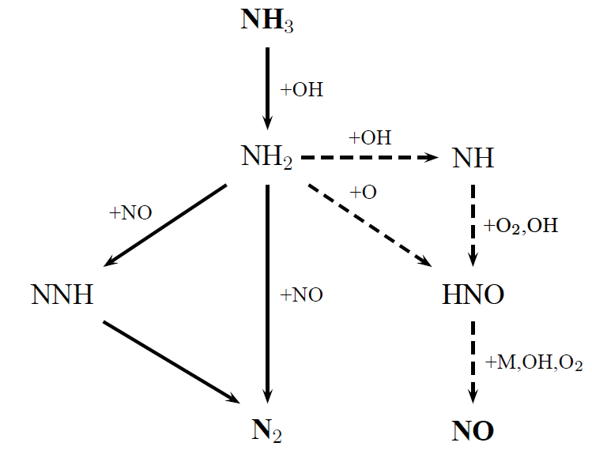

**图31：热DeNOx过程的反应路径图。虚线表示仅在高温下重要的路径。**

图31显示在水蒸气存在下热DeNOx过程的反应路径图。氨通过与O/H自由基池（主要是OH，R55）反应转化为NH2。随后NH2和NO之间的反应是该过程的关键步骤。该反应必须同时去除NO并产生游离自由基以维持反应[1, 19]。如上所述，它有两个产物通道：

NH2 + NO ⇌ NNH + OH (R65)
NH2 + NO ⇌ N2 + H2O (R66)

NNH的分解引发了一系列反应，确保了反应(R65)导致三个羟基自由基的净形成[1, 19]：

NNH ⇌ N2 + H (R20)
H + O2 ⇌ O + OH
O + H2O ⇌ OH + OH

为了使整体过程自维持，NH2 + NO反应的分支分数 α = k65 / (k65 + k66) 必须至少为25%。早期的实验[207, 279]表明较小的分支分数，但现在已充分证实，α在1100-1400 K范围内达到0.3-0.4的值（图23）。

该过程在高温端受到链分支循环的限制

发生得太快，从而导致O/H自由基库的强烈增长。这促进了NH2向NH的转化：

NH2 + OH ⇌ NH + H2O (R60)

这变得与NH2 + NO反应竞争。形成的NH通过序列 NH --(+O2)--> HNO --(+M,OH,H2O)--> NO 部分氧化为NO。另外，NH2 + O反应（R58，R59）也有助于NO的形成。在足够高的温度下，通常在1400 K左右，这些反应导致NO的净生成。

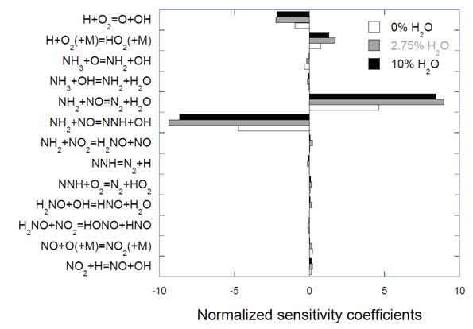

**图32：Thermal DeNOx过程中NO预测的灵敏度系数，基于Duo[278]实验条件，作为水蒸气浓度的函数（反应起始温度以上的温度）：0%（1100 K）、2.75%（1125 K）、10%（1150 K）。**

图32显示了Duo实验条件（图30）下NO的灵敏度分析。结果显示了在水蒸气浓度为三个温度下，略高于过程起始温度并低于NO还原最佳温度的结果。链分支反应增强了还原，而终止反应抑制了它。反应R65，NH2 + NO → NNH + OH，有利于NO还原；而反应R66，NH2 + NO → N2 + H2O，则是不利的。同样，但灵敏度系数要小，H + O2 → O + OH促进了反应，而H + O2 (+M) → HO2 (+M)则抑制了NO的还原。

NH2 + NO反应的灵敏度系数，特别是对于反应分支分数 α = k65/(k65 + k66) 来说非常大，显示出了热DeNOx机制对该参数的异常高灵敏度。除了H + O2反应外，机制中的其他步骤几乎不那么重要。

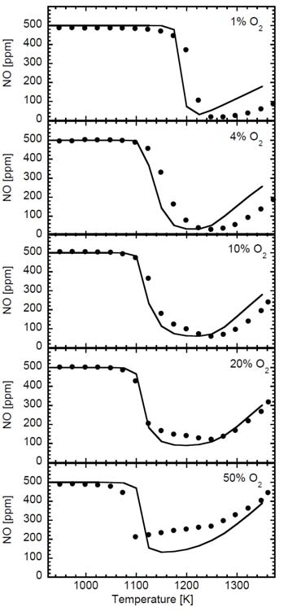

**图33：石英管式反应器中NH3还原NO的实验数据[280]与建模预测的比较：O2浓度的影响。符号代表实验数据，实线代表建模预测。入口浓度：NH3 = 1000±60 ppm，NO = 500±30 ppm，H2O = 3%，其余为N2。停留时间(s) = 88.0/T(K)。反应器表面积/体积比为7.8 cm^-1。**

图33和34比较了Kasuya等人[280]实验数据的NO建模预测。他们进行了一系列管式反应器实验，研究了从接近零到50%的O2浓度对热DeNOx过程的影响，测量了NO、NO2和N2O。

图33显示了NO的结果。氧气浓度的增加将窗口向较低温度方向移动并扩大它。同时，最大NO去除量减少。Lu和Lu[277]报告了类似的结果。这些特性被模型很好地描述。与Klippenstein等人[19]观察到的类似，某些条件下预测的反应起始温度略有偏移。当前机制中NNH极短的寿命导致预测的起始温度比实验观察到的对O2水平的敏感度更低，但这种差异可能在实验不确定性范围内。

建模预测与测量结果在定性上一致，但预测的NO2窗口扩展到比实验观察到的更高温度。二氧化氮的形成是通过序列：

NNH + O2 ⇌ N2 + HO2 (R24)
NO + HO2 ⇌ NO2 + OH (R17)

HO2的形成，进而NO2，随后通过反应得到补充：

NH2 + NO2 ⇌ H2NO + NO (R68)

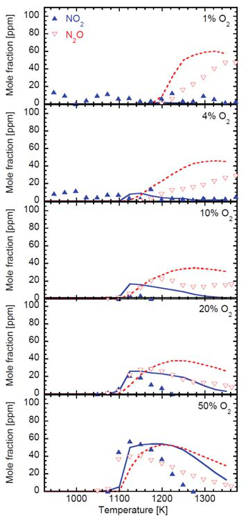

**图34：石英管式反应器中NH3还原NO的NO2和N2O形成实验数据[280]与建模预测的比较：O2浓度的影响。符号代表实验数据，实线代表建模预测。条件与图33相同。入口浓度：NH3 = 1000±60 ppm，NO = 500±30 ppm，H2O = 3%，其余为N2。停留时间(s) = 88.0/T(K)。反应器表面积/体积比为7.8 cm^-1。**

图34比较了与图33所示条件相符的NO2和N2O预测浓度与观测浓度。Kasuya等人是首次在热DeNOx过程中检测到NO2的人；目前认为NO2是该过程中的关键中间体[19, 187, 188]。发现在高O2浓度下形成了显著量的二氧化氮，但随着O2浓度的下降，其水平迅速降低。

H2NO + O2 ⇌ HNO + HO2 (R72)
HNO + O2 ⇌ NO + HO2 (R73)

HNO和H2NO与O2之间的竞争（两者的反应特性均已明确），以及其与自由基池的竞争，对于NO2的峰值浓度以及NO2形成的温度窗口的宽度都很重要[19]。

N2O的形成是温度和氧浓度的复杂函数。随着[O2]的增加，N2O的峰值从高温移向低温。在10% O2下，可以在N2O中检测到双峰，这表明两种N2O生成机制同时活跃。N2O的两个来源是反应[187, 188]：

NH2 + NO2 ⇌ N2O + H2O (R67)

主要在较低温度和较大[O2]下活跃，此时NO2易于获得，以及：

NH + NO ⇌ N2O + H (R17)

该反应在较高温度和较低的[O2]下与NH + O2竞争。与测量曲线的定性对比良好，但在NH + NO反应为主要来源的条件下，模型会高估N2O。

可燃物（如H2或CO）的存在会将NO去除的窗口向较低温度移动，因为它们能补充自由基池。此外，它导致过程窗口变窄，因为增强的自由基水平使得NH3氧化为NO的反应与NO去除反应更有效地竞争。这些效应在图35中进行了说明，该图比较了对CO添加对热DeNOx影响的模型预测与Alzueta等人[281]的实验结果。模型很好地捕捉到了起始温度的偏移以及温度窗口的变窄。

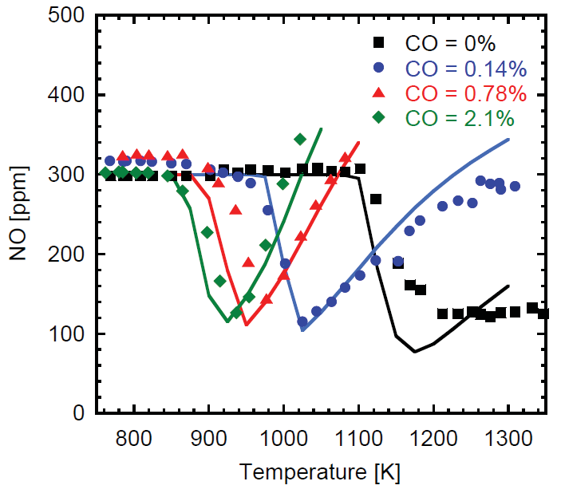

**图35：石英流动反应器中NO被NH3还原的实验数据[281]与模型预测的比较：CO浓度的影响。符号代表实验数据，实线代表模型预测。入口浓度：300 ppm NH3、300 ppm NO、4.0% O2、4.5% H2O，其余为N2。压力为1.1 atm。1200 K下的停留时间（恒定摩尔流量）约为150 ms。反应器表面积与体积比为4.4 cm^-1。**

尽管热DeNOx机理现已得到很好的理解，且模型能够满意地预测过程的主要特征，但在更广泛的条件下进行定量模型预测仍然困难。如3.6.1节所述，在本工作中，对某些关键反应的速率常数和分支比进行了重新评估，最重要的是NH2 + NO反应(R65, R66)。该反应可能是燃烧化学中表征最好的反应之一，两个产物通道的速率常数均从实验和理论上非常准确地测定。尽管如此，这种准确度(±10%)尚不足以保证对NO在热DeNOx过程中的预测。将分支比从0.37（最佳理论值[191]）下调至0.34（实验范围的下限），在1200 K时显著提高了过程的预测效果，使得反应起始温度提高了25-50 K。由于氮气化学中产物（NO, N2, N2O等）的选择性独特，这样微小的修正对预测产生了重大影响。建模预测热DeNOx的准确性也受其他反应中不确定性的限制，例如在增加的氧浓度下，步骤HNO + O2和H2NO + O2。

### 4.1.2 异氰尿酸的SNCR (RapReNOx)

异氰尿酸，(HOCN)3，可作为氨和尿素的SNCR替代剂。在600 K以上，异氰尿酸分解为异氰酸(HNCO)，其在足够高的温度下引发脱除NO的反应序列[152]。该过程由Perry[282]发现并命名为RapReNOx。与热DeNOx过程相比，RapReNOx在稍高的温度下效率更高，因为HNCO氧化具有自抑制性质（讨论见3.5节）。该过程的一个问题是氧化亚氮(N2O)的形成和可能的排放。

为研究该过程的特性，人们进行了大量关于HNCO还原NO的流动反应器研究[158-160, 181, 283]。Caton和Siebers[158]获得了最全面的数据，他们研究了温度和废气组成对过程的影响。Miller和Bowman[1, 152]、Lyon和Cole[160]以及Glarborg等人[159]报告了对RapReNOx过程的建模研究。这些研究提供了对HNCO还原NO的整体理解，但化学反应的细节仍不确定。

本研究中使用用于研究RapReNOx的化学集同3.4和3.5节中讨论的用于HCN和HNCO氧化的化学集相同。在建模中，假设异氰尿酸在过程相关的温度下瞬间分解。去除NO的关键反应是NCO + NO，它有两个产物通道：

NCO + NO ⇌ N2O + CO (R42)
NCO + NO ⇌ N2 + CO2 (R43)

总速率常数已在宽温度范围内测定[161, 284, 285]，主要的不确定性在于分支比。

我们采纳了Baulch等人[26]的建议，这基于Zhu和Lin的理论工作[153]。反应(R42)中形成的氧化亚氮可能从过程中排放，这对RapReNOx是一个关注点。

为了进行模型验证，我们将预测结果与Caton和Siebers[158]的流动反应器数据进行比较。他们系统地研究了初始浓度CO、H2O和O2的影响。他们的数据具有高HNCO/NO比和长反应时间特征，这促进了NO还原并拓宽了该工艺的温度窗口。然而，与混合条件、温度曲线以及氰尿酸分解相关的不确定性意味着，在模型评估目的使用时应持谨慎态度[152]。

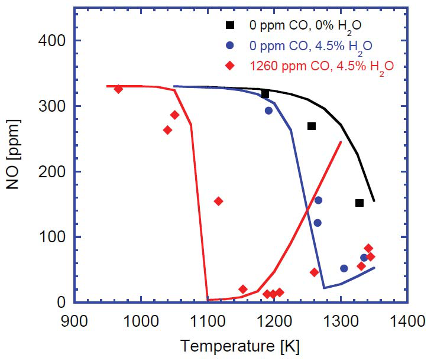

**图36：在石英流动反应器中RapReNOx过程的建模预测与实验数据比较：初始摩尔分数CO和H2O的影响。实验数据（取自Caton和Siebers[158]）以符号显示，建模预测以线条显示。入口摩尔分数：(HOCN)3 = 470 ppm，NO = 330 ppm，CO = 0或1260 ppm，O2 = 12.3%，H2O = 0或4.5%，其余为N2。反应时间为1200 K时0.72 s（恒质量流量）。表面积与体积比为1.2。在计算中，假设(HOCN)3瞬间转化为HNCO（1410 ppm）。**

图36展示了向过程中添加水蒸气和一氧化碳的效果。在缺乏H2O和CO的情况下，工艺窗口出现在高于1300 K的温度下。在这些条件下，原子氧是主要自由基，HNCO与O的反应同时产生NCO (R47)和NH (R46)。后续NCO + NO反应(R42, R43)是链终止反应。尽管该反应去除了NO，但它限制了NO的还原，将工艺推向更高温度。此外，序列 NO + O (+M) → NO2 (+M)，以及 NO2 + O → NO + O2 也是链终止并减慢反应的进行。NH自由基主要通过与O2和NO的反应来进行链式传播，其中NH + NO反应在干燥条件下对NO还原做出了相当大的贡献。

添加H2O使窗口向低温方向移动约50 K。水蒸气的存在导致链载体的主要转变是从O到OH，这是由于反应 O + H2O → OH + OH 所致，从而降低了涉及NO2的链终止序列的重要性。此外，HNCO与H2O之间的直接反应有助于促进反应进程，尽管其反应速率较慢。

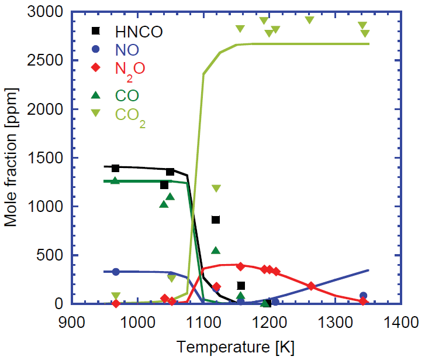

**图37：在石英流动反应器中RapReNOx过程的建模预测与实验数据比较。实验数据取自Caton和Siebers[158]，以符号显示，建模预测以线条显示。入口摩尔分数：(HOCN)3 = 470 ppm，NO = 330 ppm，CO = 1260 ppm，O2 = 12.3%，H2O = 4.5%，其余为N2。反应时间为1200 K时0.72 s（恒质量流量）。在计算中，假设(HOCN)3瞬间转化为HNCO（1410 ppm）。**

当CO作为可燃物被添加时，温度窗口进一步降低，反应起始于低于1100 K。图37展示了在这些条件下HNCO、NO、N2O、CO和CO2的实验数据与建模预测的比较。由于HNCO大大过量于NO，加上长滞留时间，该工艺的温度窗口异常宽，范围从1100 K延伸至超过1350 K。相当一部分NO转化为N2O；仅在最高研究温度1350 K时，N2O才被耗尽。

尽管HNCO子集的预测存在不确定性，但模型在存在可燃物的情况下，很好地描述了Caton和Siebers的数据[158]。而在较高温度端，一氧化氮通常预测偏高。窗口的N2O得到良好预测。然而，RapReNOx可靠实验数据的可用性有限，难以全面评估模型的预测能力。

### 4.1.3 尿素SNCR (NOxOut)

Muzio及其同事[286]提出的选择性非催化还原NO工艺以尿素为还原剂，被称为NOxOut工艺。在高温下，尿素迅速分解为NH3和HNCO[158]，因此该工艺的化学反应机理与热DeNOx和RapReNOx都存在重要的相似之处。与氨相比，使用尿素具有易于操作和减少安全隐患的优势。此外，尿素SNCR工艺具有比氨SNCR稍宽的温度窗口。该工艺的一个缺点是，与RapReNOx类似，也会形成氧化亚氮并最终排放到工艺中。

尿素SNCR工艺不像热DeNOx那样特征明显，尽管其商业影响力相似。通过严格定义的实验室条件获得的NOxOut实验数据有限，部分原因是尿素通常以固态或溶解在水的形式添加到反应器中。在实验室规模，流化床反应器实验已由Alzueta等人[287]和Lee等人[288]报道，而Rota等人[289,290]进行了搅拌槽反应器实验。

关于NOxOut工艺的化学动力学模型已有多组报告[287, 289, 291]。反应机理涉及尿素的分解反应，以及热DeNOx的H/N/O子集和RapReNOx的HNCO子集。关于尿素在高温下的分解以及代表SNCR工艺的高加热速率的数据有限，但结果表明反应速度很快[291,292]；我们假设其瞬间发生。当尿素以水溶液或固体形式加入时，分解可能发生在凝聚相中；报道的活化能为15-20 kcal mol^-1 [292]似乎过低，不适合气相解离。关于尿素凝聚相分解的细节仍有待验证，但基于热重分析（TGA）实验已经提出了一种初步的反应机理。

图38将模型预测值与Alzueta等人[287]在层流反应器中获得的数据，以及Rota等人[289]在喷射搅拌反应器中测量的数据进行比较。尽管反应器配置和尿素/NO摩尔比存在差异，但这两组数据相当一致。反应的起始（在没有可燃物的情况下）发生在约1150 K，并在约1250 K时观察到最高的NO还原。

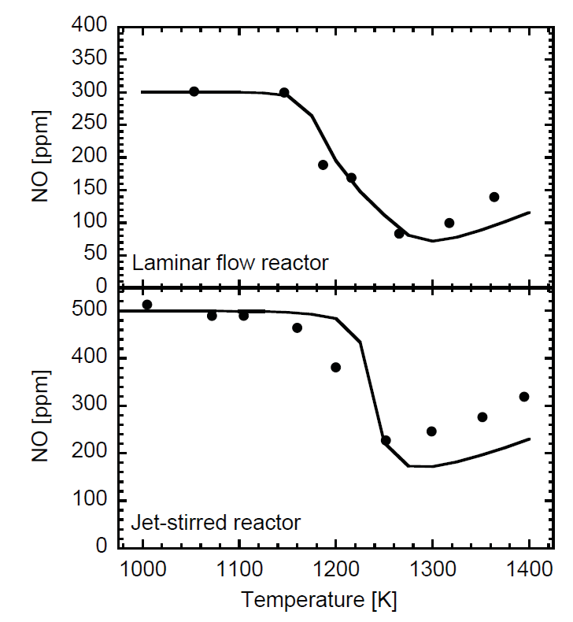

**图38：尿素还原NO的实验数据[287,289]与建模预测的比较。符号表示实验数据，实线表示建模预测。上图（层流石英管反应器(S/V = 2.3) [287])：入口浓度：尿素=150 ppm，NO = 300 ppm，O2 = 4.0%，H2O = 4%，其余为N2。停留时间(s) = 200/T(K)。下图（喷射搅拌反应器[289])：入口浓度：尿素 = 300 ppm，NO = 500 ppm，O2 = 4.0%，H2O = 19%，其余为N2。标称停留时间(s) = 200/T(K)。**

模型很好地捕捉了趋势，与实验的吻合度令人满意。NO预测的最小值出现在比观察值稍高的温度下，并且还原水平在高温下被高估，但差异不大。

类似于RapReNOx的情况，NOxOut的实验数据可用性有限，模型的预测能力难以评估。然而，可以预见预测中的不确定性将与Thermal DeNOx相似，因为是这个子集，特别是NH2 + NO反应的速率常数选择和NNH分解，控制着过程的温度窗口。

## 4.2 再燃烧（Reburning）

六十年前Myerson等人[294]发现烃自由基与NO快速反应。Wendt等人[295]概述了一种利用该反应的低NOx技术，并将该方法命名为再燃烧。在再燃烧中，通过使用燃料作为还原剂从燃烧产物中去除NO。通过将部分燃料和燃烧空气添加到后火焰区域而非主燃烧区，获得三级燃烧过程。第一阶段释放约80%的热量，通常在化学计量或过量空气下运行。再燃烧燃料（通常占总燃料的10-20%）在主燃烧区之后添加，形成富燃的第二阶段，在此阶段NO被还原。在再燃烧区下游添加二次燃烧空气以确保完全燃尽。

再燃烧过程已被广泛研究，包括实验和建模工作[296]。报道的实验工作包括来自流动反应器[21, 23, 265-267, 297, 298]、喷射搅拌反应器[100, 268, 270, 272]和低压火焰[299-303]的数据。再燃烧过程的阶段包括将再燃烧燃料混入来自主区的烟气中，再燃烧燃料的分解和火焰自由基的形成以与NO反应，以及将形成的氰基和胺类物种转化为分子氮。再燃烧化学相当复杂，与快速型NO和燃料型NO化学都有相似之处。尽管存在这种复杂性，已报道的再燃烧建模研究[1, 21, 23, 24, 262, 266, 268-273]通常提供了令人满意的结果，至少对于较小的烃类如此。

### 4.2.1 再燃烧反应子集

表10列出了模型中再燃烧子集的选定反应。在表征还原NO的反应方面已取得重大进展。在再燃烧过程典型的1200-1500 K范围内，主要是HCCO + NO、CH3 + NO和3CH2 + NO的反应在还原NO中起作用[21, 23]。在更高的温度下，例如在搅拌反应器或火焰中，NO主要由较小的碳氢自由基还原，即3CH2、CH和C[1]。其中许多步骤是复杂的多步反应。

**表10：再燃烧子集中的选定反应。用于修改后的Arrhenius表达式 k=AT^βexp(-E/[RT]) 中的参数。单位为mol, cm, s, cal。**

| 编号 | 反应 | A | β | E | 来源 |
|---|---|---|---|---|---|
| 74. | CH3 + NO ⇌ HCN + H2O | 1.5E-1 | 3.520 | 3950 | [304] |
| 75. | CH3 + NO ⇌ H2CN + OH | 1.5E-1 | 3.520 | 3950 | [304] |
| 76. | 3CH2 + NO ⇌ HCNO + H | 3.1E12 | 0.000 | -378 | [305,306] |
| 77. | 3CH2 + NO ⇌ HCN + OH | 3.9E11 | 0.000 | -378 | [305,306] |
| 78. | 1CH2 + NO ⇌ HCN + OH | 2.0E13 | 0.000 | 0 | 估计 |
| 79. | 1CH2 + NO ⇌ 3CH2 + NO | 1.0E14 | 0.000 | 0 | [307] |
| 80. | CH + NO ⇌ CO + NH | 9.1E12 | 0.000 | 0 | [26] |
| 81. | CH + NO ⇌ NCO + H | 1.8E13 | 0.000 | 0 | [26] |
| 82. | CH + NO ⇌ HCN + O | 7.9E13 | 0.000 | 0 | [26] |
| 83. | CH + NO ⇌ CN + OH | 1.1E12 | 0.000 | 0 | [26] |
| 84. | CH + NO ⇌ HCO + N | 6.8E12 | 0.000 | 0 | [26] |
| 85. | C + NO ⇌ CN + O | 2.0E13 | 0.000 | 0 | [307] |
| 86. | C + NO ⇌ CO + N | 2.8E13 | 0.000 | 0 | [307] |
| 87. | C2H3 + NO ⇌ HCN + CH2O | 7.0E21 | -3.382 | 1025 | [308] |
| 88. | C2H + NO ⇌ HCN + CO | 4.6E13 | 0.000 | 570 | [309,310] |
| 89. | C2H + NO ⇌ CN + HCO | 1.4E13 | 0.000 | 570 | [309,310] |
| 90. | C2 + NO ⇌ C2O + N | 2.3E13 | 0.000 | 8640 | [311] |
| 91. | HCCO + NO ⇌ HCNO + CO | 7.5E12 | 0.000 | -676 | [312-314] |
| 92. | HCCO + NO ⇌ HCN + CO2 | 2.1E12 | 0.000 | -676 | [312-314] |
| 93. | C2O + NO ⇌ CO + NCO | 1.0E14 | 0.000 | 670 | [315] |
| 94. | HCNO + H ⇌ HCN + OH | 7.2E10 | 0.841 | 8612 | [316] |
| 95. | HCNO + O ⇌ HCO + NO | 6.3E13 | 0.000 | 0 | [317] |
| 96. | HCNO + O ⇌ NCO + OH | 7.0E12 | 0.000 | 0 | [316] |
| 97. | HCNO + OH ⇌ CO + H2NO | 1.0E13 | 0.000 | -1490 | [318] |
| 98. | HCNO + OH ⇌ HCO + HNO | 6.0E12 | 0.000 | -1490 | [318] |

CH3和NO的反应有三个产物通道：

CH3 + NO(+M) ⇌ CH3NO(+M)

CH3 + NO ⇌ HCN + H2O (R74)
CH3 + NO ⇌ H2CN + OH (R75)

以往已在广泛研究过该反应，包括低温下（此时复合反应具有竞争性）和高温下（生成氰化物，反应式R74、R75）。在本文工作的温度范围内，CH3NO 络合物迅速解离，只有反应R74和R75用于去除NO。这两步的总体速率已相当确立。我们使用了由Miller等人[304]理论推导出的总体反应速率常数，该常数与高温实验数据[319,320]相符良好[21]，并伴有50%的分支分数。

CH2与NO之间的反应有两个主要产物通道，大致为：

3CH2 + NO ⇌ HCNO + H (R76)
3CH2 + NO ⇌ HCN + OH (R77)

尽管已有关于该反应速率和产物通道的多项实验研究[305,321-323]，但仍存在不确定性。特别是，Atakan等人[305]的静态反应器激光光解测量结果与Bauerle等人[323]在1000 K重叠温度下的激波管结果在总体速率常数以及产生OH通道的贡献方面差异显著。遵循Mendiara和Glarborg[23]，我们采用Atakan等人的总体速率常数，并使用Fikri等人[306]报告的分支分数。单重态CH2与NO的反应主要生成系间窜越至三重态3CH2，并伴随可能生成HCN的次要通道[21]。对于看起来有五个产物通道（R80-R84）的CH与NO的反应，我们依赖于Baulch等人[26]的建议。

烯酮基（ketenyl）与NO之间的反应为：

HCCO + NO ⇌ HCNO + CO (R91)
HCCO + NO ⇌ HCN + CO2 (R92)

已在多项实验研究中进行了表征[312-314,324-328]，总体速率常数和分支分数都已得到充分确立。分支分数的测量结果表明，HCNO + CO通道（R91）占主导地位，报告的产率为64-88% [313,314,326,327]。我们将Carl等人[312]报告的总速率系数测量值与报道的分支分数相结合，后者似乎与温度无关[313,314]，从而得到了本工作中使用的速率系数。

碳氢自由基与NO之间的反应大部分反馈入氰化物池，主要形成氢氰；氰化物化学将在第3.4节讨论。然而，HCCO + NO (R91) 和 3CH2 + NO (R76) 均形成HCNO，且该中间产物的命运对于NO还原效率至关重要。在早期的再燃建模工作[21]中，假设HCNO与O和OH的反应速度很快且均产生NO作为主要产物。后来，Miller等人[316]提出NCO作为HCNO + OH反应的替代产物。然而，最近的实验[318]和理论[329]研究工作表明，HCNO + OH反应主要形成H2NO (R97) 和HNO (R98)。因此，HCNO与O (R95) 和OH (R97, R98) 的反应在很大程度上将HCNO循环回NO，因此形成HCNO的反应对NO还原效率的影响很小。

### 4.2.2 再燃建模

尽管再燃过程已被广泛研究，但在实验室规模受控条件下获得的实验数据有限。出于本文目的，我们选取了来自完美搅拌反应器和流动反应器实验的数据。

Chen和Malte[330]在喷射搅拌流动反应器中研究了掺有NO的CH4/O2/N2混合物的燃烧。他们测量了随燃料-空气当量比和温度变化的NO、HCN和NH3排放。图39显示了他们测量的数据和建模预测在反应器温度为1580 K和1800 K时的比较。

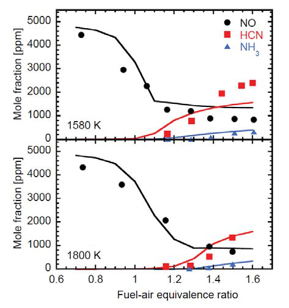

**图39：测量的[330]与预测的固定氮物种排放比较，背景为掺有5000 ppm NO的甲烷燃烧于搅拌反应器中。符号表示实验数据，实线表示计算值。反应器条件：1580 K或1800 K，名义停留时间9.0 ms，压力1.0 atm。**

再燃系统在两个研究温度下的行为相似。在贫燃条件下，60-100%的NO被排放；而在富燃条件下，NO排放明显较低，在燃料-空气当量比大于1.4时，仅占进口NO的20%以下。在此，大部分NO转化为氰化物，并伴有少量氨形成。存在一个总固定氮（TFN）的最低点，此处定义为基于当量比的HCN + NH3 + NO之和。TFN最低点在1580 K时发生在燃料-空气当量比低于1.2处，而在1800 K时，该最低点观察到的还原条件更强，φ ≈ 1.3。实验数据与建模预测之间的吻合良好。在整个当量比范围内，特别是较高温度下，NO、HCN和NH3的预测结果均很好。

竞争反应路径的重要性在很大程度上取决于实际的再燃条件，特别是再燃燃料、温度和化学计量。然而，所有结果都可以用三个最重要的总体步骤来解释：
- 再燃燃料的分解和碳氢自由基的形成
- 碳氢自由基与NO的快速反应，形成氰基物种
- 异氰酸和胺物种缓慢转化为N2和NO

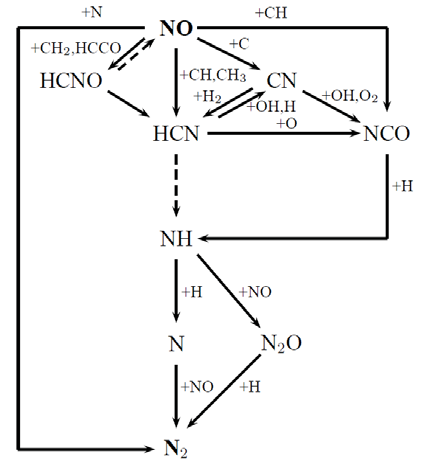

**图40：以甲烷为再燃燃料的再燃化学的反应路径图。**

图40展示了以甲烷为再燃燃料的再燃化学的反应路径图。氮氧化物通过广泛的碳氢自由基反应（主要是CH3、3CH2、CH、C和HCCO）转化为氰化物和异氰化物。在高自由基浓度（高温和/或喷射搅拌反应器条件下）下，较小的碳氢自由基在还原NO方面最为活跃；而在反应性较低的环境（较低温度和/或流动反应器条件下）下，CH3和HCCO与NO的反应占主导。

氰化物池的氧化是一系列反应，类似于前面讨论的快速NO形成（第3.2节）和HCN氧化（第3.4节）。在高温还原条件下，很大一部分HCN通过异构体在以下序列中转化：

HCN --(+M,H)--> HNC --(OH)--> HNCO --(H)--> NH2 --(H,OH)--> NH

该序列显示为图40中的单虚线。

3CH2和HCCO与NO的反应产生HCNO，这在某些条件下成为一种重要的氮中间体。HCNO部分转化...

**图40：甲烷再燃烧还原NO的反应路径图。虚线表示多步反应路径（见讨论）。**

HCNO转化为HCN是通过与原子氢反应，也可能通过热解离转化。然而，相当一部分HCNO通过直接或者间接（经由HNO和H2NO）与OH (R97, R98) 和O (R95) 反应再循环为NO；这些再循环路径在图40中用单条虚线表示。

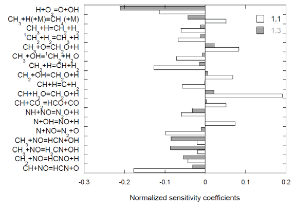

**图41：反应条件下预测NO的灵敏度系数。该图表展示了在Chen和Malte的再燃烧实验[330]中，1580 K条件下，不同化学计量比（空燃当量比φ = 1.1或1.3）下，对NO预测的灵敏度系数。横坐标表示归一化灵敏度系数，纵坐标列出了多种化学反应。**

图41展示了Chen和Malte实验中当空燃当量比为1.1和1.3时，NO的灵敏度系数。分析表明，NO去除重要的反应取决于化学计量比，但也有一些共同趋势。一氧化氮主要由碳氢自由基消耗，因此，NO的预测对涉及这些步骤的反应具有敏感性，尤其是CH3 + NO (R74, R75)、3CH2 + NO (R76) 和 CH + NO (R82)。因此，那些促进CHx形成的反应展现出负灵敏度系数；这些步骤包括CH3 + H (R99, R100b)、CH3 + OH (R103) 和 3CH2 + H (R106)。碳氢自由基氧化为含氧中间体会抑制NO的去除；这主要通过下列反应发生：CH3 + O (R101)、3CH2 + OH (R107)、CH + H2O (R115) 和 CH + CO2 (R116)。NO也可能通过与胺自由基NH + NO (R17) 反应还原，或通过反应 N + OH (R3) 重新形成。

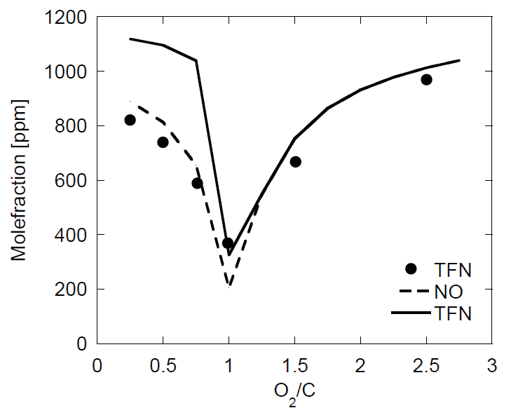

**图42：测量的[297]与预测的总固定氮物种（HCN + NH3 + NO）排放对比。该图展示了甲烷在含模拟烟气的流动反应器（耐火材料或刚玉）中反应时测量的结果与计算/预测的结果对比。符号代表实验数据，实线表示计算值（TFN），虚线表示预测的NO排放。反应条件：温度1423 ± 70 K（计算假设为1450 K），停留时间189 ms，压力1.0 atm。进口摩尔分数：0.46% CH4, 1.0% CO, 13.2% CO2, 0.115% NO；氧气可变，其余为氮气平衡。**

图42展示了Myerson[297]的流动反应器数据与模拟计算结果之间的比较。条件是在含有CO、CO2、O2和N2的模拟烟气中燃烧甲烷，并包含1150 ppm NO。该图显示了氧气浓度对排放的总固定氮（NO + HCN + NH3）的影响。Myerson观察到反应器中存在显著的温度梯度，报告的1423 K温度仅在±70 K的范围内准确。

Myerson表明，对于多种燃料，在氧与再燃燃料之间存在一个最佳摩尔比，在此比例下可以获得最小的总固定氮（TFN）。观测到的甲烷最小值出现在O2/CH4比为1.0处（图42）。实验数据与计算之间的一致性良好，除了非常还原的条件（O2/CH4 < 1.0），此时总固定氮浓度被高估了。这两种模型预测和实验数据均表明，在这些条件下的固定氮几乎完全由NO和HCN组成；NH3的生成量可忽略不计。

Alzueta和同事[21, 267]研究了不同碳氢燃料在还原条件下的再燃烧化学作用。在图43中，展示了他们针对甲烷和C2碳氢化合物燃烧时的NO计算数据与实验数据随温度变化的对比。

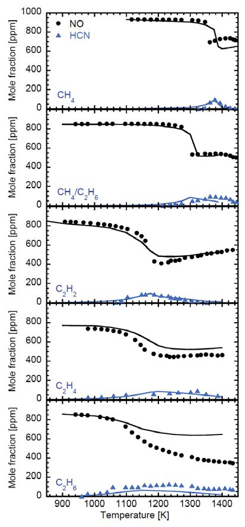

**图43：不同碳氢燃料再燃烧中NO的实验数据[21,267]与模型预测随温度的比较。**

结果显示，从NO中去除碳氢化合物的能力在调查的那些之间存在显著差异。在实验条件下，CH4仅在高于1350 K时具有活性，还原NO约30%。模拟天然气（含有约10%乙烷的甲烷）在还原NO方面更为有效，且起始温度较低，约为1300 K。在C2烃中，乙炔和乙烯表现相似，NO还原率在1150 K时可达约50%。乙烷在高于1100 K时能够还原NO，其效率随温度升高而增加。在所有燃料中，NO部分转化为氰化氢（HCN），但HCN浓度相对较低。

模型预测能很好地捕捉趋势，并且大多数与实验结果基本一致。唯一的重大差异是在使用乙烷进行再燃烧时发现，NO的还原和HCN的生成均被低估。部分这种差异可归因于反应器中的混合效应，正如Glarborg等人[21]所讨论的。

预测再燃烧潜力以降低NO，依赖于模型在还原区描述化学作用的能力，在此区域形成碳氢自由基并作为还原剂去除NO；以及在富燃-贫燃过渡区，形成的氰化物和胺转化为NO和N2。在预测燃料衍生自由基浓度方面的准确性仍有争议，即使是在甲烷的氧化过程中（见第3.2节和附录B）。然而，由于大部分C1和C2自由基通常参与去除NO，且自由基+NO的反应通常也有较好的表征，因此模型有望在还原区对NO消耗进行预测，对于甲烷约为30%，对于其他碳氢化合物则具有稍高的不确定性。燃尽化学（burnout chemistry）在富燃-贫燃过渡区进行，Kristensen等人[182]进行了更详细的讨论，包括存在剩余可燃物及NO的HCN和NH3的氧化。它与选择性非催化还原NO具有相似之处（见第4.1节）。燃尽区产生的自由基受CO和H2氧化而不是氮化学控制的，并且从反应性氮形成NO和N2的选择性受到以下因素控制：

氮物种有望被模型很好地捕捉。

**图43补充图题：在石英流动反应器中，还原氮氧化物条件下的NO还原，对比实验数据[21, 267]和建模预测。符号表示实验数据，实线表示建模预测。入口浓度：CH4 = 2800 ppm, O2 = 4830 ppm, NO = 920 ppm (τ = 181[K/T]); CH4 = 2770 ppm, C2H6 = 260 ppm, O2 = 4885 ppm, NO = 850 ppm (τ = 170[K/T]); C2H2 = 890 ppm, O2 = 1700 ppm, NO = 835 ppm (τ = 162[K/T]); C2H4 = 1020 ppm, O2 = 2015 ppm, NO = 790 ppm (τ = 165[K/T]); C2H6 = 1530 ppm, O2 = 3970 ppm, NO = 870 ppm (τ = 167[K/T])。所有实验均在2% H2O、平衡氮气(N2)和1.05 atm条件下进行。**

## 结论（Concluding remarks）

三十年前，Miller和Bowman发表了一篇关于燃烧中氮化学的划时代评论。他们得出结论：对其提出的机理的未来修改很可能是定量的，而非定性的。自那以后，我们对形成和破坏氮氧化物重要的热化学和速率常数的知识已显著增加，这得益于高水平理论工具的发展。然而，Miller和Bowman的陈述在很大程度上被证明是准确的。描述通过热机理、通过N2O或氰化物和胺的氧化形成NO的子集，由于我们在特定反应知识方面的进步而变得更为可靠，但在定性上，它们与Miller和Bowman提出的相似。这也适用于分段燃烧中用于销毁NO的回燃型化学。Miller和Bowman之后的一项重大发现是关于快速NO的形成，其中CH和N2之间控制反应的产物现在是NCN + H而不是HCN + N，并且热脱硝过程（Thermal DeNOx），其预测的NNH寿命已从10^-4 s减少到10^-9 s，因此反应现在受到NH2 + NO反应分支分数α的限制，而不是NNH与NO或O2的反应。尽管在具体的速率常数准确性方面取得了进展，但在氮化学的建模预测仍低于预期时，仍有一些子集缺乏可靠性；这些包括快速NO的形成和选择性非催化还原NO (SNCR)。然而，总体而言，当前未优化的模型在广泛的条件下为NO的形成和破坏提供了可靠的预测，并且可以在工业过程的工程计算中用于具有相当程度的信心。

氮化学面临的未来挑战包括将模型扩展到更复杂的燃料（例如，强调可能与氮物种相互作用的碳氢自由基的形成），更复杂的氮化合物，如环状物种，以及延伸至发动机和燃气轮机等遇到的高压情况。

## 致谢（Acknowledgments）

本工作是CHEC (Combustion and Harmful Emission Control) 研究计划的一部分。DTU (P.G.) 的工作得到了丹麦创新基金的资金支持。阿贡国家实验室 (B.R., S.J.K.) 的工作由美国能源部、科学办公室、基础能源科学司、化学科学、地球科学与生物科学部支持，合同编号为DE-AC02-06CH11357，并有来自J.A.M.的贡献，他通过阿贡-桑迪亚高压燃烧化学联盟 (ANL FWP 59044) 获得了资助。最后，作者感谢Tamas Turanyi仔细阅读了手稿，并对审稿人提出的非常有用的意见表示感谢。

## 参考文献

[1] J.A. Miller和C.T. Bowman. 燃烧中氮化学的机理与建模. *Prog. Energy Combust. Sci.*, 15:287–338, 1989.

[2] C.T. Bowman. 由法规驱动的燃烧生成氮氧化物排放标准控制技术. *Symp. (Int.) Combust.*, 24:859–878, 1992.

[3] P. Glarborg, A.D. Jensen 和 J.E. Johnsson. 燃煤系统中的燃料氮转化. *Prog. Energy Combust. Sci.*, 29:89–113, 2003.

[4] P. Glarborg. 隐藏交互作用——控制燃烧与排放的痕量物种. *Proc. Combust. Inst.*, 31:77–98, 2007.

[5] J.E. Johnsson. 流化床燃烧中氮氧化物的生成与还原. *Fuel*, 73:1398–1415, 1994.

[6] S.C. Hill 和 L.D. Smoot. 燃烧系统中氮氧化物生成与破坏的建模. *Prog. Energy Combust. Sci.*, 26:417–458, 2000.

[7] F.L. Dryer, F.M. Haas, J. Santner, T.I. Farouk 和 M. Chaos. 从复杂反应-平流-扩散系统解释化学动力学：流动反应器及相关实验的建模. *Prog. Energy Combust. Sci.*, 44:19–39, 2014.

[8] B. Ruscic, R.E. Pinzon, M.L. Morton, G. von Laszewski, S. Bittner, S.G. Nijsure, K.A. Amin, M. Minkoff 和 A.F. Wagner. 简介活性热化学表：重新审视几个"关键"生成焓. *J. Phys. Chem. A*, 108:9979–9997, 2004.

[9] B. Ruscic, R.E. Pinzon, G. von Laszewski, D. Kodeboyina, A. Burcat, D. Leahy, D. Montoya 和 A.F. Wagner. 活性热化学表：21世纪的热化学. *J. Phys. Conf. Ser.*, 16:561–570, 2005.

[10] B. Ruscic. 活性热化学表：甲烷、乙烷和甲醇的连续键解离焓及相关热化学. *J. Phys. Chem. A*, 119:7810–7837, 2015.

[11] B. Ruscic 和 D. H. Bross. *Active Thermochemical Tables (ATcT)* 值基于 *The Thermochemical Network* 的第1.122版. (可从 ATcT.anl.gov 获取), 2016.

[12] T. L. Nguyen, J. H. Baraban, B. Ruscic 和 J. F. Stanton. 关于HCN–HNC能量差. *J. Phys. Chem. A*, 119:10929–10934, 2015.

[13] S.J. Klippenstein, L.B. Harding 和 B. Ruscic. 从头计算与活性热化学表携手合作：核心燃烧物种的生成焓. *J. Phys. Chem. A*, 121:6580–6602, 2017.

[14] B. J. McBride 和 S. Gordon. *Properties and coefficients, computer program for calculating and fitting thermodynamic functions.* 美国国家航空航天局，格伦研究中心，克利夫兰，俄亥俄州，1999.

[15] E. Goos, A. Burcat 和 B. Ruscic. *Ideal gas thermochemical database with updates from Active Thermochemical Tables.*（<ftp://ftp.technion.ac.il/pub/supported/aetdd/thermodynamics> 镜像于 <http://garfield.chem.elte.hu/burcat/burcat.html>）, 2016.

[16] H. Hashemi, J.M. Christensen, S. Gersen, H. Levinsky, S.J. Klippenstein 和 P. Glarborg. 甲烷的高压氧化. *Combust. Flame*, 172:349–364, 2016.

[17] J. Gimenez-Lopez, C. T. Rasmussen, H. Hashemi, M.U. Alzueta, Y. Gao, P. Marshall, C.F. Goldsmith 和 P. Glarborg. 高压下C2H2氧化的实验与动力学建模研究. *Int. J. Chem. Kinet.*, 48:724–738, 2016.

[18] H. Hashemi, J. G. Jacobsen, C. T. Rasmussen, J. M. Christensen, P. Glarborg, S. Gersen, M. van Essen, H.B. Levinsky, and S.J. Klippenstein. 乙烷高压氧化. *Combust. Flame*, 182:150–166, 2017.

[19] S.J. Klippenstein, L.B. Harding, P. Glarborg, and J.A. Miller. 氮氧化物生成与控制中的含N基团作用. *Combust. Flame*, 158:774–789, 2011.

[20] P. Dagaut, P. Glarborg, and M.U. Alzueta. 氰化氢及相关化学品的氧化. *Prog. Energy Combust. Sci.*, 34:1–46, 2008.

[21] P. Glarborg, M.U. Alzueta, K. Dam-Johansen, and J.A. Miller. 流动反应器中碳氢化合物/一氧化氮相互作用的动力学模拟. *Combust. Flame*, 115:1–27, 1998.

[22] T. Mendiara and P. Glarborg. 甲烷富氧燃烧中的氨化学. *Combust. Flame*, 156:1937–1949, 2009.

[23] T. Mendiara and P. Glarborg. 甲烷富氧燃烧中的NO还原. *Energy Fuels*, 23:3565–3572, 2009.

[24] P. Glarborg, J.A. Miller, and R.J. Kee. 搅拌反应器中氮氧化物形成的动力学模拟与敏感性分析. *Combust. Flame*, 65:177–202, 1986.

[25] Y.B. Zeldovich. 燃烧与爆炸中的氮氧化. *Acta. Physicochem. USSR*, 21:577–628, 1946.

[26] D.L. Baulch, C.T. Bowman, C.J. Cobos, R.A. Cox, T. Just, J.A. Kerr, M.J. Pilling, D. Stocker, J. Troe, W. Tsang, R.W. Walker, and J. Warnatz. 燃烧模型评估动力学数据：补编II. *J. Phys. Chem. Ref. Data*, 34:757–1397, 2005.

[27] J.P. Monat, R.K. Hanson, and C.H. Kruger. 反应 N2+O → NO+N 速率系数的冲击管测定. *Symp. (Int.) Combust.*, 17:543–552, 1979.

[28] K. Thielen and P. Roth. 高温下N和O原子的共振吸收测量及NO解离与生成动力学. *Symp. (Int.) Combust.*, 20:685–693, 1984.

[29] C.P. Fenimore. 预混碳氢化合物火焰中一氧化氮的形成. *Symp. (Int.) Combust.*, 13:373–380, 1971.

[30] J.B. Livesey, A.L. Roberts, and A. Williams. 某些富氧-丙烷火焰中氮氧化物的生成. *Combust. Sci. Technol.*, 4:9–15, 1971.

[31] F. Bachmaier, K.H. Eberius, and Th. Just. 预混碳氢化合物火焰中在1个大气压下的一氧化氮形成与HCN检测. *Combust. Sci. Technol.*, 7:77–84, 1973.

[32] D. Iverach, K.S. Basden, and N.Y. Kirov. 贫燃与富燃火焰中一氧化氮的生成. *Symp. (Int.) Combust.*, 14:767–775, 1973.

[33] R.J. Harris, M. Nasralla, and A. Williams. 高温 CH4-O2-N2 火焰中氮氧化物的形成. *Combust. Sci. Technol.*, 14:85–94, 1976.

[34] P.V. Heberling. 高压下瞬发NO的测量. *Symp. (Int.) Combust.*, 16:159–166, 1977.

[35] J. Blauwens, B. Smets, and J. Peeters. 碳氢化合物火焰中瞬发NO形成机制. *Symp. (Int.) Combust.*, 16:1055–1064, 1976.

[36] M.F. Ziabelski and D.J. Seery. 高温、氧气富集的甲烷火焰中一氧化氮生成速率的直接测量. *ASME Fossil Fuels Combust. Symp.*, 25:91–94, 1989.

[37] M.A.A. Clyne and B.A. Thrush. 活性氮与氧气及一氧化氮反应的动力学. *Proc. R. Soc. London A*, 261:259–273, 1961.

[38] M.A.A. Clyne and I.S. McDermid. 基态N原子与NO及NO2基元反应速率的质谱测定. *J. Chem. Soc. Faraday Trans. 1*, 71:2189–2202, 1975.

[39] C.T. Cheah and M.A.A. Clyne. 形成电子激发态自由基的反应 2. H+NF2 反应及N原子反应中N4s, N2d和N2p原子的生成. *J. Chem. Soc. Faraday Trans. 2*, 76:1543–1560, 1980.

[40] J. Bruning and M.A.A. Clyne. SF自由基的基元反应 1. F + OCS → SF + CO 及 SF + SF → SF2 + S 反应速率常数. *J. Chem. Soc. Faraday Trans. 2*, 80:1001–1014, 1984.

[41] J.H. Lee, J.V. Michael, W.A. Payne, and L.J. Stief. 使用DF-RF与FP-RF技术测定196-400 K下N与NO反应的绝对速率. *J. Chem. Phys.*, 69:3069–3076, 1978.

[42] M. Koshi, M. Yoshimura, K. Fukuda, H. Matsui, K. Saito, M. Watanabe, A. Imamura, and C. Chen. N原子与NO及H2的反应. *J. Chem. Phys.*, 93:8703–8708, 1990.

[43] D.F. Davidson and R.K. Hanson. 源自N原子ARAS测量与准分子光解法的NO高温反应速率系数. *Int. J. Chem. Kinet.*, 22:843–861, 1990.

[44] J.V. Michael and K.P. Lim. N2O反应系统的速率常数——N2O热分解、N+NO → N2+O 及 O+N2 → NO+N 的启示. *J. Chem. Phys.*, 97:3228–3234, 1992.

[45] H.J. Mick, H. Matsui, and P. Roth. 基于Si, N, O原子测量的Si原子被NO氧化的高温动力学. *J. Phys. Chem.*, 97:6839–6842, 1993.

[46] M. Abian, M.U. Alzueta, and P. Glarborg. 流动反应器中N2/O2混合物生成NO：迈向热NO的准确预测. *Int. J. Chem. Kinet.*, 47:518–532, 2015.

[47] P. Gamallo, M. Gonzalez, and R. Sais. N+NO 反应中涉及的两个最低三重态势能面的从头算研究. *J. Chem. Phys.*, 118:10602–10610, 2003.

[48] O. Skreiberg, P. Kilpinen, and P. Glarborg. 流动反应器中富燃料条件下的氨化学. *Combust Flame*, 136:501–518, 2004.

[49] A. Fernandez, A. Goumri, and A. Fontijn. N原子与O2和CO2在宽温区内反应的动力学. *J. Phys. Chem. A*, 102:168–172, 1998.

[50] A.A. Konnov. 关于氢气火焰中生成NO不同途径的相对重要性. *Combust Flame*, 134:421–424, 2003.

[51] A. Frassoldati, T. Faravelli, and E. Ranzi. 宽范围NOx生成建模及氢气燃烧中的氮化学. *Int. J. Hydrogen Energy*, 31:2310–2328, 2006.

[52] N. Arai, T. Higashi, M. Hasatani, and S. Sugiyama. 氮氧二元体系中热NOx的生成. *Int. Chem. Eng.*, 18:661–665, 1978.

[53] J.B. Homer and M.M. Sutton. 预混氢气火焰中的NO形成及自由基过冲. *Combust Flame*, 20:71–76, 1973.

[54] A.N. Hayhurst and I.M. Vince. 火焰中由N2生成的氮氧化物——瞬发NO的重要性. *Prog. Energy Combust. Sci.*, 6:35–51, 1980.

[55] M.R. Roomina and R.W. Bilger. 湍流甲烷-空气射流火焰的条件矩闭合(CMC)预测. *Combust. Flame*, 125:1176–1195, 2001.

[56] L. Cui, K. Morokuma, J.M. Bowman, and S.J. Klippenstein. 自旋禁阻反应 CH+N2 → HCN+N 重新探讨. II. 非绝热跃迁态理论及应用. *J. Chem. Phys.*, 110:9469–9482, 1999.

[57] L.V. Moskaleva和M.C. Lin. 通过量子/统计理论计算和速率常数动力学模型研究的自旋守恒反应 CH + N2 → H + NCN：研究快速NO的主要路径. *Proc. Combust. Inst.*, 28:2393–2401, 2000.

[58] S. Xu和M. C. Lin. 单重态CH2与N2反应的从头算化学动力学及其重氮甲烷相关分解. *J. Phys. Chem. A*, 114:5195–5204, 2010.

[59] B.A. Williams和J.W. Fleming. 10托甲烷和丙烷火焰中NO形成的实验与建模研究：关于额外前体NO证据. *Proc. Combust. Inst.*, 31:1109–1117, 2007.

[60] J.A. Sutton和J.W. Fleming. 通过NCN路径对碳氢化合物火焰中快速NO形成的准确动力学建模. *Combust. Flame*, 154:630–636, 2008.

[61] A.A. Konnov. NCN形成快速NO路径在详细反应机理中的实现. *Combust. Flame*, 156:2093–2105, 2009.

[62] N. Lamoureux, P. Desgroux, A. El Bakali, 和 J.F. Pauwels. NCN在低压CH4-O2-N2和C2H2-O2-N2火焰中形成快速NO作用的角色实验和数值研究. *Combust. Flame*, 157:1929–1941, 2010.

[63] R. S. Zhu, S. C. Xu, 和 M. C. Lin. N2与单重态和三重态C2O自由基反应的从头算化学动力学. *Chem. Phys. Lett.*, 488:121–125, 2010.

[64] T. Sommer, T. Kruse, P. Roth, 和 H. Hippler. 在高温C60/Ar+N2混合物中C2与N2反应的反应扰动研究. *J. Phys. Chem. A*, 101:3720–3725, 1997.

[65] Yu. A. Kolbanovskii 和 Yu. A. Borisov. 二卡宾C2和氮分子之间反应机理的量子化学计算. *Russ J. Phys. Chem. B*, 9:29–35, 2015.

[66] M. Köhler, A. Brockhinke, M. Braun-Unkhoff, 和 K. Kohse-Höinghaus. 燃烧中C2和CH的定量激光诊断与建模研究. *J. Phys. Chem. A*, 114:4719–4734, 2010.

[67] A. el Bakali, L. Pillier, P. Desgroux, B. Lefort, L. Gasnot, J.F. Pauwels, 和 I. da Costa. 使用GDF-Kin3.0机理NCN和HCN贡献预测天然气火焰中的NO形成快速NO. *Fuel*, 85:896–909, 2006.

[68] I.G. Zsely, J. Zador, 和 T. Turanyi. 甲烷燃烧过程中NO产生的不确定性分析. *Int. J. Chem. Kinet.*, 40:754–768, 2008.

[69] S. Gersen, A.V. Mokhov, 和 H.B. Levinsky. 大气压下富燃预混甲烷/空气火焰中HCN的金刚石激光吸收测量和分析. *Combust. Flame*, 155:267–276, 2008.

[70] J.A. Sutton, B.A. Williams, 和 J.W. Fleming. NCN及其在低压C1-C4烷烃火焰中形成快速NO的研究. *Combust. Flame*, 159:562–576, 2012.

[71] E. Goos, C. Sickfeld, F. Mauss, L. Seidel, B. Ruscic, A. Burcat, 和 T. Zeuch. 火焰中快速NO的形成：NCN热化学的影响. *Proc. Combust. Inst.*, 34:657–666, 2013.

[72] N. Lamoureux, H. El Merhubi, L. Pillier, S. de Persis, 和 P. Desgroux. 低压预混火焰中NO形成的建模. *Combust. Flame*, 163:557–575, 2016.

[73] E.P. Clifford, P.G. Wenthold, W.C. Lineberger, G.A. Petersson, 和 G.B. Ellison. NCN-和HNC-离子的光电子能谱. *J. Phys. Chem. A*, 101:4338–4345, 1997.

[74] R.T. Bise, H. Choi, 和 D.M. Neumark. NCN自由基单重态和三重态的光解动力学. *J. Chem. Phys.*, 111:4923–4932, 1999.

[75] R.T. Bise, A.A. Hoops, 和 D.M. Neumark. HNCN自由基的光解和光异构化途径. *J. Chem. Phys.*, 114:9000–9011, 2001.

[76] S. Canneaux, A. Wallet, M. Ribaucour, 和 F. Louis. NCN双自由基热化学性质的理论研究：对燃烧化学的影响. *Comput. Theo. Chem.*, 967:67–74, 2011.

[77] L.B. Harding, S.J. Klippenstein, 和 J.A. Miller. 使用多参考方法重新考察CH + N2的化学反应动力学. *J. Phys. Chem. A*, 112:522–532, 2008.

[78] N. Fasseber, J. Dammeier, 和 G. Friedrichs. NCN与H反应的总速率常数的直接测量及其对NCN产物分支比和生成焓的影响. *Phys. Chem. Chem. Phys.*, 16:11647–11657, 2014.

[79] B. Ruscic. 基于 *Thermochemical Network* 版本 1.112 的 *Active Thermochemical Tables (ATcT)* 值. (存于 ATcT.anl.gov), 2013.

[80] B. Ruscic. 基于 *Thermochemical Network* 版本 1.118 的 *Active Thermochemical Tables (ATcT)* 值. (存于 ATcT.anl.gov), 2015.

[81] B. Ruscic, D. Feller, 和 K. A. Peterson. 活性热化学表：几种同核第一周期双原子分子的解离能及相关的值. *Theor. Chem. Acc.*, 133:1415/1–12, 2014.

[82] S. J. Klippenstein, M. Pfeifle, A.W. Jasper, 和 P. Glarborg. 高压下形成快速NO的相关性与理论建模. *submitted for publication*.

[83] J. Dammeier, N. Fasseber, 和 G. Friedrichs. NCN + O、NCN + NCN和NCN + M反应的高温速率常数的直接测量. *Phys. Chem. Chem. Phys.*, 14:1030–1037, 2012.

[84] R.S. Zhu 和 M.C. Lin. NCN被O氧化的从头算研究：总速率常数和产物分支比的预测. *J. Phys. Chem. A*, 111:6766–6771, 2007.

[85] N. Fasseber 和 G. Friedrichs. 反应NCN + O2的速率常数的冲击管测量. *Int. J. Chem. Kinet.*, 47:586–595, 2015.

[86] J. Dammeier 和 G. Friedrichs. 冲击波后NCN加NO和NCN加NO2反应速率常数的直接测量. *J. Phys. Chem. A*, 115:14382–14390, 2011.

[87] A.J. Dean, R.K. Hanson, 和 C.T. Bowman. 高温冲击管研究CH和C原子与N2的反应. *Symp. (Int.) Combust.*, 23:259–265, 1991.

[88] V. Vasudevan, R.K. Hanson, C.T. Bowman, D.M. Golden, 和 D.F. Davidson. CH与N2反应的冲击管研究：总体速率和分支比. *J. Phys. Chem. A*, 111:11818–11830, 2007.

[89] J.A. Miller 和 S.P. Walch. 快速NO：高温速率系数对于CH+N2→HCN+N的理论预测. *Int. J. Chem. Kinet.*, 29:253–259, 1997.

[90] J.A. Miller, M.J. Pilling, 和 J. Troe. 通过对基本反应的定量理解解开燃烧机理. *Proc. Combust. Inst.*, 30:43–88, 2005.

[91] D. Lindackers, M. Burmeister, 和 P. Roth. 高温下C和CH与N2和NO的反应的扰动研究. *Symp. (Int.) Combust.*, 23:251–257, 1991.

[92] W.-S. Teng, L.V. Mosaleva, H.-L. Chen, and M.C. Lin. NCN基元化学动力学：基于双线性态和四线性态势面的NCN生成焓及反应产物分支预测. *Journal of Physical Chemistry A*, 117:5775-5784, 2013.

[93] R.S. Zhu, H.M.T. Nguyen, and M.C. Lin. NCN与OH反应的从头算研究：个体总反应速率常数的预测. *Journal of Physical Chemistry A*, 113:298-304, 2009.

[94] R.S. Zhu and M.C. Lin. NCN与O2反应的从头算研究. *International Journal of Chemical Kinetics*, 37:593-598, 2005.

[95] P.A. Berg, D.A. Hill, A.R. Noble, G.P. Smith, J.B. Jefferies, and D.R. Crosley. 低压甲烷火焰中CH浓度的绝对测量：与模型结果的比较. *Combustion and Flame*, 121:223-235, 2000.

[96] N. Lamourex, X. Mercier, C. Western, J.F. Pauwels, and P. Desgroux. 层流低压火焰中NCN的定量测量. *Proceedings of the Combustion Institute*, 32:937-944, 2009.

[97] N. Lamourex, P. Desgroux, A. El Bakali, and J.F. Pauwels. NCN在层流低压CH4/O2/N2和C2H2/O2/N2火焰中快速NOx生成中作用的实验与数值研究. *Combustion and Flame*, 160:745-746, 2013.

[98] N. Lamourex, C.M. Western, X. Mercier, and P. Desgroux. NCN基团A3Πu-X3Σg-跃迁光谱在高温度下的再研究：火焰中定量NCN测量的应用. *Combustion and Flame*, 160:755-765, 2013.

[99] N. Lamourex, H. El Merhubi, L. Gasnot, C. Schoemaeker, and P. Desgroux. 基于LIF/CRDS技术的层流低压CH4/O2/N2火焰中HCN和CN物种分布的测量与建模. *Proceedings of the Combustion Institute*, 35:745-752, 2015.

[100] W. Bartok, V. S. Engleman, R. Goldstein, and E. G. del Valle. 燃烧过程中氮氧化物生成机理的基础动力学研究与模拟. *AIChE Symposium Series*, 126 (68):30-38, 1972.

[101] P. Malte and D.T. Pratt. 搅拌火焰中单原子氧和氮氧化物的测量. *Symposium (International) on Combustion*, 15:1061-1070, 1975.

[102] J.W. Bozelli and A.M. Dean. 火焰中生成NOx的一条可能新途径：O + NNH. *International Journal of Chemical Kinetics*, 27:1097-1109, 1995.

[103] M.S. Day, J.B. Bell, X. Gao, and P. Glarborg. 贫燃料预混湍流H2/O2/N2火焰中氮氧化物生成的数值模拟. *Proceedings of the Combustion Institute*, 33:1591-1599, 2011.

[104] N.E. Meagher and W.R. Anderson. O(3P) + N2O反应的速率动力学：第二部分. 解释与建议的速率系数. *Journal of Physical Chemistry A*, 104:6013-6031, 2000.

[105] P. Marshall, A. Fontijin, and C.F. Melius. 高温光化学与BAC-MP4研究基态H原子与N2O的反应. *Journal of Chemical Physics*, 86:5540-5549, 1987.

[106] H. Lillich, A. Schuck, H-R. Volpp, J. Wolfrum, and P.D. Naik. 高温下NH + NO和NH + O2反应的速率动力学研究. *Symposium (International) on Combustion*, 25:993-1001, 1994.

[107] H.J. Romming and H.G. Wagner. NH与O2和NO在1200至2200 K温度范围内反应的速率动力学研究. *Symposium (International) on Combustion*, 26:559-566, 1996.

[108] K. Yokoyama, Y. Sakane, and T. Fueno. 入射激波中NH与NO反应生成OH的机理. *Bulletin of the Chemical Society of Japan*, 64:1738-1742, 1991.

[109] J. D. Mertens, A. Y. Chang, R. K. Hanson, and C. T. Bowman. 激波管法研究NH与NO、O2和O的反应. *International Journal of Chemical Kinetics*, 23:173-196, 1991.

[110] J.L. Durant. NH (ND)与NO反应的产物分支比. *Journal of Physical Chemistry*, 98:518-521, 1994.

[111] S. Okada, A. Tezaki, A. Miyoshi, and H. Matsui. NH与NO反应的产物分支比. *Journal of Chemical Physics*, 101:9582-9588, 1994.

[112] R. W. Quandt and J. F. Hershberger. NH + NO和NH + NO2反应的产物分支比. *Journal of Physical Chemistry*, 99:16939-16944, 1995.

[113] S. Gordon, W. Mulac, and P. Nangia. 氨气脉冲辐解. II. NH2自由基的消失速率. *Journal of Physical Chemistry*, 75:2087-2093, 1971.

[114] I. Hansen, K. Hoinghaus, C. Zetzscher, and F. Stuhl. 通过脉冲真空UV光解NH3检测NH及其在NH自由基反应中的应用. *Chemical Physics Letters*, 42:370-372, 1976.

[115] J.A. Harrison, A.R. Whyte, and L.F. Phillips. NH与NO和NO2反应的速率动力学. *Chemical Physics Letters*, 129:346-352, 1986.

[116] W. Hack, H.Gg. Wagner, and A. Zasyipkin. NH与N、O和NO的基元反应. *Berichte der Bunsengesellschaft für physikalische Chemie*, 98:156-164, 1994.

[117] H. Geiger, P. Wiesen, and K.H. Becker. 298 K下CH自由基与一氧化氮反应的产物研究. *Physical Chemistry Chemical Physics*, 1:5601-5606, 1999.

[118] A.A. Konnov, G. Colson, and J. De Ruyck. 通过NNH生成NO的新途径. *Combustion and Flame*, 121:548-550, 2000.

[119] A.A. Konnov, I.V. Dyakov, and J. De Ruyck. 预混合H2+CO+CO2与空气火焰中氮氧化物的生成. *Proceedings of the Combustion Institute*, 29:2171-2177, 2002.

[120] N.L. Haworth, J.C. Mackie, and G.B. Bacskay. NNH + O反应势能面的从头算量子化学与动力学研究：该途径对燃烧中生成NO有多重要？ *Journal of Physical Chemistry A*, 107:6792-6803, 2003.

[121] D.L. Baulch, D.D. Drysdale, D.G. Horne, and A.C. Lloyd. 高温反应测定的动力学数据. 第2卷，H2-N2-O2系统的均相气相反应. London: Butterworths, 1973.

[122] R.K. Hanson and S. Salimian. 氮的燃烧化学. 见 In Jr., W.C. Gardiner, 编辑, *Combustion chemistry*, New York: Springer-Verlag, 1984.

[123] F. Kaufman, N.J. Gerri, and R.E. Bowman. 一氧化氮在N2O热分解中的作用. *Journal of Chemical Physics*, 25:106-115, 1956.

[124] H. Dindi, H.-M. Tsai, and M.C. Branch. 碳氧化物-氮氧化物火焰的燃烧机理. *Combustion and Flame*, 87:13-20, 1991.

[125] M. Rohrig, E. L. Petersen, D. F. Davidson, and R. K. Hanson. N2O热分解的压力依赖性. *International Journal of Chemical Kinetics*, 28:599-608, 1996.

[126] M. Gonzalez, R. Sayos, and R. Valero. O(D-1) + N2O → 2NO, N2 + O2反应基态势能面的从头算与动力学研究. *Chemical Physics Letters*, 355:123-132, 2002.

[127] A.N. Hayhurst and E.M. Hutchinson. 在常压下通过NNH在富燃料火焰中产生NO的新途径的证据. *Combustion and Flame*, 114:274-279, 1998.

[128] A.A. Konnov and J. De Ruyck. 温度依赖的反应速率常数对于反应 NH + O → NH + NO. *Combust. Flame*, 125:1258–1264, 2001.

[129] J.E. Harrington, G.P. Smith, P.A. Berg, A.B. Noble, J.B. Jeffries, and D.R. Crosley. 火焰中新NO生成机制的证据. *Symp. (Int.) Combust.*, 26:2133–2138, 1996.

[130] R. Steele, P. Malte, D. Nicol, and J. Kramlich. 贫预混射流搅拌火焰中的 NOx 和 N2O. *Combust. Flame*, 100:440–449, 1995.

[131] A. Lucassen, K. Zhang, J. Warkentin, K. Moshammer, P. Glarborg, P. Marshall, and K. Kohse-Höinghaus. 利用二甲胺和乙胺作为生物质相关模型燃料时小胺的燃烧转化过程中的燃料氮转化. *Combust. Flame*, 159:2254–2279, 2012.

[132] Murakami N., Tokunaga K., and Sakai M. 过氧化氰化氢形成一氧化氮. *Nenryo Kyokai Shi*, 61:759–769, 1982.

[133] T. Higashihara, K. Saito, and I. Murakami. 氢化氰在冲击波中的氧化 - 一氧化氮的形成. *J. Phys. Chem.*, 87:3707–3712, 1983.

[134] J.A. Miller, M.C. Branch, W.J. McLean, Chandler D.W., M.D. Smooke, and Kee R.J. 低压 H2-O2-HCN-Ar 火焰中 HCN 向 NO 和 N2 的转化. *Proc. Combust. Inst.*, 20:673–684, 1984.

[135] K. Thielen and P. Roth. 冲击加热 HCN/O2/Ar 混合物中 N、O 和 H 原子的共振吸收测量. *Combust. Flame*, 69:141–154, 1987.

[136] T. Hulgaard and K. Dam-Johansen. 燃烧条件下的均相一氧化氮生成与破坏. *AIChE J.*, 39:1342–1354, 1993.

[137] P. Glarborg and J.A. Miller. 流动反应器中氢化氰氧化机理与建模. *Combust. Flame*, 99:475–483, 1994.

[138] P. Dagaut, F. Lecomte, S. Chevailler, and M. Cathonnet. 在整个宽广温度范围内对一氧化氮氧化和简单燃料的相互敏化：实验与详细动力学建模. *Combust Sci Technol*, 148:27–57, 1999.

[139] P. Dagaut, F. Lecomte, S. Chevailler, and M. Cathonnet. HCN 的氧化以及与一氧化氮的反应：实验与详细动力学建模. *Combust. Sci. Technol.*, 155:105–127, 2000.

[140] V. J. Wargadalam, G. Löffler, F. Winter, and H. Hofbauer. 在 600-1000°C 下氧化 HCN 和 NH3 均一生成 NO 和 N2O. *Combust. Flame*, 120:465–478, 2000.

[141] J. Gimenez-Lopez, A. Millera, R. Bilbao, and M.U. Alzueta. O2/CO2 气氛中 HCN 氧化：一项实验与动力学建模研究. *Combust. Flame*, 157:267–276, 2010.

[142] J. Gimenez-Lopez, A. Millera, R. Bilbao, and M. U. Alzueta. HCN 与 NO 在代表富氧燃料燃烧条件的 CO2 气氛中的相互作用. *Energy Fuels*, 29:6593–6597, 2015.

[143] P. Glarborg and P. Marshall. HNC 异构体建模中 HCN 氧化的重要性. *Energy Fuels*, 31:2156–2163, 2017.

[144] J.A. Miller, C. Parrish, and N.J. Brown. 反应 O + HCN → products 的热速率系数和分支比的统计-理论研究. *J. Phys. Chem.*, 90:3339–3345, 1986.

[145] J.A. Miller and C.F. Melius. 高温下羟基与氢化氰反应的理论分析. *Symp. (Int.) Combust.*, 21:919–927, 1986.

[146] A.M. Dean and J.W. Bozzelli. 氮的燃烧化学. 收录于 W.C. Gardiner (编), *Gas phase combustion chemistry*, 第2章. Springer-Verlag, 2000.

[147] S.T. Wooldridge, R.K. Hanson, and C.T. Bowman. 冲击管中 HCN+OH → products 反应对 CN 和 OH 的激光-吸收同时测量. *Int. J. Chem. Kinet.*, 27:1075–1087, 1995.

[148] R. Sumathi and M.T. Nguyen. CH2N 体系的理论研究：单重态与四重态低能态下的反应. *J. Phys. Chem. A*, 102:8013–8020, 1998.

[149] A.J.C. Bunkan, Y. Tang, S.R. Sellevag, and C.J. Nielsen. CH2=NH 和 HNC 大气气相化学：第一性原理方法. *J. Phys. Chem. A*, 118:5279–5288, 2014.

[150] W. Feng and J. F. Hershberger. 重新研究 CN + O2 反应的分支比. *J. Phys. Chem. A*, 113:3523–3527, 2009.

[151] Y. Gao and G. MacDonald. 在 292 K 下测定 NCO + O 反应速率常数. *J. Phys. Chem. A*, 107:4625–4635, 2003.

[152] J. A. Miller and C. T. Bowman. 燃烧产物中异氰酸还原 NO 的动力学建模. *Int. J. Chem. Kinet.*, 23:289–313, 1991.

[153] R. S. Zhu and M. C. Lin. 重新审视 NCO + NO 反应：从头 MO/VRRKM 计算总速率常数和产物分支比. *J. Phys. Chem. A*, 104:10807–10811, 2000.

[154] M.C. Lin, Y. He, and C.F. Melius. 通信 - HCN → HNC 过程对含氮高温燃料化学的启示. *Int. J. Chem. Kinet.*, 24:1103–1107, 1992.

[155] F. Mohammad, V.R. Morris, W.H. Fink, and W.M. Jackson. 使用瞬态红外发射光谱法研究 CN + O2 → CO+NO 反应通道的机理与分支比. *J. Phys. Chem.*, 97:11590–11598, 1993.

[156] K.T. Rim and J.F. Hershberger. CN + O2 反应产物分支比对温度的依赖性. *J. Phys. Chem. A*, 103:3721–3725, 1999.

[157] B. S. Haynes. 富燃火焰中氢化氰的氧化. *Combust. Flame*, 28:113–121, 1977.

[158] J. A. Caton and D. L. Siebers. 比较氰尿酸和氨去除一氧化氮的效果. *Combust. Sci. Technol.*, 65:277–293, 1989.

[159] P. Glarborg, P.G. Kristensen, S.H. Jensen, and K. Dam-Johansen. 异氰酸 (HNCO) 氧化化学的流动反应器研究. *Combust. Flame*, 98:241–258, 1994.

[160] R.K. Lyon and J.A. Cole. 对 RapreNOx 过程的重新审视. *Combust. Flame*, 82:435–443, 1990.

[161] R.A. Perry. 使用激光光解-激光诱导荧光技术研究 NCO 自由基与 H2 和 NO 的反应动力学. *J. Chem. Phys.*, 82:5485–5488, 1985.

[162] F.P. Tully, R.A. Perry, L.R. Thorne, and M.D. Allendorf. 异氰酸的非自由基氧化. *Symp. (Int.) Combust.*, 22:1101–1106, 1988.

[163] C. H. Wu, H. T. Wang, M. C. Lin, and R. A. Fifer. 冲击波中 CO 和 H 原子生成的动力学研究及其从 HNCO 分解的过程. *J. Phys. Chem.*, 94:3344–3347, 1990.

[164] Y. He, X.P. Liu, M.C. Lin, and C.F. Melius. 中等温度下 HNCO 的热反应. *Int. J. Chem. Kinet.*, 23:1129–1149, 1991.

[165] Y. He, M. C. Lin, C. H. Wu, and C. F. Melius. 冲击波中 HNCO 与 NO2 的反应. *Symp. (Int.) Combust.*, 24:711–717, 1992.

[166] Y. He, X.P. Liu, M.C. Lin, and C.F. Melius. 中等温度下 HNCO 与 NO2 的热反应. *Int. J. Chem. Kinet.*, 25:845–863, 1993.

[167] J. D. Mertens, A. Y. Chang, R. K. Hanson, and C. T. Bowman. HNCO 冲击管热解中 NH 的反应动力学. *Int. J. Chem. Kinet.*, 21:1049–1067, 1989.

[168] J. D. Mertens, A. Y. Chang, R. K. Hanson, and C. T. Bowman. H + HNCO → NH2 + CO 的冲击管研究. *Int. J. Chem. Kinet.*, 23:655–668, 1991.

[169] J. D. Mertens, R. K. Hanson, and C. T. Bowman. 氧原子与异氰酸反应的冲击管研究. *Int. J. Chem. Kinet.*, 24:279–295, 1992.

[170] S.T. Wooldridge, R.K. Hanson, and C.T. Bowman. 通过 OH 和 CO2 的同时激光吸收测量研究 CO+OH → CO2+H 和 HNCO+OH → products 的冲击管实验. *Int. J. Chem. Kinet.*, 28:361–372, 1995.

[171] J.A. Miller and C.F. Melius. 氢原子与异氰酸反应的理论分析. *Int. J. Chem. Kinet.*, 24:421–432, 1992.

[172] D. Sengupta and M. T. Nguyen. OH+HNCO 反应中 NH2+CO2 形成的机理：基于从头算和统计理论的速率常数评估. *J. Chem. Phys.*, 106:9703–9707, 1997.

[173] X.-G. Wei, X.-M. Sun, X.-P. Wu, S. Geng, Y. Ren, N.-B. Wong, and W.-K. Li. 水分子在异氰酸自催化中性水解中的协同效应：一项全面的理论研究. *J. Mol. Model.*, 17:2069–2082, 2011.

[174] X. Cheng, Y. Zhao, W. Zhu, and Y. Liu. 由 NH3 和 CO2 合成氰尿酸机理的理论研究. *J. Mol. Model.*, 19:5037–5043, 2013.

[175] W.L. Feng, Y. Wang, and S.-W. Zhang. 异氰酸二聚反应的机理与速率常数的理论研究. *J. Mol. Structure (Theochem)*, 342:147–151, 1995.

[176] N. Borduas, B. Place, G. R. Wentworth, J. P. D. Abbatt, and J. G. Murphy. HNCO 在水中的溶解度和反应性：对 HNCO 在大气中归宿的启示. *Atmos. Chem. Phys.*, 16:703–714, 2016.

[177] A. Zabardasti and M. Solimannejad. 水和异氰酸氢键团簇的理论研究与AIM分析. *J. Mol. Structure THEOCHEM*, 819:52–59, 2007.

[178] A. Nicolle, S. Cagnina, and T. de Bruin. 水溶液中尿素分解的第一性原理建模. *Chem. Phys. Lett.*, 664:149–153, 2016.

[179] A.M. Mebel, A. Luna, M.C. Lin, and K. Morokuma. [HCNO] 体系在单重态和三重态下的全局势能面的密度泛函研究. *J. Chem. Phys.*, 105:6439–6454, 1996.

[180] J. Cao, Z.X. Wang, L.J. Gao, and F. Fu. 水辅助的 [H2CNCO] 体系异构化. *J. Mol. Model.*, 21:66, 1–8, 2015.

[181] B. G. Wicke, K. A. Grady, and J. W. Ratcliffe. 700°C 下氰尿酸 + 一氧化氮反应及氧气的影响. *Combust. Flame*, 78:249–255, 1989.

[182] P.G. Kristensen, P. Glarborg, and K. Dam-Johansen. 分级燃烧燃尽过程中的氮化学. *Combust. Flame*, 107:211–222, 1996.

[183] J. A. Miller, M. D. Smooke, R. M. Green, and R. J. Kee. 火焰中氨氧化的动力学建模. *Combust. Sci. Technol.*, 34:149–176, 1983.

[184] R. P. Lindstedt, F. C. Lockwood, and M. A. Selim. 氨氧化的详细动力学研究. *Combust. Sci. Technol.*, 108:231–254, 1995.

[185] O. Mathieu and E.L. Petersen. 氨高温氧化及相关 NOx 化学的实验与建模研究. *Combust. Flame*, 162:554–570, 2015.

[186] P. Glarborg, K. Dam-Johansen, J.A. Miller, R.J. Kee, and M.E. Coltrin. 流动反应器中 Thermal DeNOx 过程的建模。表面效应与氧化亚氮形成. *Int. J. Chem. Kinet.*, 26:421–436, 1994.

[187] J. A. Miller and P. Glarborg. Thermal De-NOx 过程中 N2O 和 NO2 形成的建模. *Springer Ser. Chem. Phys.*, 61:318–333, 1996.

[188] J. A. Miller and P. Glarborg. Thermal DeNOx 过程建模：接近最终方案. *Int. J. Chem. Kinet.*, 31:757–765, 1999.

[189] Z. Tian, Y. Li, L. Zhang, P. Glarborg, and F. Qi. 低压预混 NH3/CH4/O2/Ar 火焰的实验与动力学建模研究. *Combust. Flame*, 156:1413–1426, 2009.

[190] J. A. Miller and S. J. Klippenstein. NH2 + NO 反应的理论考量. *J. Phys. Chem. A*, 104:2061–2069, 2000.

[191] S. J. Klippenstein. 从理论反应动力学到燃烧化学建模. *Proc. Combust. Inst.*, 36:77–111, 2017.

[192] S. J. Klippenstein, L. B. Harding, P. Glarborg, Y. Gao, and P. Marshall. NH2 + NO2 反应的速率常数和分支分数. *J. Phys. Chem. A*, 117:9011–9022, 2013.

[193] S.J. Klippenstein, L.B. Harding, B. Ruscic, R. Sivaramakrishnan, N.K. Srinivasan, M.-C. Su, and J.V. Michael. NH2OH 的热分解及后续反应：从头算过渡态理论与反射激波管实验. *J. Phys. Chem. A*, 113:10241–10259, 2009.

[194] G. Altnay and R. G. Macdonald. NH2(X2B1) + NH2(X2B1) 和 NH2(X2B1) + H 复合反应在 N2 中随温度和压力变化的速率常数测定. *J. Phys. Chem. A*, 119:7593–7610, 2015.

[195] J. V. Michael, J. W. Sutherland, and R. B. Klemm. 750-1777 K 温度范围内 H + NH3 反应的速率常数. *J. Phys. Chem.*, 90:497–500, 1986.

[196] J. W. Sutherland, P. M. Patterson, and R. B. Klemm. O(3P) 原子与氨反应的闪光光解-冲击管动力学研究. *J. Phys. Chem.*, 94:2471–2475, 1990.

[197] S. Salimian, R. K. Hanson, and C. H. Kruger. O 和 OH 与 NH3 反应的高温研究. *Int. J. Chem. Kinet.*, 16:725–739, 1984.

[198] R. Sumathi and S. D. Peyerimhoff. HO2+NH2 反应速率常数的量子统计分析. *Chem. Phys. Lett.*, 263:742–748, 1996.

[199] A. Fontijn, S.M. Shamsuddin, D. Crammond, P. Marshall, and W.R. Anderson. NH 与 H2 反应的动力学及 NH + CO2、H2O 生成 HNO 的重新评估. *Combust. Flame*, 145:543–551, 2006.

[200] S. Xu and M. C. Lin. NH2 + HNOx 反应的从头算化学动力学，第一部分：NH2 + HNO 的动力学与机理. *Int. J. Chem. Kin.*, 41:667–677, 2009.

[201] S. Song, R. K. Hanson, C. T. Bowman, and D. M. Golden. Thermal De-NOx 温度窗口内 NH2 + NO → products 总体速率的激波管测定. *Int. J. Chem. Kinet.*, 33:715–721, 2001.

[202] J.A. Miller and C.F Melius. 亚胺自由基与一氧化氮和分子氧的反应. *Symp. (Int.) Combust.*, 24:719–726, 1992.

[203] D.-C. Fang, L.B. Harding, S.J. Klippenstein, and J.A. Miller. NH2 + NO 中分支的直接过渡态理论分析. *Faraday Disc. Royal Soc. Chem.*, 119:207–222, 2001.

[204] S. Song, R. K. Hanson, C. T. Bowman, and D. M. Golden. 高温下 NH2 + NO 反应产物分支比的激波管研究. *J. Phys. Chem. A*, 106:9233–9235, 2002.

[205] J. A. Silver and C. E. Kolb. 294-1215 K 温度范围内 NH2 + NO 反应的动力学测量. *J. Phys. Chem.*, 86:3240–3246, 1982.

[206] L. J. Stief, W. D. Brobst, D. F. Nava, R. P. Borkowski, and J. V. Michael. 216 K 至 480 K 的 NH2+NO 反应速率常数. *J. Chem. Soc. Faraday Trans. 2*, 78:1391–1401, 1982.

[207] B. Atakan, A. Jacobs, M. Wahl, R. Weller, and J. Wolfrum. 294-1027 K 下 NH2+NO 反应的动力学测量和产物分支比. *Chem. Phys. Lett.*, 155:609–613, 1989.

[208] M. Wolf, D. L. Yang, and D. L. Durant. NHx 自由基反应的动力学研究. *J. Photochem. Photobiol. A: Chem.*, 80:85–93, 1994.

[209] M. Wolf, D. L. Yang, and D. L. Durant. NH2+NO → products 反应的综合研究：反应速率系数、产物分支分数和从头算计算. *J. Phys. Chem. A*, 101:6243–6251, 1997.

[210] J. Park and M. C. Lin. 302 和 1060 K 之间 NH2 + NO 反应产物分支的直接测定. *J. Phys. Chem.*, 100:3317–3319, 1996.

[211] J. Park and M. C. Lin. NH2 + NO 反应中的产物分支比：重新评估. *J. Phys. Chem. A*, 103:8906–8907, 1999.

[212] P. Glarborg, P. G. Kristensen, K. Dam-Johansen, and J.A. Miller. 1210 和 1370 K 之间 NH2+NO 反应的分支分数. *J. Phys. Chem. A*, 101:3741–3745, 1997.

[213] M. Votsmeier, S. Song, R. K. Hanson, and C. T. Bowman. 使用 NH2 频率调制检测的 NH2 + NO 反应产物分支比激波管研究. *J. Phys. Chem. A*, 103:1566–1571, 1999.

[214] V. P. Bulatov, A. A. Ioffe, V. A. Lozovsky, and O. M. Sarkisov. 关于 295-620 K 下 NH2 自由基与 NO2 的反应. *Chem. Phys. Lett.*, 161:141–146, 1989.

[215] C. J. Howard. 平衡 HO2+NO = OH+NO2 的动力学研究及 HO2 的热化学. *J. Am. Chem. Soc.*, 102:6937–6941, 1980.

[216] N.K. Srinivasan, M.-C. Su, J.W. Sutherland, J.V. Michael, and B. Ruscic. 高温 OH + NO2 → HO2 + NO 和 OH + HO2 → H2O + O2 速率常数的反射激波管研究. *J. Phys. Chem. A*, 110:6602–6607, 2006.

[217] W. Hack, H. Schacke, M. Schröter, and H. Gg. Wagner. NH2 自由基与 NO、NO2、C2H2、C2H4 及其他碳氢化合物反应的速率. *Symp. (Int.) Combust.*, 17:505–513, 1979.

[218] H. Kurasawa and R. Lesclaux. NH2 与 NO2 反应的动力学. *Chem. Phys. Lett.*, 66:602–607, 1979.

[219] A. R. Whyte and L. F. Phillips. NH2 与 NO 和 NO2 的反应速率. *Chem. Phys. Lett.*, 102:451–454, 1983.

[220] T. X. Xiang, L. M. Torres, and W. A. Guillory. NH2 自由基和 NO2 的态选择反应与弛豫. *J. Chem. Phys.*, 83:1623–1629, 1985.

[221] V. P. Bulatov, A. A. Ioffe, V. A. Lozovsky, and O. M. Sarkisov. 关于 295-620 K 下 NH2 自由基与 NO2 的反应. *Chem. Phys. Lett.*, 159:171–174, 1989.

[222] P. Pagsberg, B. Sztuba, E. Ratajczak, and A. Sillesen. 脉冲辐解引发的 NH2 + NOx 气相反应的光谱动力学研究. *Acta Chem. Scand.*, 45:329–334, 1991.

[223] P. Glarborg, K. Dam-Johansen, and J.A. Miller. 流动反应器中氨与二氧化氮的反应：对 NH2+NO2 反应的启示. *Int. J. Chem. Kinet.*, 27:1207–1220, 1995.

[224] H. Meunier, P. Pagsberg, and A. Sillesen. 脉冲辐解结合时间分辨红外二极管激光光谱法研究 NH2 + NO2 → N2O + H2O 和 NH2 + NO2 → H2NO + NO 反应的动力学和分支比. *Chem. Phys. Lett.*, 261:277–282, 1996.

[225] J. Park and M. C. Lin. NH2 + NO2 反应的质谱研究. *J. Phys. Chem. A*, 101:2643–2647, 1997.

[226] S. Song, D. M. Golden, R. K. Hanson, and C. T. Bowman. NH2 + NO2 反应的激波管研究. *Proc. Combust. Inst.*, 29:2163–2170, 2002.

[227] J. Park and M. C. Lin. 300 和 990 K 温度之间 NH2 + NO2 反应产物分支概率的质谱测定. *Int. J. Chem. Kinet.*, 28:879–883, 1996.

[228] R. W. Quandt and J. F. Hershberger. NH2 + NO2 反应产物分支比的二极管激光研究. *J. Phys. Chem.*, 100:9407–9411, 1996.

[229] N. Lindholm and J. F. Hershberger. NH2 + NO2 反应的产物分支比. *J. Phys. Chem. A*, 101:4991–4995, 1997.

[230] M. Yumura and T. Asaba. 氨高温热解中化学反应的速率常数. *Symp. (Int.) Combust.*, 18:863–872, 1981.

[231] D.F. Davidson, K. Kohse-Hoinghaus, A.Y. Chang, and R.K. Hanson. 氨的热解机理. *Int. J. Chem. Kinet.*, 22:513–535, 1990.

[232] M. Rohrig and H.G. Wagner. NH 与水煤气组分 CO2、H2O 和 H2 的反应. *Symp. (Int.) Combust.*, 25:975–981, 1994.

[233] M.-K. Bahng and R.G. Macdonald. 293 K 下自由基-自由基反应 NH2 + NH 和 NH2 + H2 速率常数的测定. *J. Phys. Chem. A*, 113:2415–2423, 2009.

[234] P. Dransfeld, W. Hack, H. Kurzke, F. Temps, and H.G. Wagner. 气相中 NH2 自由基基元反应的直接研究. *Symp. (Int.) Combust.*, 20:655–663, 1972.

[235] J.D. Adamson, S.K. Farhat, C.L. Morter, G.P. Glass, R.F. Curl, and L.F. Phillips. NH2 与 O 的反应. *J. Phys. Chem.*, 98:5665–5669, 1994.

[236] S. Inomata and N. Washida. 242 和 473 K 温度之间 NH2 和 HNO 与氧原子反应的速率常数. *J. Phys. Chem. A*, 103:5023–5031, 1999.

[237] Y. Song, H. Hashemi, J.M. Christensen, C. Zou, P. Marshall, and P. Glarborg. 高压下氨的氧化. *Fuel*, 181:358–365, 2016.

[238] C. P. Fenimore 和 G. W. Jones. 火焰中的氨氧化. *J. Phys. Chem.*, 65:298-303, 1961.

[239] D. I. MacLean 和 H. Gg. Wagner. 氨-氧和一肼分解火焰的反应区结构. *Symp. (Int.) Combust.*, 11:871-878, 1967.

[240] R. J. Blint 和 C. J. Dasch. 火焰中由 NH3 生成 NO 和 N2 的过程. *ACS Symp. Series*, 249:87-101, 1984.

[241] C. J. Dasch 和 R. J. Blint. 火焰中氨的机制与实验研究. *Combust. Sci. Technol.*, 41:223-244, 1984.

[242] A. M. Dean, M.-S. Chou, 和 D. Stern. 火焰中的氮化学：观测与详细化学. *ACS Symp Series*, 249:71-86, 1984.

[243] A.M. Dean, M.-S. Chou, 和 D. Stern. 富燃料氨火焰的动力学. *Int. J. Chem. Kinet.*, 16:633-653, 1984.

[244] J. Bian, J. Vandooren, 和 P.J. van Tiggelen. 氨-氧火焰结构的实验研究. *Symp. (Int.) Combust.*, 21:953-963, 1986.

[245] C. Duynslaegher, H. Jeanmart, 和 J. Vandooren. 预混氨/氢/氧/氩火焰的火焰结构研究：实验与数值考察. *Proc. Combust. Inst.*, 32:1277-1284, 2009.

[246] T. Takeyama 和 H. Miyama. 冲击波中氨氧化的动力学研究 II. 氨消耗速率. *Bull. Chem. Soc. Japan*, 39:2352-2355, 1966.

[247] T. Takeyama 和 H. Miyama. 氨-氧反应的冲击管研究. *Symp. (Int.) Combust.*, 11:845-852, 1967.

[248] D. C. Bull. 氨氧化的冲击管研究. *Combust. Flame*, 12:603-610, 1968.

[249] H. Miyama. 冲击波中氨氧化的动力学研究 IV. 氨-氧-氮与氨-氧-氩混合物着火感应期的比较. *Bull Chem Soc Japan*, 41:1761-1765, 1968.

[250] H. Miyama. 冲击波引起氨-氧混合气的着火. *J. Chem. Phys.*, 48:1421-1422, 1968.

[251] J.N. Bradley, R.N. Butlin, 和 D. Lewis. 冲击波中氨的氧化. *Trans. Faraday Soc.*, 64:71-78, 1968.

[252] L. J. Drummond. 氨的高温氧化. *Combust. Sci. Technol.*, 5:175-182, 1972.

[253] N. Fujii, H. Miyama, M. Koshi, 和 T. Asaba. 冲击波中氨氧化的动力学. *Symp. (Int.) Combust.*, 18:873-883, 1981.

[254] A. M. Dean, J. E. Hardy, 和 R. K. Lyon. 氨氧化的动力学与机理. *Symp. (Int.) Combust.*, 19:97-105, 1982.

[255] T. Hasegawa 和 M. Sato. 煤气化燃料中氨的去除研究. *Combust. Flame*, 114:246-258, 1998.

[256] E. Vilas 和 P. Glarborg. 高氧浓度下氨对 NO 的选择性非催化还原. *Technical Report CHEC R0410, DTU Chemical Engineering*, 2004.

[257] R. K. Lyon 和 D. J. Benn. NO-NH3-O2 反应的动力学. *Symp. (Int.) Combust.*, 17:601-610, 1979.

[258] R.K. Lyon. NH3-NO-O2 反应. *Int. J. Chem. Kinet.*, 8:315-318, 1976.

[259] R. K. Lyon 和 J. E. Hardy. 热力 DeNOx 工艺的发现与发展. *Ind. Eng. Chem. Fundam.*, 25:19-24, 1986.

[260] S. L. Chen, J. M. McCarthy, W. D. Clark, M. P. Heap, W. R. Seeker, 和 D. W. Pershing. 炉内 NOx 还原再燃烧过程的中试与模型试验评价. *Symp. (Int.) Combust.*, 21:1159-1169, 1986.

[261] R. Mechenbier 和 H. Kremer. 用于减少燃料基 NOx 排放的煤粉/甲烷燃料分级燃烧. *VDI-Ber.*, 645:87-98, 1987.

[262] P. Kilpinen, P. Glarborg, 和 M. Hupa. 重新燃烧化学：动力学建模研究. *Ind. Eng. Chem. Res.*, 31:1477-1490, 1992.

[263] A. Kicherer, H. Spliethoff, H. Maier, 和 K. R. G. Hein. 不同再燃燃料对 NOx 还原的影响. *Fuel*, 73:1443-1446, 1994.

[264] R. Bilbao, A. Millera, 和 M. U. Alzueta. 温度和氧浓度对天然气再燃过程中 NOx 还原的影响. *Ind. Eng. Chem. Res.*, 33:2846-2852, 1994.

[265] R. Bilbao, M. U. Alzueta, 和 A. Millera. 操作变量对天然气再燃效率影响的实验研究. *Ind. Eng. Chem. Res.*, 34:4531-4539, 1995.

[266] R. Bilbao, A. Millera, M.U. Alzueta, 和 L. Prada. 不同烃类燃料在气体再燃中应用的评估. *Fuel*, 76:1401-1407, 1997.

[267] M. U. Alzueta, P. Glarborg, 和 K. Dam-Johansen. 烃类与一氧化氮之间的低温相互作用：实验研究. *Combust. Flame*, 109:25-36, 1997.

[268] P. Dagaut, F. Lecomte, S. Chevaller, 和 M. Cathonnet. 模拟再燃条件下天然气混合气还原 NO 的实验与详细动力学模型研究. *Combust. Sci. Technol.*, 139:329-363, 1998.

[269] E.B. Ledesma, P.F. Nelson, 和 J.C. Mackie. 煤挥发分在流化反应器中还原 NO 的实验与动力学模拟研究. *Proc. Combust. Inst.*, 28:2345-2351, 2000.

[270] P. Dagaut, J. Luche, 和 M. Cathonnet. C1 至 C4 烃类与 NO 相互作用在再燃过程中的动力学. *Proc. Combust. Inst.*, 28:2459-2465, 2000.

[271] P. Glarborg, P.G. Kristensen, K. Dam-Johansen, M.U. Alzueta, A. Millera, 和 R. Bilbao. 非烃类燃料中的一氧化氮还原. *Energy Fuels*, 14:828-838, 2000.

[272] P. Dagaut 和 F. Lecomte. JSR 中生物质热解气体进行 NO 再燃的实验与动力学模拟研究. *Energy Fuels*, 17:608-613, 2003.

[273] A. Frassoldati, T. Faravelli, 和 E. Ranzi. 高温下 NO 与烃类相互作用的动力学建模. *Combust. Flame*, 135:97-112, 2003.

[274] S. L. Chen, J. C. Kramlich, W. R. Seeker, 和 D. W. Pershing. 使用 -NH 和 -CN 化合物结合分级空气添加进行先进的 NOx 还原工艺. *J. Air Waste Manag. Assoc.*, 39:1375-1379, 1989.

[275] J. A. Miller, M. C. Branch, 和 R. J. Kee. 氨选择性还原一氧化氮的化学动力学模型. *Combust. Flame*, 43:81-98, 1981.

[276] R. Rota, D. Antos, E.F. Zanoelo, 和 S. Carra. 氨还原一氧化氮的实验与动力学模拟研究. *Combust. Sci. Technol.*, 163:25-47, 2001.

[277] Z.-M. Lu 和 J.-D. Lu. O2 浓度对热力 DeNOx 过程中 NO 还原和 N2O 生成的影响. *Combust. Flame*, 156:1303-1315, 2009.

[278] W. Duo. 选择性非催化还原一氧化氮涉及反应的动力学研究. 博士论文. *PhD thesis, DTU Chemical Engineering, Technical University of Denmark*, 1990.

[279] J.W. Stephens, C.L. Morter, S.K. Farhat, G.P. Glass, 和 R.F. Curl. 高温下 amidogen + NO 反应的分支比. *J. Phys. Chem.*, 97:8944-8951, 1993.

[280] F. Kasuya, P. Glarborg, and K. Dam-Johansen. 热脱硝工艺：分压与温度的影响. *Chem. Eng. Sci.*, 50:1455–1466, 1995.

[281] M. U. Alzueta, H. Rojel, P.G. Kristensenand, P. Glarborg, and K. Dam-Johansen. CO/NH3/NO/O2体系的实验室研究：对混合再燃/SNCR策略的启示. *Energy Fuels*, 11:716–723, 1997.

[282] R.A. Perry and D.L. Siebers. 排气流中氮氧化物的快速还原. *Nature*, 324:657–658, 1986.

[283] D. L. Siebers and J. A. Caton. 用三聚氰酸从废气中去除一氧化氮. *Combust. Flame*, 79:31–46, 1990.

[284] B. Atakan and J. Wolfrum. NCO自由基与NO和O2在294至1260 K温度范围内的反应动力学研究. *Chem. Phys. Lett.*, 178:157–162, 1991.

[285] J. D. Mertens, A.J. Dean, R. K. Hanson, and C. T. Bowman. 利用NCO激光吸收探测NCO与O和NO反应的激波管研究. *Symp. (Int.) Combust.*, 24:701–710, 1992.

[286] L.J. Muzio, J.K. Arand, and D.P. Teixeira. 燃烧产物中一氧化氮的气相分解. *Symp. (Int.) Combust.*, 16:199–208, 1977.

[287] M.U. Alzueta, R. Bilbao, A. Millera, M. Oliva, and J. C. Ibanez. 流动反应器条件下的一氧化氮与尿素相互作用. *Energy Fuels*, 12:1001–1007, 1998.

[288] S. Lee, K. Park, J.W. Park, and B.H. Kim. 使用尿素和碱性添加剂还原NO的特性. *Combust. Flame*, 141:200–203, 2005.

[289] R. Rota, D. Antos, E.F. Zanoelo, and M. Morbidello. NOxOUT工艺的实验与模型分析. *Chem. Eng. Sci.*, 57:27–38, 2002.

[290] R. Rota and E.F. Zanoelo. 含氧添加剂对NOxOUT工艺效率的影响. *Fuel*, 82:765–770, 2003.

[291] MU Alzueta, R Bilbao, A Millera, M Oliva, and JC Ibanez. 关于尿素热分解新发现对尿素-SNCR过程建模的影响. *Energy Fuels*, 14:509–510, 2000.

[292] H. Aoki, T. Fujiwara, Y. Morozumi, and T. Miura. NO选择性非催化还原用尿素热分解反应速率测量. 第五届清洁环境与燃烧技术国际会议, 1:115–118, 1999.

[293] Wolfgang Brack, Barbara Heine, Felix Birkhold, Matthias Kruse, Gunter Schoch, and Olaf Deutschmann Steffen Tischer. 基于尿素及其最重要副产物的系统热重分析的尿素分解动力学建模. *Chem. Eng. Sci.*, 106:1–8, 2014.

[294] A.L. Myerson, F.R. Taylor, and B.G Faunce. 丙烷-二氧化氮混合物多级火焰的点火极限与产物. *Symp. (Int.) Combust.*, 6:154–163, 1957.

[295] J. O. L. Wendt, C. V. Sternling, and M. A. Matovich. 通过二次燃料注入还原三氧化硫和氮氧化物. *Symp. (Int.) Combust.*, 14:897–904, 1973.

[296] LD Smoot, SC Hill, and H Xu. 通过再燃控制NOx. *Prog. Energy Combust. Sci.*, 24:385–408, 1998.

[297] A.L. Myerson. 模拟燃烧排气中由碳氢化合物-氧混合物还原一氧化氮. *Symp. (Int.) Combust.*, 15:1085–1092, 1975.

[298] J. Gimenez-Lopez, V. Aranda, A. Millera, R. Bilbao, and M. U. Alzueta. 富氧燃烧关注条件下的燃气再燃实验参数研究. *Fuel Process. Technol.*, 92:582–589, 2011.

[299] Thorne L.R., M.C. Branch, Chandler D.W., Kee R.J., and J.A. Miller. 低压火焰中碳氢化合物/一氧化氮的相互作用. *Proc. Combust. Inst.*, 21:965–977, 1986.

[300] A. Garo, C. Hilaire, and D. Puechberty. 掺入氮氧化物或氨的甲烷氧火焰的实验研究：与模拟的比较. *Combust. Sci. Technol.*, 86:87–103, 1992.

[301] T. Etzkorn, S. Muris, J. Wolfrum, C. Dembny, H. Bockhorn, P. F. Nelson, A. Attia-Shahin, and J. Warnatz. 低压化学计量CH4/O2火焰中NO的生成与分解. *Symp. (Int.) Combust.*, 24:925–932, 1992.

[302] B. A. Williams and J. W. Fleming. 掺杂N2O、NO和NO2的CH4/O2/Ar火焰中物种浓度的比较. *Combust. Flame*, 93:98–106, 1994.

[303] W. Juchmann, H. Latzel, D. I. Shin, G. Peiter, T. Dreier, H. R. Volpp, J. Wolfrum, R. P. Lindstedt, and K. M. Leung. 低压CH4/O2/NO火焰的绝对自由基浓度测量与建模. *Symp. (Int.) Combust.*, 27:469–476, 1998.

[304] J. A. Miller, C. F. Melius, and P. Glarborg. 高温下CH3+NO的速率系数：理论分析与实验对比. *Int. J. Chem. Kinet.*, 30:223–228, 1998.

[305] B. Atakan, D. Kocis, J. Wolfrum, and P. Nelson. CN自由基与N原子以及3CH2自由基与NO反应动力学的直接研究. *Symp. (Int.) Combust.*, 24:691–699, 1992.

[306] M. Fikri, S. Meyer, J. Roggenbuck, and F. Temps. CH2+NO反应产物分布的实验与理论研究. *Faraday Discuss.*, 119:223–242, 2001.

[307] D.L. Baulch, C.J. Cobos, R.A. Cox, P. Frank, G. Hayman, Th. Just, J.A. Kerr, T. Murrells, M.J. Pilling, J. Troe, R.W. Walker, and J. Warnatz. 燃烧模型的评价动力学数据：补充I. *J. Phys. Chem. Ref. Data*, 23:847–1033, 1994.

[308] F. Stribel, L.E. Jusinski, A. Fahr, J.B. Halpern, S.J. Klippenstein, and C.A. Taatjes. 乙烯基自由基与NO反应的动力学：从头算理论、主方程预测与激光吸收测量. *Phys. Chem. Chem. Phys.*, 6:2216–2223, 2004.

[309] J. Peeters, H. van Look, and B. Ceursters. C2H与NO和H2在295至440 K之间反应的绝对速率系数. *J. Phys. Chem.*, 100:15124–15129, 1996.

[310] W. Feng and J.F. Hershberger. C2H + NO反应产物通道的实验与理论研究. *J. Phys. Chem. A*, 117:3585–3592, 2013.

[311] T. Kruse and P. Roth. C2与NO的高温反应（包括产物通道测量）. *Int. J. Chem. Kinet.*, 31:11–21, 1999.

[312] S.A. Carl, Q. Sun, L. Vereecken, and J. Peeters. HCCO与NO反应在T=297-802 K范围内的绝对速率系数. *J. Phys. Chem. A*, 106:12242–12247, 2002.

[313] W. Boullart, M.T. Nguyen, and J. Peeters. 一氧化氮与烯酮基自由基（HCCO+NO）之间反应实验研究——T=700-670 K时的速率系数及700 K时的产物分布. *J. Phys. Chem.*, 98:8036–8043, 1994.

[314] J.P. Meyer and J.F. Hershberger. HCCO + NO反应的产物通道. *J. Phys. Chem. B*, 109:8363–8366, 2005.

[315] W. D. Thweat, M.A. Erickson, and J. F. Hershberger. CCO + NO 和 CCO + NO2 反应的动力学研究. *J. Phys. Chem. A*, 108:74–79, 2004.

[316] J. A. Miller, S. J. Klippenstein, and P. Glarborg. 再燃烧中的动力学问题：HCNO的命运. *Combust. Flame*, 135:357–362, 2003.

[317] J. A. Miller, J.L. Durant, and P. Glarborg. 再燃烧中的一些化学动力学问题：HCCO+NO反应的分支比. *Symp. (Int.) Combust.*, 27:235–243, 1998.

[318] W. H. Feng, J. P. Meyer, and J. F. Hershberger. OH与HCNO反应的动力学. *J. Phys. Chem. A*, 110:4458–4464, 2006.

[319] M. Braun-Unkhoff, C. Naumann, K. Wintergest, and P. Frank. 在高温下NO和O2与CH3的反应研究. *VDI Ber.*, 1090:287–294, 1993.

[320] G. Hennig and H.Gg. Wagner. 激波中正丙基与NO反应的研究. *Ber. Bunsenges. Phys. Chem.*, 98:749–753, 1994.

[321] C. Vinckier and W. Debruyn. 亚甲基与氧原子、氧气和一氧化氮反应的温度依赖性. *J. Phys. Chem.*, 83:2057–2062, 1979.

[322] V. Seidler, F. Temps, H.Gg. Wagner, and M. Wolf. CH2(X3B1)自由基与NO和NO2反应的动力学. *J. Phys. Chem.*, 93:1070–1073, 1989.

[323] S. Bauerle, M. Klatt, and H.Gg. Wagner. 高温下CH2与NO反应的研究. *Ber. Bunsenges. Phys. Chem.*, 99:97–104, 1995.

[324] H.G. Unfried, G.P. Glass, and R.F. Curl. 乙烯酮自由基的红外脉冲动力学光谱法. *Chem. Phys. Lett.*, 177:33–38, 1991.

[325] F. Temps, H.Gg. Wagner, and M. Wolf. 关于HCCO与C2H2, O2, NO, 和NO2反应的某些实验研究. *Z. Phys. Chem.*, 176:27–39, 1992.

[326] U. Eickhoff and F. Temps. HCCO与NO反应产物的FTIR研究. *Phys. Chem. Chem. Phys.*, 1:243–251, 1999.

[327] K.T. Rim and J.F. Hershberger. HCCO与NO反应产物分支比. *J. Phys. Chem. A*, 104:293–296, 2000.

[328] L. Vereecken, R. Sumathy, S.A. Carl, and J. Peeters. NOx的再燃烧还原：对HCCO加NO反应分支比的理论研究. *Chem. Phys. Lett.*, 344:400–406, 2001.

[329] H. M. T. Nguyen and T. N. Nguyen. 对HCNO加OH反应复杂机理的计算. *Chem. Phys. Lett.*, 599:15–22, 2014.

[330] A.T. Chen and P.C. Malte. 论文WSS/CI 84-86，发表于1984年西部州分会秋季会议，The Combustion Institute, 1984年10月22-23日，加州斯坦福.

[331] C. N. Hinshelwood and R. E. Burk. 氨在各种表面上的热分解. *J. Chem. Soc. Trans.*, 127:1105–1117, 1925.

[332] K. F. Roenigk and K. F. Jensen. 低压法正硅化硅制备氮化硅. *J. Electrochem. Soc.*, 134:1777–1785, 1987.

[333] J. Suhlmann and G. Rotzoll. 石英玻璃表面对高温下NH3还原NO的影响. *Chem.-Ing.-Tech.*, 64:580–581, 1992.

[334] B. Lewis and G. von Elbe. 气体燃烧与火焰及爆炸. Academic Press, 第二版, 1987.

[335] M. Balat-Pichelin, J. M. Badie, R. Berjoan, and P. Boubert. 通过光学发射光谱法测定地球再入条件下原子氧在陶瓷材料上的重组系数. *Chem. Phys.*, 291:181–194, 2003.

[336] Y. C. Kim and M. Boudart. 硅石上O、N、H原子的复合——动力学和机理. *Langmuir*, 7:2999–3005, 1991.

[337] B. Gordiets, C. M. Ferreira, J. Nahorny, D. Pagnon, M. Touzeau, and M. Vialle. N和O原子在N2-O2放电中的表面动力学. *J. Phys. D Appl. Phys.*, 29:1021–1031, 1996.

[338] G. Cartry, L. Magne, and G. Cernogora. 在熔融二氧化硅上的原子氧复合：表面状态影响的实验证据. *J. Phys. D Appl. Phys.*, 32:L53–56, 1999.

[339] P. Macko, P. Veis, and G. Cernogora. 利用双脉冲放电技术，在Pyrex表面不同壁温下对氧原子复合的研究. *Plasma Sources Sci. Technol.*, 13:251–262, 2004.

[340] L. Bedra, M. Rutigliano, M. Balat-Pichelin, and M. Cacciatoe. 高温下石英上的原子氧复合：实验与分子动力学模拟. *Langmuir*, 22:7208–7216, 2006.

[341] W.V. Smith. H原子和OH自由基的表面复合. *J. Chem. Phys.*, 11:110–125, 1943.

[342] W. Hack, A. W. Preuss, F. Temps, and H. Gg. Wagner. 利用LMR-ESR光谱仪研究反应 O+HO2 → OH+O2. *Ber. Bunsenges. Phys. Chem.*, 83:1275–1279, 1979.

[343] A. Garo, D. Puechberty, and M. Ledoux. 25 torr下丙烷氧气火焰中石英壁上的OH自由基复合动力学. *Combust. Flame*, 56:307–316, 1984.

[344] K. A. Sahetchian, A. Heiss, and R. Rigny. HO2自由基双分子复合反应形成氢的证据——HO2自由基的低温异相反应. *Can. J. Chem.*, 60:2896–2902, 1982.

[345] V. B. Rozhenshtein, Y.M. Gershenzon, S.D. Ilin, O. P. Kishkovich, and R.T. Malkhasyan. 利用组合电子-自旋共振LMR光谱仪研究HO2自由基的反应——表面破坏. *Kinet. Cat.*, 26:460–466, 1985.

[346] A. Zh. Arutyunyan, G. L. Grigoryan, and A. B. Nalbandyan. 过氧化氢蒸气在玻璃和二氧化硅上非均相自由基分解的电子-自旋共振研究. *Kinet. Cat.*, 26:678–682, 1985.

[347] C.A. Bank and E. A. Th. Verdurmen. 石英表面上一氧化碳和氧气的催化反应. *J. Phys. Chem.*, 67:2869–2871, 1963.

[348] V. Guerra. 壁温对单个物种表面原子复合概率影响的理论研究. *Jap. J. Appl. Phys.*, 45:8200–8203, 2006.

[349] A. A. Buchachenko, V. L. Kovalev, and A. A. Krupnov. 氧化铝表面上的氧闭合复合模型. *Russ. J. Phys. Chem. B*, 32:86–94, 2013.

[350] P. G. Kristensen. 氮燃尽化学. 博士学位论文，丹麦技术大学生物化学工程系，1995.

[351] P. G. Kristensen, P. Glarborg, and K. Dam-Johansen. 均相燃烧化学石英流反应器系统的验证. Technical Report CHEC Report 9511, DTU化学工程系, 1995.

[352] A.W. Jasper, S.J. Klippenstein, L.B. Harding, and B. Ruscic. 甲基自由基与羟基自由基的反应及甲醇分解的动力学. *J. Phys. Chem. A*, 111:3932–3950, 2007.

[353] C. Wilson and G.G. Balint-Kurti. CH3+OH → CH2+H2O反应在三重态表面上的新途径. *J. Phys. Chem. A*, 102:1625–1631, 1998.

[354] P.-F. Lee, H. Matsui和N.-S. Wang. 高温下CH2与H2反应的初步研究. *J. Phys. Chem. A*, 116:1891–1896, 2012.

[355] J.M. Preses, C. Fockenberg和G.W. Flynn. 甲基自由基与氧原子反应生成一氧化碳的产率测量. *J. Phys. Chem. A*, 104:6758–6763, 2000.

[356] F. Hayes, W.D. Lawrance, W.S. Staker和K.D. King. 单线态亚甲基去除率的温度依赖性. *J. Phys. Chem.*, 100:11314–11318, 1996.

[357] A.W. Jasper, S.J. Klippenstein和L.B. Harding. 甲醇分解的二级动力学：针对 ³CH₂ + OH, ³CH₂ + ³CH₂ 和 ³CH₂ + CH₃ 的理论速率系数. *J. Phys. Chem. A*, 111:8699–8707, 2007.

[358] M. Rohrig, E.L. Petersen, D.F. Davidson, R.K. Hanson和C.T. Bowman. 测量反应 CH + O₂ 的速率系数：2200至2600 K温度范围内的产物. *Int. J. Chem. Kinet.*, 29:781–789, 1997.

[359] P. Glarborg和L.L.B. Bentzen. 甲烷富氧燃烧中高CO₂浓度的化学效应. *Energy Fuels*, 22:291–296, 2008.

[360] D. Husain和L.J. Kirsch. 基于真空紫外区吸收光谱法的原子碳C反应. *Trans. Faraday Soc.*, 67:2025–2035, 1971.

[361] J. Grebe和K.H. Homann. 系统C₂H₂-O-H中OH和CH物种的动力学. *Ber. Bunsenges. Phys. Chem.*, 86:581–587, 1982.

[362] T. Bohland和F. Temps. 测定反应 CH₂ + H → CH + H₂ 的速率常数. *Ber. Bunsenges. Phys. Chem.*, 88:459–461, 1984.

[363] T. Bohland, F. Temps和H.Gg. Wagner. CH₂自由基与H和D原子反应的直接研究. *J. Phys. Chem.*, 91:1205–1209, 1987.

[364] W. Boullart和J. Peeters. C₂H₂+O和HCCO+H反应的产物分布——CH₂+H反应的速率常数. *J. Phys. Chem.*, 96:9810–9816, 1992.

[365] K. Devriendt, W. van Poppel, W. Boullart和J. Peeters. 400 K < T < 1000 K温度范围内反应 ³CH₂ + H → CH + H₂ 的动力学研究. *J. Phys. Chem.*, 99:16953–16959, 1995.

[366] P. Frank, K.A. Bhaskaran和Th. Just. 三线态亚甲基与自由基在高温下的反应. *J. Phys. Chem.*, 90:2226–2231, 1986.

[367] J. Peeters和G. Mahnen. 甲烷-氧气火焰中基元步骤的反应机理与速率常数. *Symp. (Int.) Combust.*, 14:133–146, 1973.

[368] J. Deppe和H. Gg. Wagner. 利用FM光谱法在激波管后方检测碳氢化合物热解中的¹CH₂自由基. *Z. Phys. Chem.*, 215:1501–1525, 2001.

[369] M.R. Berman和M.C. Lin. CH和CD与H₂和D₂反应的动力学与机理. *J. Chem. Phys.*, 81:5743–5752, 1984.

[370] S. Zabanick, J.W. Fleming和M.C. Lin. 372至675 K温度范围内反应 CH + H₂ = CH₂ + H 的动力学研究. *J. Chem. Phys.*, 85:4373–4376, 1986.

[371] K.H. Becker, R. Kurtenbach和P. Wiesen. 反应 CH + H₂ 中温度和压力的依赖性. *J. Phys. Chem.*, 95:2390–2394, 1991.

[372] R.A. Brownsword, A. Canosa, B.R. Rowe, I.R. Sims, I.W.M. Smith, D.W.A. Stewart, A.C. Symonds和D. Travers. 宽温区(13-744 K)的动力学：反应 CH(v=0) 与 H₂ 和 D₂ 的速率常数以及CH(v=1)被H₂和D₂移除的速率. *J. Chem. Phys.*, 106:7662–7677, 1997.

[373] A.J. Dean, D.F. Davidson和R.K. Hanson. 利用乙醛光解和碳原子原子共振吸收光谱法研究C原子与H和O反应的激波管研究. *J. Phys. Chem.*, 95:183–191, 1991.

[374] R. van Harrevelt, M.C. van Hemert和G.C. Schatz. 利用量子力学和经典轨迹计算研究CH+H反应. *J. Chem. Phys.*, 116:6002–6011, 2002.

[375] J. Grebe和K. Homann. 系统C₂H₂-O-H中的蓝绿化学发光——发射体CH、C₂和C₃H的形成. *Ber. Bunsenges. Phys. Chem.*, 86:587–597, 1982.

[376] K.H. Becker, B. Engelhardt, P. Wiesen和K.D. Bayes. 低总压下CH反应的速率系数. *Chem. Phys. Lett.*, 154:342–348, 1989.

[377] S. Zabanick, J.W. Fleming和M.C. Lin. CH自由基与H₂O和CH₂O的反应. *Symp. (Int.) Combust.*, 21:713–719, 1986.

[378] M. A. Blitz, M. Pesa, M. J. Pilling和P. W. Seakins. CH与H₂O的反应：温度依赖性与同位素效应. *J. Phys. Chem. A*, 103:5699–5704, 1999.

[379] M. W. Bosnali和Perner D. 脉冲辐射分解产生的CH与甲烷及其他物质的反应. *Z. Naturforsh.*, 26:1768–1769, 1971.

[380] A. Bergeat, S. Moisan, R. Mereau和J.-C. Loison. CH与H₂O反应的机理与动力学. *Chem. Phys. Lett.*, 480:21–25, 2009.

[381] Kevin M. Hickson, Philippe Caubet和Jean-Christophe Loison. 水的不寻常低温反应活性：CH + H₂O反应作为星际甲醛的来源. *J. Phys. Chem. Lett.*, 4:2843–2846, 2013.

[382] J. E. Butler, J. W. Fleming, L. P. Goss和M. C. Lin. 与碳氢化合物燃烧有关的重要CH自由基反应动力学. *Am. Chem. Soc. Symp. Ser.*, 134:397–401, 1980.

[383] M. R. Berman, J. W. Fleming, A. B. Harvey和M. C. Lin. CH自由基与O₂、NO、CO和CO₂反应的温度依赖性. *Symp. (Int.) Combust.*, 19:73–79, 1982.

[384] C. Mehlmann, M. J. Frost, D. E. Heard, B. J. Orr和P. F. Nelson. 与N₂、CO、O₂、NO和NO₂在298 K下，以及与CO₂在296-873 K下碰撞去除CH(D)（ν=0和1）的速率常数. *J. Chem. Soc. Faraday Trans.*, 92:2335–2341, 1996.

[385] M. W. Markus, P. Roth和T. Just. CH与CO₂和O₂反应的激波管研究. *Int. J. Chem. Kinet.*, 28:171–179, 1996.

[386] R.J. Hennessy, C. Robinson和D.B. Smith. 通过实验和详细建模对比研究甲烷和乙烷火焰化学. *Symp. (Int) Combust.*, 21:761–772, 1986.

[387] T. Etzkorn, J. Fitzer, S. Muris和J. Wolfrum. 低压甲烷氧火焰中绝对甲基自由基和羟基自由基浓度的测定. *Chem. Phys. Lett.*, 208:307–310, 1993.

[388] S. Cheskis, I. Derzy, V.A. Lozovsky, A. Kachanov和F. Stoeckel. 碳氢化合物火焰中检测单线态CH₂自由基的谐振腔激光吸收光谱法. *Chem. Phys. Lett.*, 277:423–429, 1997.

[389] V. A. Lozovsky, I. Derzy和S. Cheskis. 通过谐振腔内激光吸收法和谐振腔环形光谱法测量的低压甲烷-空气火焰中自由基浓度分布. *Symp. (Int) Combust.*, 27:445–452, 1998.

[390] A. McIlroy. 借助腔衰荡激光吸收光谱法在原位火焰中直接测量¹CH₂. *Chem. Phys. Lett.*, 296:151-158, 1998.

[391] I. Derzy, S. Cheskis 和 V.A. Lozovsky. 甲烷/空气火焰中单线态亚甲基的吸收截面及绝对浓度. *Chem. Phys. Lett.*, 313:121-128, 1999.

[392] A. McIlroy. 富甲烷火焰中小自由基（OH、HCO 和 ¹CH₂）的激光研究. *Israel J Chem*, 39:55-62, 1999.

[393] R. Evertsen, J. A. van Oijen, R. T. E. Hermanns, L. P. H. de Goey 和 J. J. ter Meulen. 利用腔衰荡光谱法测量预混大气平面火焰中的绝对 HCO 和 ¹CH₂ 浓度. *Combust. Flame*, 135:57-64, 2003.

[394] A. Fomin, T. Zavlev, V. A. Alekseev, I. Rahinov, S. Cheskis 和 A. A. Konnov. 极强富甲烷预混火焰中 ¹CH₂ 的实验及模拟研究. *Combust. Flame*, 171:198-210, 2016.

[395] D.E. Heard, J.B. Jeffries, G.P. Smith 和 D.R. Crosley. 激光诱导荧光（LIF）测量促进 NO 生成的甲烷空气火焰自由基. *Combust. Flame*, 88:137-148, 1992.

[396] J. Luque, G. P. Smith 和 D. R. Crosley. 低压火焰中 CH 基团的定量测定. *Symp. (Int.) Combust.*, 26:959-966, 1996.

[397] D. R. Crosley, J. B. Jeffries 和 G. P. Smith. 化学重要火焰自由基的绝对浓度测量. *Israel J. Chem.*, 39:41-48, 1999.

[398] L. Gasnot, P. Desgroux, J. F. Pauwels 和 L.R. Sochet. 低压预混火焰 CH₄ + O₂ + N₂：一项关于快速 NO 的研究. *Combust. Flame*, 117:291-306, 1999.

[399] I Derzy, VA Lozovsky 和 S Cheskis. 利用腔衰荡光谱法测量的火焰中绝对 CH 浓度. *Chem. Phys. Lett.*, 306:319-324, 1999.

[400] R. Evertsen, R.L. Stolk 和 J.J. Ter Meulen. 将腔衰荡光谱法应用于大气火焰中 CH 检测的研究. *Combust. Sci. Technol.*, 149:19-34, 1999.

[401] J. Luque, R.J.H. Klein-Douwel, J.B. Jeffries, P. Smith 和 D.R. Crosley. 大气压火焰中 CH 的定量激光诱导荧光. *Appl. Phys. B - Lasers Optics*, 75:779-790, 2002.

[402] R. Evertsen, J. A. van Oijen, R. T. E. Hermanns, L. P. H. de Goey 和 J. J. ter Meulen. 利用腔衰荡光谱法测量预混大气平面火焰中的绝对 CH 浓度. *Combust. Flame*, 132:34-42, 2003.

[403] J. Luque, P.A. Berg, J.B. Jeffries, G.P. Smith, D.R. Crosley 和 J.J. Scherer. 利用腔衰荡吸收和激光诱导荧光进行低压火焰中 CH 自由基的定量测量. *Appl. Phys. B - Lasers Optics*, 78:93-102, 2004.

[404] L Pillier, A El Bakali, X Mercier, A Rida, JF Pauwels 和 P Desgroux. 天然气中 C-2 和 C-3 化合物对 NO 形成的影响：基于 LIF/CRDS 耦合的实验研究. *Proc. Combust. Inst.*, 30:1183-1191, 2005.

[405] P. Versailles, G. M. G. Watson, A. C. A. Lipardi 和 J. M. Berghthorson. C₁-C₄ 烷烃在大气压预混火焰中的定量 CH 测量. *Combust. Flame*, 165:109-124, 2016.

[406] R.G. Joklik, J.W. Daily 和 W.J. Pitz. 乙炔/氧火焰中 CH 自由基浓度的测量及其与模型计算结果的比较. *Symp. (Int.) Combust.*, 21:895-904, 1986.

[407] J. Luque 和 D. R. Crosley. 利用激光诱导荧光测量低压火焰中的绝对 CH 浓度. *Appl. Phys. B - Lasers Optics*, 63:91-98, 1996.

# 附录 A: 石英反应器中的表面反应

在天然气化学实验中，相当一部分数据是在常压、层流石英反应器中获得的。虽然这些数据得益于特性明确的实验条件，但反应器壁上表面反应的潜在影响给数据解释引入了不确定性。非均相反应可能涉及燃料组分的分解、促进反应、自由基的损失或抑制反应。

某些氮物种，特别是氨 [186,331,332]，已知会在石英表面分解。Dean 等人 [254] 观察到非均相效应影响了氨氧化时的诱导时间。对于热 DeNOx，Lyon 和 Benn [257] 发现表面影响很小，这与 Glarborg 等人 [186] 的建模研究一致，后者认为表面分解对于低 S/V 石英反应器中的 SNCR 并不重要。然而，Suhlmann 和 Rotzoll [333] 报告称，对于高表面积/体积比，石英表面的存在拓宽了该过程的温度窗口。

自由基在 SiO2 表面（石英、Pyrex 等）上的复合已被广泛研究，因为其对反应器中反应的重要性（例如，爆炸极限 [334]）以及用于地球再入航天器的热屏蔽 [335]。通常用表观复合效率 γ 来描述表面上的自由基复合。现有 H [336]、O [335–340]、OH [215, 341–343]、HO2 [215,342,344–346] 和 N [337] 的数据。

可以预料，表面对系统的影响将取决于系统中水蒸气的浓度。在流动反应器实验中，主要的自由基是 O（干条件）或 OH（湿条件），前提是混合气不要太富燃料。除了控制主链载体外，水蒸气的存在已被报道会改变表面状况，例如在石英表面上抑制 CO 的氧化 [347]。

在干燥系统中，二氧化硅表面可能更具活性，原子氧是在氧化条件下占主导地位的动力链载体。石英上 O 的复合概率被发现是温度的复杂函数 [336]，但在 700-1430 K 范围内的结果是一致的，表明表观复合效率的活化能为 4.2 kcal mol⁻¹ [335, 336]。在这些温度下，Eley-Rideal 和 Langmuir-Hinshelwood 复合机制都可能对自由基损失有贡献 [340,348,349]。

一个自由基损失机制是否能解释干湿条件下 SNCR 实验反应的起始温度的测量值与预测值之间的差异（见第 4.1.1 节和图 30），这是一个有趣的问题。图 44 比较了在干条件下获得的 NH3/NO/O2 系统的实验结果 [278] 与带有和不带有石英表面原子氧非均相去除的建模预测。石英表面上的原子氧汇被表示为一个伪一级反应，其活化能被设定为 Kim 和 Boudart [336] 报告的数值，且 A 因子经过调整以预测图 44 条件下反应的观测起始点。将此伪反应添加到机制中会使过程的预测温度窗口向更高温度移动，从而在建模和实验之间提供了良好的吻合度。然而，文献中关于表面反应对氨氧化和干燥系统中热 DeNOx 的影响的研究结果表明，非均相自由基损失微不足道。Lyon 和 Benn [257] 报告称，当体积比变化两倍时，NH3/O2/NO 系统的反应速率在 6% 的范围内可重复。此外，Dean 等人 [254] 将 S/V 比从 4 cm⁻¹ 变化到 20 cm⁻¹，但在诱导后 NH3 氧化速率中没有观察到显著变化。

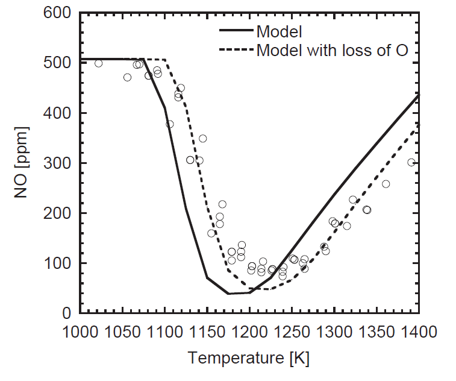

**图 44:** 干条件下 NO 被 NH3 还原的实验数据 [278] 与建模预测的比较。符号代表实验数据，而线代表建模预测。入口浓度：NH3 = 832 ppm, NO = 507 ppm, O2 = 4.0%，其余为 N2。停留时间 (s) = 92.7/T(K)。虚线表示通过使用表面原子 O 损失进行的建模预测，其速率常数为 kO,surf = 20·S/V · T^0.5 · exp(-2110/T) s⁻¹。

Kristensen 及其同事 [350,351] 讨论了湿系统中石英流动反应器表面上的自由基损失。图 45 展示了他们的结果，即在不同大小的石英反应器中湿 CO 的氧化。湿气 CO 氧化实验具有良好的重现性，与时间及不同大小的反应器无关。结果表明，在有水条件下，老化反应器石英表面上的自由基损失可以忽略不计。具有上述导出的速率常数的建模预测假设它与反应器的表面积/体积比成正比，显示出未在实验中观察到的反应器尺寸影响。

基于这些证据，我们得出结论，石英反应器中自由基的表面损失在与燃烧相关的温度下通常是可以忽略不计的。然而，活性物质的表面分解或氧化可能在某种程度上起作用，必须对反应缓慢的反应器实验或在起始时敏感的反应系统（例如，NH3 氧化）中的数据做出谨慎的解释。

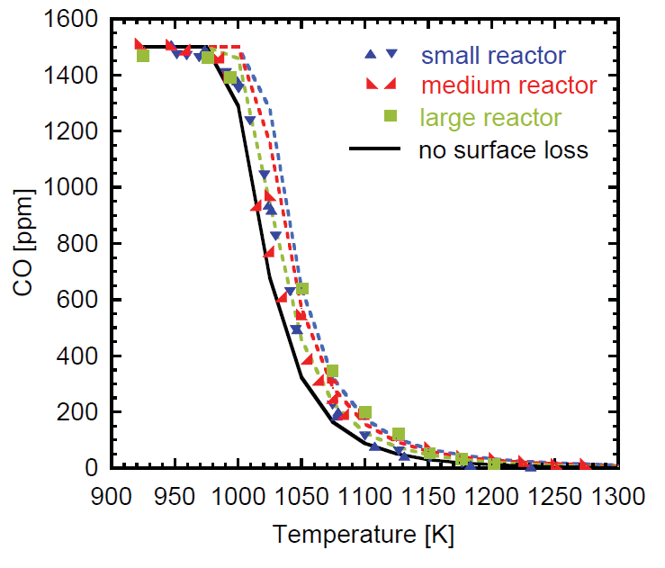

**图 45:** 流动反应器中湿 CO 氧化的实验数据 [350] 与建模预测的比较：石英反应器尺寸的影响。符号代表实验数据，而实线代表建模预测。反应器表面积与体积比为 10 cm⁻¹（小），7.8 cm⁻¹（中）和 4.4 cm⁻¹（大）。入口浓度：1468-1520（1500）ppm CO, 2.1% O2, 2.0% H2O，其余为 N2。停留时间为 64/T[K] s（小或中反应器）和 69/T[K] s（大反应器）。压力为 1.05 atm。建模预测是分别使用（虚线，颜色与相应的实验数据相同）和无（实线）表面原子 O 损失进行的，其速率常数为 kO,surf = 20·S/V · T^0.5 · exp(-2110/T) s⁻¹。

必须谨慎地解释来自反应缓慢的系统（例如 HNCO 氧化）或对引发敏感的系统的反应器实验或批次反应器实验中的数据（例如，NH3 氧化）。

# 附录 B: 烃自由基的形成与消耗

表 11 列出了 CHn 子集（n = 0-3）中的重要反应。亚甲基的三重态（³CH2）和单重态（¹CH2）主要通过涉及 H 和 OH 的反应由甲基生成。在目前的机理中，CH3 + H 生成 ³CH2 + H2 (R99) 的速率常数取自 Klippenstein（未发表工作），而代表逆反应的生成 ¹CH2 + H2 (R100b) 的通道，则采用了 Baulch 等人 [26] 的评估结果。CH3 + OH 反应 (R103, R104) 的速率常数基于 Jasper 等人 [352] 的理论工作。单重态 CH2 由 (R100b) 和 (R104) 生成后，主要通过快速的碰撞诱导系间窜越转化为三重态 (R105)。

CH 自由基由亚甲基通过反应 CH2 + H → CH + H2 (R106) 和 CH2 + OH → CH + H2O (R108) 形成。这两个步骤的速率常数一直存在疑问。反应 R106 [361-365] 的低温数据吻合良好，表明这是一个快速反应，速率常数约为 10¹⁴ mol cm⁻³ s⁻¹。然而，外推至高温尚不确定。早期的激波管 [366] 和火焰 [367] 高温数据表明，该反应在 2000 K 下不比 10¹³ mol cm⁻³ s⁻¹ 更快，而 Rohrig 等人 [358] 以及 Deppe 和 Wagner [368] 近期较新的激波管工作则建议在高温下也是快速反应。

对逆反应 CH + H2 → CH2 + H (R106b) 的速率常数测量 [369-372] 支持 Rohrig 等人 [358] 以及 Deppe 和 Wagner 的结论，即 CH2 + H 的速率常数在很大程度上与温度无关。图 46 比较了 R106 的可用数据，这些数据既直接的来自正向反应的测量，也通过平衡常数从转换的 k106b 数据获得。由反应 R106b 衍生的 k106 值普遍较大，可能由于竞争步骤 CH + H2 (+M) → CH3 (+M) 的干扰所致。在目前的工作中，我们应用了比 Baulch 等人 [26] 推荐值略快的速率常数 1.6·10¹⁴ cm³ mol⁻¹ s⁻¹。然而，数据存在显著分散，准确测定 k106 在广泛温度范围内是可取的。

**表 11：选定的参与烃自由基形成与消耗的反应。** 采用修正的 Arrhenius 表达式 k = A·T^β·exp(-E/[RT]) 使用的参数。单位为 mol, cm, s, cal。

| # | 反应 | A | β | E | Source |
|---|---|---|---|---|---|
| 99. | CH3 + H ⇌ ³CH2 + H2 | 1.2E06 | 2.43 | 11941 | a |
| 100. | ¹CH2 + H2 ⇌ CH3 + H | 7.6E13 | 0.00 | 0 | [354] |
| 101. | CH3 + O ⇌ CH2O + H | 6.9E13 | 0.00 | 0 | [26, 355] |
| 102. | CH3 + O ⇌ CO + H2 + H | 1.5E13 | 0.00 | 0 | [26, 355] |
| 103. | CH3 + OH ⇌ ³CH2 + H2O | 4.3E04 | 2.568 | 3997 | — |
| 104. | CH3 + OH ⇌ ¹CH2 + H2O | 2.2E14 | -0.53832 | -220 | [352], 0.013 bar |
| | | 1.2E15 | -0.72747 | 600 | 0.13 bar |
| | | 4.3E15 | -0.85972 | 1888 | 1.3 bar |
| 105. | ¹CH2 + M ⇌ CH2 + M | 1.3E13 | 0.00 | 400 | [356] (N2) |
| 106. | ³CH2 + H ⇌ CH + H2 | 1.6E14 | 0.00 | 0 | See text |
| 107. | ³CH2 + OH ⇌ CH2O + H | 2.9E13 | 0.1228 | -162 | [357] |
| 108. | ³CH2 + OH ⇌ CH + H2O | 8.6E05 | 2.019 | 6776 | [357] |
| 109. | ³CH2 + O2 ⇌ CO2 + H + H | 2.1E09 | 0.9929 | -269 | a |
| 110. | ³CH2 + O2 ⇌ CH2O + O | 1.3E06 | 2.4202 | 1604 | a |
| 111. | CH + H ⇌ C + H2 | 1.2E14 | 0.000 | 0 | [26] |
| 112. | CH + OH ⇌ HCO + H | 3.0E13 | 0.000 | 0 | [21] |
| 113. | CH + O2 ⇌ HCO + O | 9.7E13 | 0.000 | 0 | [358] |
| 114. | CH + OH ⇌ C + H2O | 4.0E07 | 2.000 | 3000 | [21] |
| 115. | CH + H2O ⇌ CH2O + H | 8.5E08 | 1.144 | -2051 | a |
| 116. | CH + CO2 ⇌ HCO + CO | 8.8E06 | 1.750 | -1040 | [359] |
| 117. | C + OH ⇌ CO + H | 5.0E13 | 0.000 | 0 | est |
| 118. | C + O2 ⇌ CO + O | 2.0E13 | 0.000 | 0 | [360] |

注 a：速率常数由 S.J. Klippenstein 计算（未发表工作）。

在反应 R102 和 R109 中，初始双分子产物在达到热化之前有显著比例解离。在此情况下，该直接解离分数的适当现象学速率模型需要将反应描述为生成三个独立的分子产物。

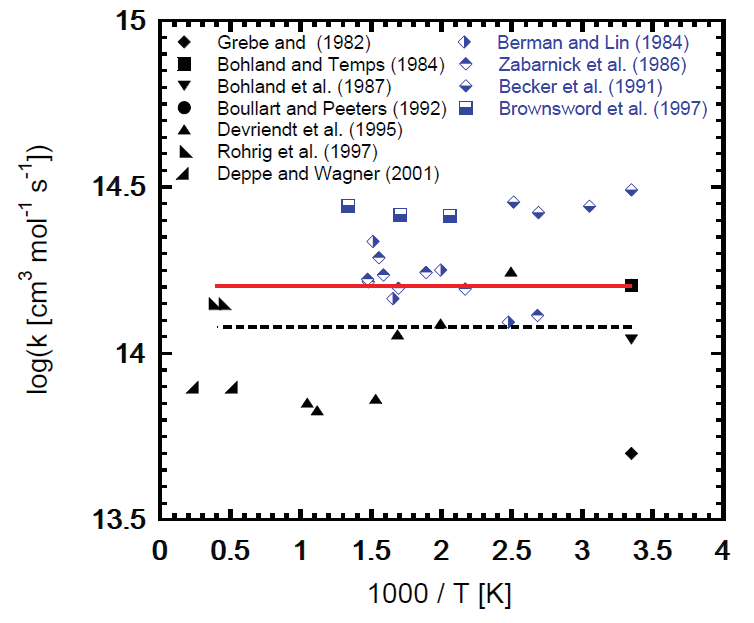

**图 46：** 反应 CH2 + H ⇌ CH + H2 (R106) 的阿伦尼乌斯图。实心符号表示正向反应的测量值，而空心符号表示源自逆反应步骤测量的数据，这些是利用热力学性质转换得到的。k106 的数据来源：Grebe 和 Homann [361]、Bohland 和 Temps [362]、Bohland 等人 [363]、Boullart 等人 [364]、Devriendt 等人 [365]、Rohrig 等人 [358] 以及 Deppe 和 Wagner [368]。源自 k106b 测量的派生数据：Berman 和 Lin [369]、Zabarnick 等人 [370]、Becker 等人 [371]、Brunsword 等人 [372]。实线表示目前模型中使用的值，而虚线表示 Baulch 等人 [26] 的推荐值。

对于 CH2 与 OH 的反应（R107, R108），我们依赖于 Jasper 等人 [357] 的理论工作。形成 CH 的反应 R106 和 R108 与涉及 O、OH 和 O2 的步骤相竞争，这些步骤形成含氧物种，从而加剧了 CHn 自由基池的消耗。

在最主要的消耗 CH 步骤中，在还原条件下是与原子氢的反应：

CH + H ⇌ C + H2 (R111)

Baulch 等人 [26] 推荐 k111 的值为 1.2·10¹⁴ cm³ mol⁻¹ s⁻¹，基于对激波管反应 R111b 的测量结果，由 Dean 等人 [373] 提供。快速反应得到了理论 [374] 的支持，但与室温下的测量值存在冲突 [375, 376]。反应 R111 与其他消耗 CH 的步骤相竞争，包括与 O、OH、O2 和 H2O 的反应。即使它们比自由基-自由基反应慢得多，在高浓度的燃烧产物条件下，CH 与 H2O 和 CO2 的反应可能会变得重要。CH 和 H2O 之间的反应生成甲醛，

CH + H2O ⇌ CH2O + H (R115)

图 47 显示了该反应的 Arrhenius 图。之前的建模研究依赖于 Zabarnick 等人 [377]（298-669 K）以及 Blitz 等人 [378]（291-673 K）的测量结果，这些数据显示反应 R115 具有负温度依赖性，使其在大多数燃烧条件下相对缓慢。最近，Klippenstein（未发表工作）在高水平理论研究下对该反应进行了研究。他计算出的速率常数在约 800 K 处有一个最小值，并在高于此值时随温度缓慢增加。他的速率常数被采纳于目前的模型中，结果是一个在燃烧温度下更具竞争性的反应，因此导致 CH 消耗更快。

CH 和 CO2 之间反应的速率常数已在更宽的温度范围（298-3500 K）进行了测量 [382-385]。显示在 Arrhenius 表达式中存在明显弯曲的数据，可通过 Glarborg 和 Bentzen [359] 提出的速率常数很好地描述。

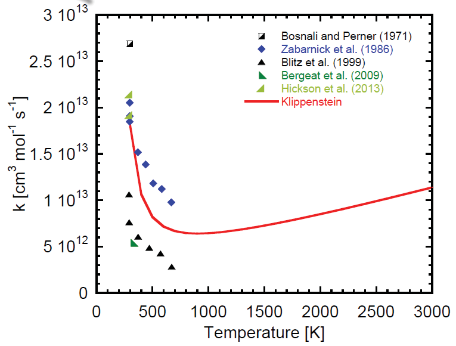

**图 47：** 反应 CH + H2O → CH2O + H (R115) 的阿伦尼乌斯图。符号表示测量值，实线表示理论计算结果。数据来源：Bosnali 和 Perner [379]、Zabarnick 等人 [377]、Blitz 等人 [378]、Bergeat 等人 [380]、Hickson 等人 [381] 以及 Klippenstein（未发表）。

## 4.2.3 模拟火焰中的 CHn 自由基池

报告的低压力预混甲烷火焰中的烃自由基浓度包括甲基 [303, 386, 387]、三重态亚甲基 [386] 单重态亚甲基 [388-394] 的数据。CH 的数据最为丰富，已在甲烷火焰 [62, 70, 95, 97, 303, 395–405] 以及 C2H2 [62, 97, 406]、C2H4 [35]、C2H6 [70, 405]、C3H6 [66] 和 C3H8 [70, 396, 405, 407] 的火焰中被检测到。

第 3.2.3 节中显示的图 11 比较了来自两组低压甲烷火焰（在不同燃料-空气当量比范围内获得）的测量和计算的 CH 分布。建模预测通常与测量结果令人满意地一致，在所有条件下 CH 浓度都捕获在 2 倍以内。这里我们将建模预测与通过分子束取样和质谱法获得的更广泛的 CH4 自由基的测量分布进行比较。

在图 48 中，将建模预测与 Hennessy 等人 [386] 的低压预混甲烷/氧气/氩气火焰数据进行了比较。该火焰的结构被模型很好地预测；所有主要物种（包括显示的 CH4）都被精确捕获。CH3 和 ³CH2 的峰值浓度被预测在 2 倍以内，但亚甲基峰值与测量分布相比偏移了约 1.5 mm。

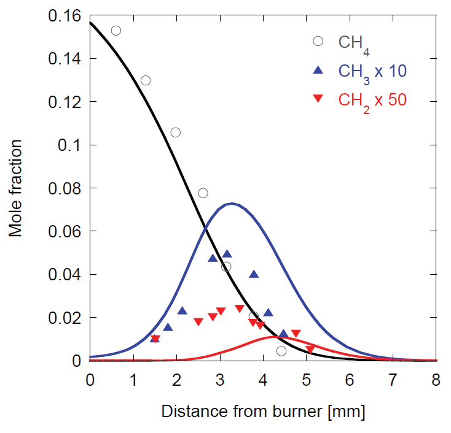

**图 48：** 低压预混甲烷/空气火焰中 CH4、CH3 和 ³CH2 摩尔分数的测量值 [386] 与预测值的比较。符号表示实验数据，实线表示计算值。条件：压力 20 torr，入口组成 19% CH4, 38% O2，其余为 Ar。最大火焰温度约为 2300 K，未燃气体混合物速度为 119 cm/s。

图 49 比较了来自 Blauwens 等人 [35] 的低压预混乙烯/O2/N2 火焰的 ³CH2、CH 和 C 的测量与预测分布。该火焰在接近化学计量条件下运行。虽然 CH 计算得相当准确，但模型将 ³CH2 和 C 浓度分别高估了 2 倍和 3 倍。

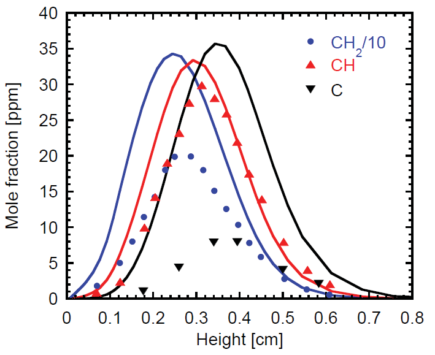

**图 49：** 低压预混乙烯/O2/N2 火焰中 ³CH2、CH 和 C 摩尔分数的测量值 [35] 与预测值的比较。符号表示实验数据，实线表示计算值。条件：压力 30 torr，入口组成 23.5% C2H4, 38.5% O2，其余为 N2，接近化学计量条件。

Hennessy 等人和 Blauwens 等人的火焰中测量的自由基浓度不确定性据报道分别为 3 倍和 2 倍。Lamoureux 等人 [72] 和 Berg 等人 [95] 通过激光诊断测量了 CH 浓度，估计精度为 20%（见第 3.2.3 节）。我们估计，小碳氢化合物燃烧中 CH3 自由基浓度的建模预测大多在 2 倍以内准确。

对于较大的碳氢化合物，燃料衍生自由基的形成和消耗更为复杂。Sutton 等人 [70] 将建模预测与不同燃料和化学计量比的火焰测量进行了比较，并得出结论：所测试的机理无法在更广泛的燃料和条件范围内准确预测 CH 浓度。此外，对于更复杂的燃料，较大的碳氢化合物自由基（如炔丙基 C3H3）在与氮化学相互作用时可能变得重要。这方面需要更多工作，但这超出了本综述的范围。
*（内容由AI生成，仅供参考）*
