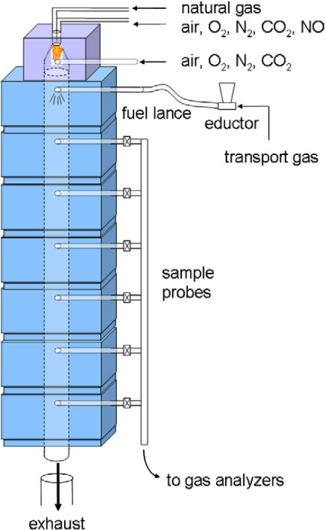
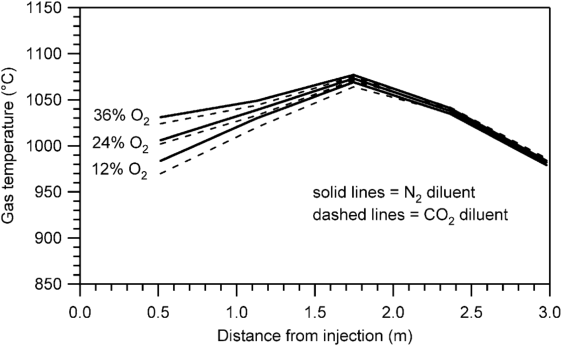
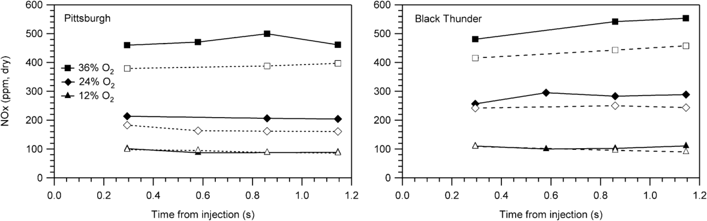
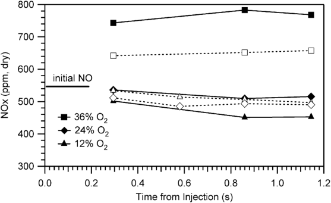
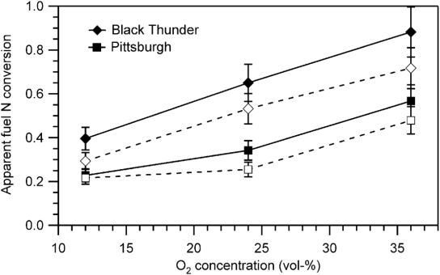
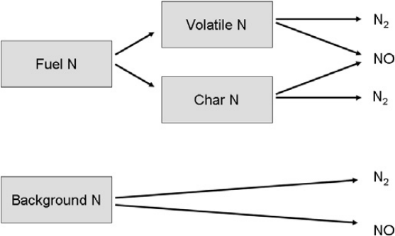
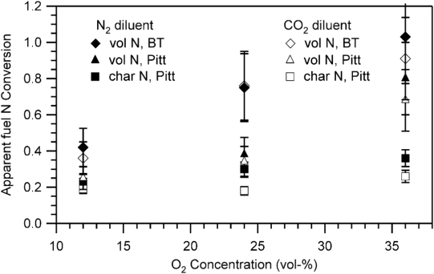
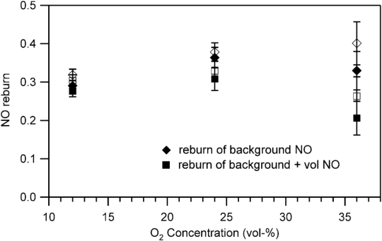

# 煤粉富氧燃烧过程中 NOx 生成的基础研究

**作者**：Christopher R. Shaddix ⇑, Alejandro Molina ¹

**单位**：Combustion Research Facility, Sandia National Laboratories, Livermore, CA 94550, United States（美国桑迪亚国家实验室燃烧研究装置）

**出处**：Proceedings of the Combustion Institute 33 (2011) 1723–1730

---

## 摘要

在 N2 和 CO2 气氛、等温及近似恒定氧浓度（即稀释煤粉装载）条件下，测量了煤粉与煤粉焦燃烧过程中的 NOx 生成。研究了三种氧浓度（12% O2、24% O2、36% O2）和两种代表性美国煤，气体温度为 1050 ℃。为考察 NO 再燃反应的重要性，还在煤引入气流中额外加入高浓度（550 ppm）NO 进行了实验。在低背景 NO 水平下，随着主体气体氧含量的增加，燃料氮转化为 NOx 的分率在 N2 和 CO2 气氛下均显著升高，但在 CO2 气氛下燃料转化率通常较低。焦-N 转化率低于挥发分-N 转化率，尤其是在高氧浓度下。这些结果凸显了挥发分火焰温度和焦燃烧温度对 NOx 生成的重要性。在高背景 NOx 条件下，仅在 36% O2 环境中观察到净 NOx 生成。在这些稀释装载条件下，NO 再燃率为 20%–40%，取决于煤种、稀释剂采用 N2 还是 CO2、主体 O2 浓度，以及是否考虑挥发分-NOx 的再燃。该数据集为理解和区分富氧燃烧条件下 NOx 的不同来源与汇提供了独特机会。

**关键词**：煤燃烧；NOx；富氧燃烧；CO2 再循环；再燃

---

## 1. 引言

煤的烟气再循环富氧燃烧（oxy-fuel combustion）是在实现近零气体排放的同时继续利用煤进行发电的一种有前景的方法 [1,2]。该工艺产生的近纯 CO2 产品流适用于提高采收率（EOR）、煤层气（CBM）开采或地质封存，以缓解 CO2 排放对全球气候变化的贡献。与煤气化过程的碳捕集相比，煤的富氧燃烧可将碳捕集与封存作为常规煤粉锅炉的改造技术，充分利用现有锅炉所代表的巨大资本投入。此外，富氧再循环燃烧是对现有煤粉（pc）燃烧技术的一种适度改进，该技术具有经过充分验证的可靠性和工业接受度。

O2/CO2 再循环燃烧的一个重要附带好处是大部分污染物排放的降低，尤其是 NOx。根据烟气压缩程度（用于 CO2 回收和输送）以及所需二次烟气净化程度的不同，锅炉排出的 NOx 可能以液体流出物形式被捕集 [3]，也可能可与 CO2 一起封存。然而在短期内，满足 NOx 的最佳可用控制技术（BACT）排放标准十分重要，因为在技术实施过程中烟气偶尔会排放到大气中。即使从长远来看，在系统启动/重启操作期间排放烟气时，可能仍需满足 BACT 排放标准。

已有大量关于煤粉富氧燃烧中 NOx 生成的研究，采用了各种反应器和燃烧器构型，包括携带流反应器 [4–8]、层流燃烧器 [9] 和旋流燃烧器 [10–15]。这些研究显示，与空气气氛煤粉燃烧相比，NOx 减排程度各不相同，如 Toftegaard 等人 [16] 近期综述所述。O2 再循环燃烧中 NOx 排放通常较低，原因是：(a) 使用近乎无 N2 的氧化剂，热力（Zeldovich）型和快速型 NOx 生成可忽略；(b) 再循环 NOx 的再燃。Normann 等人 [17] 和 Mackrory、Tree [9] 还证明，在主体气体中 N2 可忽略的高温富氧燃烧条件下，逆 Zeldovich 机理可对 NO 破坏作出显著贡献。然而，O2/CO2 再循环燃烧通常使用较高氧浓度以维持火焰稳定性和炉膛出口温度（即锅炉传热），且富氧煤粉火焰局部常存在极高氧浓度，若燃烧器设计运行不当，可能导致燃料氮生成 NOx 增多 [14]。

目前对 O2/CO2 再循环燃烧过程中 NOx 各生成与破坏路径相互作用的理解仍然缺乏。特别是热力型、快速型和燃料-N NOx、火焰区再循环 NOx 再燃以及煤粉富氧燃烧中煤焦对 NOx 还原的相对重要性尚未明确。为增进对这些复杂相互作用的理解，我们在一个大型湍流携带流反应器中，于等温和近似恒定氧浓度条件下开展了煤粉与焦颗粒燃烧的 NOx 生成实验。这一高度受控的数据集为理解和区分富氧燃烧条件下 NOx 的不同来源与汇提供了独特机会。

---

## 2. 实验

### 2.1 气体组成与温度

实验在桑迪亚多功能燃烧器（MFC）中进行。MFC 是一台电加热、下喷式湍流携带流反应器，长 4.2 m，内流道直径 150 mm（见图 1）。该装置的基本布局已在文献中描述 [18]。为开展富氧燃烧实验，对 MFC 的气体供应系统进行了改造，可提供干燥氮气、氧气或二氧化碳的混合气，从而可研究多种 O2/N2 或 O2/CO2 条件。本文报道的实验中，MFC 顶部的天然气燃烧器用于在反应气体流入主反应管（燃料颗粒在此引入）之前对其进行预热。该气体燃烧器可在轻微富氧条件下运行。为在 MFC 中产生预热的富氧混合气体，将强富氧气体混合物与气体燃烧器流出物在进入 MFC 前快速混合。

初步实验表明，当气流氧含量在 10 vol% O2 到 40 vol% O2（N2 或 CO2 气氛）之间变化时，MFC 可维持名义 1050 ℃（1320 K）的运行温度。因此，建立了一系列在 MFC 中采用稀释煤或煤焦装载的实验条件，其燃烧过程中的平均氧含量名义上匹配我们之前在较小流动反应器中研究煤颗粒着火和富氧燃烧焦燃烧动力学时使用的 12、24 和 36 vol% O2 条件 [19–21]。为尽量减少煤燃烧释放的热量（这会改变气体温度分布）以及颗粒燃烧过程中氧含量的变化，这些实验选择了贫燃当量比 0.15。在此条件下，煤燃烧前后的氧含量仅变化 15%，如表 1 所示。

所研究煤和煤焦燃烧过程中测得的气体温度分布（图 2）显示，由于引入煤或焦燃烧的放热，温度略有升高；富氧水平越高，温度升高出现得越早，这大概是因为氧含量越高，煤和焦颗粒燃尽越快。氧浓度较高的流动条件下温度也略高，因为为在高氧浓度下维持恒定当量比需要更高的燃料装载量，从而在近似恒定的气体体积流量下释放更多热量。

注意，本研究有意选择实验条件，以生成表征煤颗粒在给定氧-稀释剂环境中燃烧特性的 NO 生成数据（即煤颗粒在整个燃烧寿命期间经历已知的主体气体浓度和温度）。与煤在空气或富氧氮气/二氧化碳中近化学计量混合燃烧（类似于实际锅炉运行）时收集的更典型数据相比，这些数据应能更深入地揭示控制 NOx 生成的化学和物理现象。后一类数据有助于追踪富氧燃烧中 NO 生成的总体趋势，但由于燃烧过程中经历的氧浓度（通常从 30+ vol% O2 降至几个 vol% O2）和温度范围很广，其科学认识有限。此外，后一类研究中的高颗粒装载将 NO 生成和破坏过程交织在一起，而本研究稀释装载条件下以 NO 生成过程为主（至少在初始 NO 水平较低时如此）。为单独考察 NO 再燃的强度，还在煤引入气流中加入高水平 NO 进行了实验。这些实验中进入 MFC 的 NO 浓度约为 550 ppm，而典型基线浓度为 30 ppm NO。



**图 1** 桑迪亚多功能燃烧器（MFC）示意图，为富氧燃烧研究配置

### 2.2 气体分析

沿反应器每 0.6 m 使用一系列碳化硅探针（内径 7.6 mm × 长 0.5 m）抽取气体样品。样品气离开探针后，经保持在 135 ℃ 的加热特氟龙管，通过加热微粒过滤器，然后由两套独立的 Horiba 气体分析系统（各配备水汽去除系统）分析。气体分析系统以干基测量 CO2（NDIR 和热电式分析仪）、CO（NDIR）、NO（NDIR 和化学发光分析仪，设置为测量总 NOx）以及 O2（顺磁和氧化锆分析仪）的浓度。除 NOx 外，两套分析系统的结果对所有物种的偏差均在 5% 以内，对 NOx 的偏差在 10% 以内。对于给定实验，沿反应器平均 NOx 分布在两套分析仪中显示相似趋势。在给定 NOx 时间记录内，标准差在 1%–10% 之间，大多数数据记录的标准差为几个百分点。每台 NOx 分析仪的报道不确定度为满量程的 ±1%，对大多数报道的测量值相当于 3 ppm。NOx 时间记录中观察到的较大变异反映了煤给料速率微小变化的影响。本文使用两套 NOx 分析系统结果的平均值。

### 2.3 煤与焦

本研究的煤包括 Pittsburgh 煤（一种典型的美国东部中硫高挥发分烟煤）和 Black Thunder 煤（美国西部粉河盆地（PRB）开采量最大的低硫次烟煤之一）。这两种煤经商业粉磨，满足典型煤粉燃烧器规格（70 wt% 通过 200 目）。表 2 给出了这些煤的工业分析和元素分析。煤和焦中氮的质量分数由 Huffman Labs（科罗拉多州戈尔登）用标准元素分析仪测定。未尝试解吸可能吸附在颗粒表面的 N2 [22,23]。由于煤的比表面积小，这不会显著影响煤的分析，但可能高估焦的氮含量。

除燃烧原煤研究 NO 生成外，还燃烧了 Pittsburgh 煤焦颗粒，以评估燃料挥发分对 NOx 生成和再燃的影响。焦颗粒的制备方法是：在 MFC 以 2% O2、1500 K 运行时注入大量煤流，并用名义截断尺寸 10 μm 的旋风分离器在 MFC 底部收集焦颗粒 [24]。为满足旋风分离器的流量要求并同时淬熄热反应器流，以 26:1 的稀释比向 MFC 出口流加入空气。按灰示踪分析，以此方式制备的焦的（焦）燃尽率为 37%，且挥发分可忽略，如表 2 所示。测得的焦粒径分布显示，在 10 到 20 μm 以下急剧下降（符合预期），其余部分与原煤的粒径分布一致 [24]。

---

## 3. 结果

### 3.1 NOx 浓度

低背景和高背景 NOx 条件下煤燃烧实验中在 MFC 内测得的 NOx 浓度分别示于图 3 和图 4。一氧化碳（CO）的测量（此处未显示）表明，煤在第一个取样位置处已基本完全燃烧，因此随着反应器内停留时间的增加，NOx 仅出现微小变化。测得 NOx 浓度随主体气体氧含量从 12 增至 36 vol% 而显著增加。在富氧水平下，CO2 主体气体中燃烧明显降低 NOx 生成，而在 12% O2 时，NOx 生成不随稀释剂气体或煤种而变化。Black Thunder 煤产生的 NOx 高于 Pittsburgh 煤（在富氧水平下），尽管 Black Thunder 煤中燃料氮含量较低。在低氧水平（12 vol% O2）下，NOx 水平随 MFC 中停留时间的增加而持续下降（在煤燃烧初始升高之后），而在 24% O2 下，NOx 水平随停留时间大致保持不变。在 36% O2 下，NOx 水平随停留时间趋于增加，尤其是 Black Thunder 煤。



**图 2** 所研究条件下，距 MFC 顶部距离的函数关系——气体温度（由 3.2 mm 直径 K 型热电偶测量）

**表 1** NOx 生成实验的主要气体浓度（Pittsburgh 煤）

| 名义条件 | 煤燃烧前 (vol%) |  |  |  | 煤燃烧后 (vol%) |  |  |  |
|---|---|---|---|---|---|---|---|---|
|  | O2 | N2 | CO2 | H2O | O2 | N2 | CO2 | H2O |
| 12% O2 in N2 | 12.6 | 75.9 | 3.9 | 7.6 | 10.7 | 75.7 | 5.4 | 8.2 |
| 24% O2 in N2 | 25.0 | 63.5 | 3.9 | 7.6 | 21.2 | 63.2 | 6.9 | 8.7 |
| 36% O2 in N2 | 37.6 | 50.9 | 3.9 | 7.6 | 31.9 | 50.5 | 8.3 | 9.3 |
| 12% O2 in CO2 | 13.3 | 1.1 | 73.9 | 11.7 | 11.3 | 2.3 | 74.3 | 12.1 |
| 24% O2 in CO2 | 26.0 | 1.1 | 61.2 | 11.7 | 22.2 | 1.2 | 63.8 | 12.8 |
| 36% O2 in CO2 | 38.7 | 1.1 | 48.6 | 11.7 | 32.9 | 1.1 | 52.6 | 13.4 |



**图 3** 所示氧水平下煤燃烧期间测得的 NOx 浓度。实线和实心符号表示 N2 稀释剂，虚线和空心符号表示 CO2 稀释剂。煤注入前初始 NO 为 30 ± 10 ppm。未显示误差棒，因为测量不确定度在符号尺寸以内。



**图 4** 高初始 NOx 水平下 Pittsburgh 煤燃烧期间测得的 NOx 浓度。线和符号方案与图 3 相同。N2 稀释剂煤注入前初始 NO 为 530 ± 30 ppm，CO2 稀释剂为 570 ± 80 ppm。未显示误差棒，因为测量不确定度在符号尺寸以内。

当煤在高背景 NOx 水平下燃烧时（模拟实际富氧燃烧中再循环 NOx），净 NOx 生成大大减少，如图 4 所示。在 12 vol% O2 燃烧时，NOx 浓度实际上略有下降（即煤燃烧期间发生净 NOx 破坏），在 24% O2 时净 NOx 生成基本为零。在 36% O2 时存在显著的 NOx 净生成，尤其是 N2 稀释剂。

**表 2** 煤与焦的工业分析和元素分析

|  | Pittsburgh 煤 |  | Black Thunder 煤 |  | Pittsburgh 焦 |  |
|---|---|---|---|---|---|---|
| 工业分析 | wt%, 收到基 | wt% 干基 | wt%, 收到基 | wt% 干基 | wt%, 收到基 | wt% 干基 |
| 水分 | 1.4 | — | 10.8 | — | 1.1 | — |
| 灰分 | 6.9 | 7.0 | 5.0 | 5.6 | 19.4 | 19.6 |
| 挥发分 | 35.4 | 35.9 | 40.4 | 45.3 | 3.3 | 3.3 |
| 固定碳 | 56.3 | 57.1 | 43.8 | 49.1 | 76.2 | 77.1 |
| 元素分析 | wt% 干基 | wt% 干燥无灰基 | wt% 干基 | wt% 干燥无灰基 | wt% 干基 | wt% 干燥无灰基 |
| C | 77.2 | 82.9 | 60.9 | 64.1 | 76.1 | 94.7 |
| H | 5.2 | 5.6 | 5.2 | 5.5 | 0.7 | 0.9 |
| O^a^ | 7.2 | 7.7 | 27.6 | 29.1 | 1.1 | 1.3 |
| N | 1.5 | 1.6 | 0.9 | 0.9 | 1.3 | 1.6 |
| S | 2.0 | 2.2 | 0.4 | 0.5 | 1.2 | 1.5 |

^a^ 差减法求得。

### 3.2 燃料-N 转化

为正确解释 NOx 生成随主体气体氧含量及不同固体燃料的变化，必须考虑不同流动条件下燃料装载量的变化。此外，Black Thunder 煤的氧含量较高，需要更高的质量装载量才能达到与 Pittsburgh 煤相同的化学计量比。假设大部分 NOx 来源于燃料氮，分析 NOx 数据更具洞察力的方法是将其表示为燃料氮转化为 NOx 的表观分率，可按式 (1) 计算，使用燃料的实测 N 含量和实验中易于测量的参数：

**式 (1)**
```
N_NOx / N_(0,fuel) = [NOx] × V̇(P/RT) / (Y_(N,fuel) × Ṁ_fuel / MW_N)
```

其中 V̇ 为气体体积流量，P 为系统压力，R 为理想气体常数，T 为气体温度，Y(N,fuel) 为燃料中氮的质量分数，Ṁfuel 为固体燃料质量流量，MWN 为氮的原子量。式 (1) 中的 [NOx] 为测得的 NOx 浓度，通过反应器质量平衡校正为湿基。采用 NOx 测量 3% 的典型标准差、炉气与煤流量 5% 的估计不确定度以及燃料-N 含量 10% 的估计不确定度，由式 (1) 确定的转化分率的不确定度为 13%。

当使用 CO2 稀释剂且背景 NO 可忽略时，式 (1) 可被准确解释，此时煤或焦是系统中唯一的显著氮源。当使用 N2 稀释剂或存在显著背景 NO 时，该计算仍然有用，但不一定精确反映燃料氮转化率（因为存在其他潜在重要的 NO 源和汇，如热力型和快速型 NOx 生成以及 NOx 再燃）。

图 5 显示了计算得到的煤氮转化率，使用 MFC 中最后一个取样点（燃料注入后停留时间 1.2 s）的数据作为煤完全燃烧时 NOx 的代表值。从该图可明显看出，Pittsburgh 煤颗粒在 12% O2 气氛中燃烧时，只有 1/5 的燃料氮转化为 NOx。在 24% O2 时，N2 稀释剂中约有 1/3 的燃料氮转化为 NOx，而在 CO2 环境中约有 1/4 转化。在 36% O2 时，转化因子分别增加到 55% 和 45%。对于 Black Thunder 煤，燃料氮转化因子在 12% O2 燃烧时约为 35%，24% O2 燃烧时约为 60%，36% O2 燃烧时约为 80%，且在 CO2 环境中的氮转化下降与 Pittsburgh 煤相似。



**图 5** Pittsburgh 和 Black Thunder 煤的燃料-N 转化因子随主体 O2 含量的变化。实线和实心符号表示 N2 稀释剂，虚线和空心符号表示 CO2 稀释剂。误差棒基于对式 (1) 的误差传播。

回顾这些实验的氧含量在煤燃烧过程中保持相对恒定，因此随着主体氧浓度升高，挥发分火焰温度和煤焦燃烧温度均升高。观察到的氮转化因子随气流 O2 含量增加而升高，可能反映了挥发分火焰和焦燃烧温度的升高。我们之前的建模分析 [24] 表明，挥发分氮和焦氮燃烧形成的重要中间物种 NCO 随温度升高越来越多地转化为 NO。对于 36% O2 in N2 的情况，挥发分燃烧过程中甚至可能形成一些热力型或快速型 NOx，尽管 N2 与 CO2 环境结果的微小差异表明这只是次要因素。Spinti 和 Pershing [25] 在其燃烧实验中也发现了类似的焦氮转化率随烟气中过量氧增加而升高的趋势。

### 3.3 通量分析

Pittsburgh 焦燃烧实验结果可与 Pittsburgh 煤燃烧实验通过通量分析相结合，方案如图 6 所示。该方案还允许利用极低背景 NOx 和高背景 NOx 数据的组合计算再燃分数。图 6 所示的 NOx 生成与再燃复杂相互作用的简化表示不能有意义地应用于涉及高颗粒装载和变化气相组成的典型燃烧实验，但应适用于当前数据集。

为应用该方案，假设在研究的条件范围内，给定煤的煤氮在挥发分和焦之间的分配保持恒定。对于 Pittsburgh 煤，基于先前在相似流动条件下对该煤氮释放的测量 [26]，假设该分配相等。一般而言，次烟煤的煤氮分配为挥发分形式略多于焦形式 [26]，因此 Black Thunder 煤氮的 60% 被分配给挥发分形式。利用这些燃料氮分配分率，可由煤燃烧和焦燃烧转化因子按式 (2) 计算挥发分 N 转化因子：

**式 (2)**
```
CF_vol = ( [N_coal] × CF_coal − [N_char] × CF_char ) / [N_vol]
```

其中 CF 为氮转化因子，下标 vol 指煤的挥发分组分。对于焦氮转化因子 0.3、煤氮在焦和挥发分间对半分配的情况，由式 (2) 确定挥发分转化因子的估计不确定度为 25%。

图 7 显示了 Pittsburgh 煤测得的焦 N 转化因子和由式 (2) 推导的挥发分 N 转化因子。未对 Black Thunder 煤的焦 N 转化因子进行测量。然而，先前的测量表明，次烟煤和烟煤焦在相同流动环境中燃烧时的 N 转化因子基本相同 [27]。因此，合理假设 Black Thunder 焦 N 转化率与每个实验条件下 Pittsburgh 煤的实测值大致相同。考虑到不同煤焦燃烧过程的相似性，以及 Pittsburgh 焦 N 转化因子随气流 O2 含量变化很小，这一假设似乎是合理的。Black Thunder 挥发分 N 转化的预测结果也示于图 7。



**图 6** 应用通量分析分析 MFC 中煤粉和煤粉焦燃烧期间 NOx 生成所考虑的氮转化路径示意图。



**图 7** Pittsburgh 和 Black Thunder 煤的焦 N 和挥发分 N 转化因子随主体 O2 含量的变化。实心符号表示 N2 稀释剂，空心符号表示 CO2 稀释剂。Pittsburgh 煤在 12% O2 时的挥发分 N 转化率与焦 N 相同。误差棒基于式 (1) 和式 (2) 的误差传播。

图 7 的结果显示，在富氧水平下，挥发分生成的 NOx 占总煤-NOx 生成的比例更大。这可能是因为氧浓度对挥发分火焰温度的影响大于对焦燃烧温度的影响 [28]。CO2 背景气体在 24% O2 和 36% O2 时对焦-NOx 转化有较小影响，在 12% O2 时影响可忽略。Black Thunder 煤的挥发分氮转化率显著高于 Pittsburgh 煤，在 36% O2 燃烧时达到完全转化为 NOx。对两种煤而言，CO2 稀释剂仅在高 O2 浓度下影响挥发分 N 转化因子。

对于高背景 NO 实验，需要考虑该背景 NO 的部分还原（即"再燃"），如图 6 所示。为评估这一点，使用低背景 NO 条件下建立的燃料氮转化因子来预测燃料氧化期间会产生多少 NO。然后从测量到的 NO 中减去该燃料-NO 生成量，差值除以初始背景 NO 得到（背景 NO 的）再燃分数。当然，挥发分衍生的 NO 也可能发生再燃，因此在假设挥发分衍生 NO 与主体气体中提供的 NO 以相同效率再燃的条件下也计算了再燃分数。这两种计算的结果示于图 8。



**图 8** Pittsburgh 煤燃烧期间计算得到的 NO 再燃分数随主体 O2 含量的变化。实心符号表示 N2 稀释剂，空心符号表示 CO2 稀释剂。菱形和正方形分别表示仅基于原始背景 NO 水平的再燃分数，以及基于背景 NO 与煤挥发分燃烧预期生成 NO 之和的再燃分数。误差棒基于误差传播和对无再燃时 NO 生成预测 10% 的估计不确定度。

考虑背景 NO 再燃，N2 环境的数据显示再燃分数从 12% O2 的略低于 0.30 小幅增至 24% O2 的 0.36，在 36% O2 时略微下降至 0.33。然而，随着气流 O2 含量的增加，推导出的再燃分数不确定度增大，难以确定明确的趋势。再燃分数在 CO2 环境中似乎略高，并随 O2 含量升高呈一致上升趋势。CO2 条件下较高的再燃分数与 Spinti 和 Pershing [25] 在空气及含少量 CO2 的人造空气中高温焦燃烧中发现的结果一致，即人造空气中较低的焦燃烧温度促进了更大的 NO 再燃。Okazaki 和 Ando [4] 的研究也发现，由于 CO2 浓度升高，净 NOx 生成略有下降，但将该效应完全归因于 CO2 对 NOx 生成的影响。

当同时考虑背景 NO 与挥发分 NO 的再燃时，再燃分数略低，尤其是在 36% O2 环境中。遗憾的是，无论是选择仅基于背景 NO 再燃的解释，还是基于背景 NO 与煤挥发分燃烧生成 NO 相结合的再燃解释，都没有明确的理性依据。

---

## 4. 结论

在稀释煤装载条件下、气体温度 1050 ℃、O2 浓度 12%–36% 范围内，燃料氮转化为 NOx 的分率随主体气体氧含量的增加而显著升高：典型美国高挥发分烟煤从 20% 转化增至 50% 转化，典型美国次烟煤从 40% 增至 90%。与 N2 环境相比，CO2 环境中的转化分率略低。由高挥发分烟煤制备的煤粉焦颗粒实验显示，在 12% 和 24% O2 下转化分率略低于原煤，在 36% O2 下显著低于原煤。同样，焦在 CO2 环境中的转化分率略低。为考察 NO 再燃反应的重要性而在高背景 NOx 条件下进行的实验，仅在 36% O2 环境中产生净 NOx 生成。计算得到的 NO 再燃分数在 20%–40% 之间，大多数值集中在 30% 左右。

## 致谢

本研究由美国能源部（DOE）通过国家能源技术实验室电力系统高级研究项目资助，由 Robert Romanosky 博士管理。Sandia 是由洛克希德·马丁公司运营的多项目实验室，为 DOE 国家核安全管理局服务，合同号 DE-AC04-94AL85000。

---

## 参考文献

[1] B.J.P. Buhre, L.K. Elliott, C.D. Sheng, R.P. Gupta, T.F. Wall, Prog. Energy Combust. Sci. 31 (4) (2005) 283–307.

[2] R. Tan, G. Corragio, S. Santos, Oxy-Coal Combustion with Flue Gas Recycle for the Power Generation Industry. A Literature Review, Report No. IFRF Doc. No. G 23/y/1, International Flame Research Foundation, 2005.

[3] V. White, L. Torrente-Marciano, D. Sturgeon, D. Chadwick, Energy Proc. 1 (2009) 399–406.

[4] K. Okazaki, T. Ando, Energy 22 (2/3) (1997) 207–215.

[5] Y. Hu, S. Naito, N. Kobayashi, M. Hasatani, Fuel 79 (2000) 1925–1932.

[6] Y.Q. Hu, N. Kobayashi, M. Hasatani, Fuel 80 (2001) 1851–1855.

[7] Y.Q. Hu, N. Kobayashi, M. Hasatani, Energy Convers. Manage. 44 (2003) 2331–2340.

[8] Y. Liu, Y. Yu, W. Yan, Z. Zhao, G. Zhengyang, Experimental studies on NO emissions, in: Coal Combustion Facing the 21st Century from O2/CO2 coal combustion, Southeast University Press, Nanjing, PRC, 2003.

[9] A.J. Mackrory, D.R. Tree, Combust. Sci. Technol. 181 (2009) 1413–1430.

[10] N. Kimura, K. Omata, T. Kiga, S. Takano, S. Shikisima, Energy Convers. Manage. 36 (6–9) (1995) 805–808.

[11] T. Kiga, S. Takano, N. Kimura, et al., Energy Convers. Manage. 38 (Suppl.) (1997) S129–S134.

[12] T. Nozaki, S.-I. Takano, T. Kiga, Energy 22 (2/3) (1997) 199–205.

[13] E. Croiset, K.V. Thambimuthu, Fuel 80 (2001) 2117–2121.

[14] E.H. Chui, A.J. Majeski, M.A. Douglas, Y. Tan, K.V. Thambimuthu, Energy 29 (2004) 1285–1296.

[15] K. Andersson, F. Normann, F. Johnsson, B. Leckner, Ind. Eng. Chem. Res. 47 (2008) 1835–1845.

[16] M.B. Toftegaard, J. Brix, P.A. Jensen, P. Glarborg, A.D. Jensen, Prog. Energy Combust. Sci. 36 (2010) 581–625.

[17] F. Normann, K. Andersson, B. Leckner, F. Johnsson, Fuel 87 (2008) 3579–3585.

[18] L.G. Blevins, T.H. Cauley III, J. Eng. Gas Turb. Power 127 (2005) 457–463.

[19] A. Molina, C.R. Shaddix, Proc. Combust. Inst. 31 (2007) 1905–1912.

[20] C.R. Shaddix, A. Molina, Proc. Combust. Inst. 32 (2009) 2091–2098.

[21] A. Molina, C.R. Shaddix, Proceedings of the 34th International Technical Conference on Coal Utilization and Fuel Systems, Clearwater FL, June 1–5, 2008.

[22] K. Matsuoka, T. Horii, T. Aihara, T. Kyotani, A. Tomita, Energy Fuels 17 (2003) 359–362.

[23] T. Lang, A.D. Jensen, P.A. Jensen, Energy Fuels 19 (2005) 1631–1643.

[24] A. Molina, J.J. Murphy, F. Winter, B.S. Haynes, L.G. Blevins, C.R. Shaddix, Combust. Flame 156 (2009) 574–587.

[25] J.P. Spinti, D.W. Pershing, Combust. Flame 135 (2003) 299–313.

[26] L.L. Baxter, R.E. Mitchell, T.H. Fletcher, R.H. Hurt, Energy Fuels 10 (1996) 188–196.

[27] P.F. Nelson, P.C. Nancarrow, J. Bus, A. Prokopiuk, Proc. Combust. Inst. 29 (2002) 2267–2274.

[28] C.R. Shaddix, A. Molina, Ignition, flame stability, and char combustion in oxy-fuel combustion, in: L. Zheng (Ed.), Oxy-Fuel Combustion for Fossil-Fuel Power Plants, Woodhead Publishing, Cambridge, UK, 2011.
