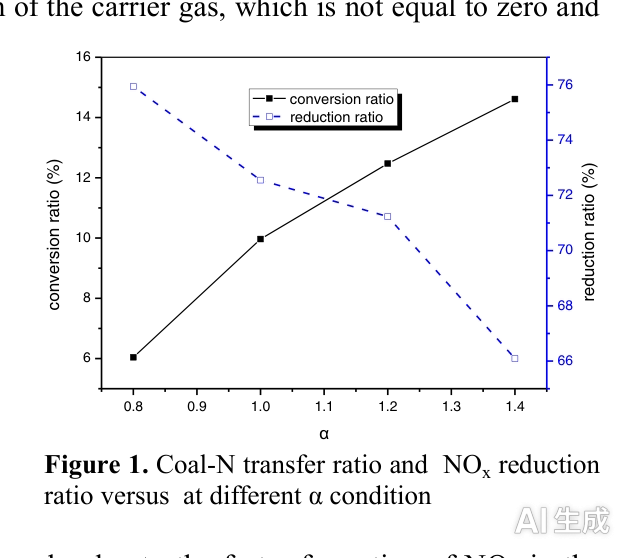
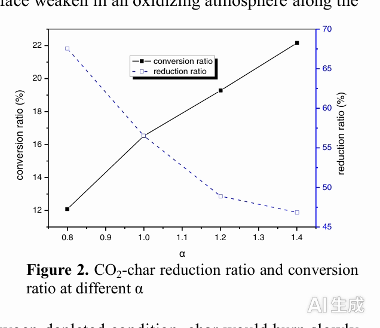
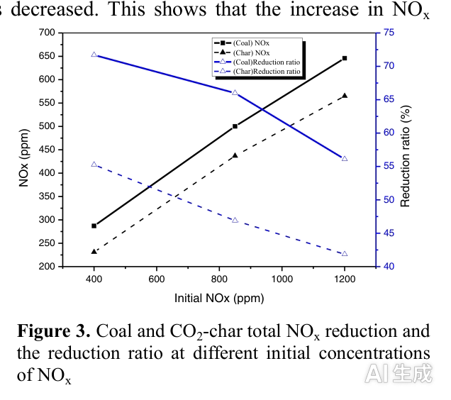

---
AIGC:
    Label: "1"
    ContentProducer: 001191440300708461136T1XGW3
    ProduceID: 4dcff8c4f0c4eb682e9fb9e4b0ef72a3_1a87cc17b33c11f18368525400248c00
    ReservedCode1: ktI041+IdsIIYFExn0EF2IYsof6/xo4b4cWol/3ejxRE4AnsyYoA4vMEwL06V3wejuKycfEfi6yjBXGondL3qhzLj8/6+roKRLk/QIoaDqFsPoT42HUIJWmW5DKab/LWbiwTK+08GqNQmN0avtPijbIDffWkRKl3zdsqAIXgcUpnjjVqA+FY0dL7cKk=
    ContentPropagator: 001191440300708461136T1XGW3
    PropagateID: 4dcff8c4f0c4eb682e9fb9e4b0ef72a3_1a87cc17b33c11f18368525400248c00
    ReservedCode2: ktI041+IdsIIYFExn0EF2IYsof6/xo4b4cWol/3ejxRE4AnsyYoA4vMEwL06V3wejuKycfEfi6yjBXGondL3qhzLj8/6+roKRLk/QIoaDqFsPoT42HUIJWmW5DKab/LWbiwTK+08GqNQmN0avtPijbIDffWkRKl3zdsqAIXgcUpnjjVqA+FY0dL7cKk=
---

# 原煤与煤焦在 O2/CO2 燃烧过程中 NOx 生成与还原特性的研究

**作者**：孙志军^a,b^、苏胜^a,*^、宁星^a^、徐俊^a^、鲁琦^a^、张云^a^、孙路石^a^、胡松^a^、向军^a,*^、张安超^b^

**单位**：
- a. 煤燃烧国家重点实验室，华中科技大学，武汉 430074，中国
- b. 机械与动力工程学院，河南理工大学，焦作 454001，中国

**出处**：Energy Procedia 66 (2015) 69–72 | 第12届燃烧与能源利用国际会议（12ICCEU）

---

## 摘要

本研究在滴管炉中、近似等温条件下，研究了煤粉焦（pulverized coal char）与原煤粉（pulverized raw coal）在 O2/CO2 气氛中燃烧时的 NOx 排放行为。选取代表性中国煤——临沂南仓煤（LNC）及 LNC CO2-焦（在 CO2 气氛下制得）为研究对象，在四种过量氧系数（α = 0.6、0.8、1.2 和 1.4）下进行实验。燃烧实验在高浓度（850 ppm）NO 气氛下进行。当 α 从 0.6 增至 1.4 时，煤粉燃烧与焦燃烧中 NOx 的还原总量均增大。为研究煤与焦对 NOx 再燃反应的影响，还在 O2/CO2 气氛下、三种高背景 NO 浓度（400、850 和 1200 ppm）下进行了 LNC 煤焦与原煤的燃烧实验。在高浓度 NO 实验中，净 NO 还原量增加；但计算得到的 NO 还原率反而下降。

**关键词**：煤燃烧；O2/CO2；NOx 还原

---

## 1. 引言

燃煤电厂是全球 CO2 排放的最大来源，其对全球变暖的贡献已被广泛认识。然而从长远来看，燃煤发电仍是主要的电力来源，尤其是在中国等以煤发电为主的国家。O2/CO2 煤燃烧是缓解大气中 CO2 增长的最有前景的技术之一 [1-6]。在该方法中，氧气从空气中分离后与碳氢燃料燃烧，产生高浓度 CO2 的烟气以便封存。从成本角度看，O2/CO2 燃烧具有优势，因为空气分离设备可以附加到现有技术上 [3]。

O2/CO2 燃烧之所以有前景，不仅因为它是一种简便的 CO2 回收方式，还因为其 NOx 排放低 [3, 5]。前人曾在单通道燃烧器中开展基础研究，[[考察高 CO2 浓度下、在炉膛入口注入 NOx 时的煤燃烧特性 ]][7]。如 Sun 等 [8] 所述，在富燃料条件下，气相反应对再循环 NO 的还原作用可被模拟的挥发分氮（volatile-N）增强。Hao 等 [9] 得出结论：带热再循环的 O2/CO2 煤燃烧可通过减少烟气排放体积和降低低氧燃空化学计量比来进一步降低 NO 排放。Ping 等 [10] 研究了煤对 NO 的非均相还原，发现在其实验条件下，char-N 对总 NOx 还原的贡献超过 40%。目前对 O2/CO2 燃烧过程中 NOx 各生成与还原路径相互作用效应的详细理解仍然缺乏 [7]。尽管已有大量关于煤粉富氧燃烧中 NOx 生成与破坏的研究，但针对 CO2-焦对 NOx 生成与还原影响的研究很少。本研究通过实验考察了 O2/CO2 气氛下 CO2-焦与煤燃烧过程中，初始 NOx 浓度和过量氧系数对 NOx 还原的影响。

---

## 2. 实验装置与方法

实验在滴管炉（DTF）反应器系统中进行。反应器为高 2.2 m 的刚玉管，内径 55 mm，采用电加热。反应器有效加热长度为 1.8 m，燃料颗粒由顶部安装的刮板式给煤机（MFEV-10，Sankyo Piotech，日本）随混合气体携带进入炉内。由于本研究 DTF 总气流量保持在 5.0 L/min，所有工况下煤颗粒在反应器内的停留时间估计约为 1 s。气体流量采用校准过的质量流量控制器测量，两种气体先混合后再送入炉内。给煤速率随 α 变化，操作温度维持在 1200 ℃，氧浓度保持在 20 vol.%。

所有试验用煤均为一种候选中国煤（LNC）。煤焦在 DTF 中、1200 ℃、CO2 气氛下制备。煤样粒径范围为 75–106 μm，实验前在室温下真空干燥约 24 小时。煤与焦的分析结果见表 1。烟气中 NOx 浓度由在线多功能气体分析仪（Ecom-J2KN，RBR，德国）测量，精度为 ±5 ppm。气体在进入分析仪前先经冷却和干燥。

### 表 1 煤与焦的分析结果

| 项目 | 工业分析 (ad, wt. %) |  |  |  | 元素分析 (ad, wt. %) |  |  |  |  |
|---|---|---|---|---|---|---|---|---|---|
|  | 挥发分 | 水分 | 灰分 | 固定碳 | 碳 | 氢 | 氧 | 氮 | 硫 |
| 煤 | 29.68 | 2.96 | 23.96 | 43.41 | 57.96 | 4.18 | 8.50 | 1.12 | 1.33 |
| CO2-焦 | 1.44 | 2.08 | 56.43 | 40.06 | 39.63 | 0.40 | 0.44 | 0.53 | 1.15 |

在温度低于 1200 ℃ 时，NOx 主要来源于煤中氮（coal-N），NOx 的转化率可定义为 [7]：

**式 (1)**
```
转化率 (%) = [ C(NOx=0,1) × V × (P / (R·T)) ] / [ M(fuel) × (Y(N,fuel) / M(N)) ] × 100%
```

其中，C(NOx=0,1) 为载气中 NOx 浓度为零时烟气中的 NOx 浓度，V 为气体体积流量，P 为系统压力，R 为理想气体常数，T 为烟气绝对温度，M(fuel) 为燃料质量流量，Y(N,fuel) 为燃料中氮的质量分数，M(N) 为氮的原子量。

由于载气中 NOx 初始浓度不为零，其会被煤或焦还原，NOx 的还原率定义为：

**式 (2)**
```
还原率 (%) = [ C(NOx≠0,0) − C(NOx≠0,1) ] / C(NOx≠0,0) × 100%
```

其中，C(NOx≠0,0) 表示载气的初始 NOx 浓度（不为零），C(NOx≠0,1) 表示初始浓度不为零时烟气中的 NOx 浓度。

---

## 3. 结果与讨论

### 3.1 过量氧系数（α）对 NOx 生成与还原的影响

为研究煤与焦燃烧中 NOx 的还原，实验在 O2/CO2 气氛下进行，α 范围为 0.8～1.4，初始 NOx 浓度为 0 和 850 ppm。

煤-N 转化率与 NOx 还原率的结果如图 1 所示。随着 α 增大，煤-N 转化率逐渐升高，而 NOx 还原率呈相反趋势。这可能是因为在富氧环境下 NOx 的生成比贫氧环境下更快，有利于 NOx 的生成。NOx 还原率随 α 增大而下降，尤其在富氧气氛下更为明显。这可能是因为氧浓度升高对燃烧过程中新生成的 CHi 自由基影响更大，这些自由基与氧的反应比与 NOx 的反应更容易。此外，氧化性气氛会削弱燃烧过程中煤在焦表面的非均相还原反应 [11]。

CO2-焦在 O2/CO2 气氛下、不同 α 值及初始 NOx 浓度为 0.850 ppm 时的 NOx 生成与还原结果如图 2 所示。不同 α 值下焦-N 的转化率与煤相似但更高。NOx 还原率在 α 增至 1.2 之前迅速下降，随后在 α 从 1.2 增至 1.4 时下降更趋平缓。这可能是因为在低 α 值下，煤焦不完全燃烧会使 CO 浓度升高，从而促进 CO 对 NOx 的非均相还原反应。在高 α 值条件下，CO 会迅速与 O2 燃烧，不利于 NOx 的还原。在贫氧条件下，焦燃烧缓慢，煤焦有足够时间与 NOx 混合。对比煤粉与煤焦对 NOx 的还原率可以发现，随 α 增大，有利于煤-N 和焦-N 的转化。



**图 1** 不同 α 条件下煤-N 转化率与 NOx 还原率



**图 2** 不同 α 条件下 CO2-焦的还原率与转化率

### 3.2 初始 NOx 浓度对 NOx 还原的影响

本节考察在 α = 1.4 时，不同初始 NOx 浓度下煤粉与焦燃烧对 NOx 的还原。测试了煤和焦在不同初始 NOx 浓度燃烧时的 NOx 排放。结果表明：对焦而言，烟气中 NOx 排放量几乎与初始 NOx 浓度成正比；而对煤而言，从 400 到 850 ppm，NOx 的增幅小于从 850 到 1200 ppm 的增幅。这可能是因为在相同过量氧系数（α）下，煤的质量流量（0.56 g/min）小于焦的质量流量（0.94 g/min）。

图 3 显示了煤与煤焦燃烧过程中计算得到的 NOx 还原总量和 NOx 还原率。随着初始 NOx 浓度的升高，NOx 还原总量增大，而 NOx 还原率下降。这表明 NOx 浓度升高可以增加总还原量，但还原率会下降。通过提高 NOx 浓度可以增强非均相还原的强度；然而 NOx 排放浓度也会增加，这不利于 NOx 的还原。在本实验条件下，煤的 NOx 还原率高于煤焦。



**图 3** 不同初始 NOx 浓度下煤与 CO2-焦的 NOx 总还原量及还原率

---

## 4. 结论

对 O2/CO2 气氛下煤与焦的 NOx 排放行为开展了实验，研究了不同过量氧系数（α）和初始 NOx 浓度对 NOx 还原率的影响。结果表明：

(1) 随着过量氧系数 α 增大，煤和焦燃烧的 NOx 还原率均下降。即使在 α = 1.4 时，煤燃烧和焦燃烧仍可分别达到 66% 和 46% 的还原率。

(2) 随着初始 NOx 浓度的增加，燃烧过程中煤的 NOx 还原率高于 CO2-焦。随着初始 NOx 浓度的升高，净 NO 还原量增加；但计算得到的 NO 还原率下降。

## 致谢

作者衷心感谢国家自然科学基金（项目编号：21176098、51176062、51306040 和 51306046）的资助。

---

## 参考文献

[1] Kimura N, Omata K, Kiga T, Takano S, Shikisima S. The characteristics of pulverized coal combustion in O2/CO2 mixtures for CO2 recovery. Energy Convers. Manage. 1995; 36: 805-8.

[2] Sheng CD, Lu YH, Gao XP, Yao H. Fine ash formation during pulverized coal combustion - A comparison of O2/CO2 combustion versus air combustion. Energy Fuels 2007; 21: 435-40.

[3] Wall T, Liu YH, Spero C, Elliott L, Khare S, Rathnam R, et al. An overview on oxyfuel coal combustion - State of the art research and technology development. Chem. Eng. Res. Des. 2009; 87: 1003-16.

[4] Buhre B, Elliott LK, Sheng CD, Gupta RP, Wall TF. Oxy-fuel combustion technology for coal-fired power generation. Prog. Energy Combust. Sci. 2005; 31: 283-307.

[5] Chen L, Yong SZ, Ghoniem AF. Oxy-fuel combustion of pulverized coal: Characterization, fundamentals, stabilization and CFD modeling. Prog. Energy Combust. Sci. 2012; 38: 156-214.

[6] Figueroa JD, Fout T, Plasynski S, McIlvried H, Srivastava RD. Advances in CO2 capture technology — The U.S. Department of Energy's Carbon Sequestration Program. International Journal of Greenhouse Gas Control 2008; 2: 9-20.

[7] Shaddix CR, Molina A. Fundamental investigation of NOx formation during oxy-fuel combustion of pulverized coal. Proceedings of the Combustion Institute 2011: 1723-30.

[8] Sun SZ, Cao HL, Chen H, Wang XY, Qian JA, Wall T. Experimental study of influence of temperature on fuel-N conversion and recycle NO reduction in oxyfuel combustion. Proceedings of the Combustion Institute 2011; 33: 1731-8.

[9] Liu H, Okazaki K. Simultaneous easy CO2 recovery and drastic reduction of SOx and NOx in O2/CO2 coal combustion with heat recirculation. Fuel 2003; 82: 1427-36.

[10] Lu P, Xu SR, Zhu XM. Study on NO heterogeneous reduction with coal in an entrained flow reactor. Fuel 2009; 88: 110-5.

[11] Castillo R. Thermodynamic analysis of a hard coal oxyfuel power plant with high temperature three-end membrane for air separation. Appl. Energ. 2011; 88: 1480-93.
*（内容由AI生成，仅供参考）*
